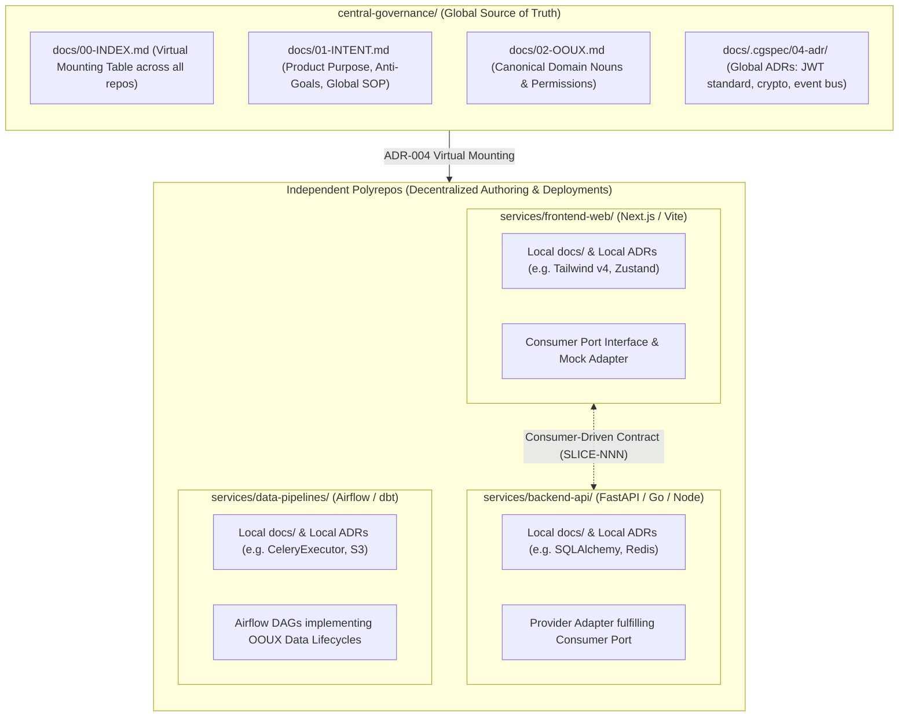

# CGSpec Polyrepo Template (Federated Multi-Repo Architecture)

This template demonstrates how the **Reformed CGSpec v0.2 Specification-Driven SDLC** governs a multi-repository ecosystem (e.g. separate Git repositories for frontend, backend API, and Airflow data pipelines) while simultaneously guaranteeing **Global Coherence** and **100% Service Independence**.

---

## 1. The Core Polyrepo Problem & The CGSpec Solution

In a polyrepo setup, organizations face a critical tension:
- **Autonomy:** Each team wants their own Git repository, independent deployments, independent CI/CD, and freedom to choose local technologies.
- **Coherence:** The business needs unified authentication, consistent domain nouns, non-conflicting API contracts, and an unbroken user experience.

Without a specification engine, polyrepos degrade into **Silent Integration Drift**: the backend changes an API payload, the frontend breaks in production, and documentation across scattered wikis is perpetually obsolete.

CGSpec solves this through three codified architectural mechanisms:



---

## 2. The 3 Architectural Mechanisms

### Mechanism 1: Two-Tier Hierarchical ADRs (ADR-005)
- **Tier 1 (Global System ADRs in `central-governance/docs/.cgspec/04-adr/`):** Decisions that bind all repositories (e.g. `ADR-001: Ed25519 Token Signing`, `ADR-002: PostgreSQL 16 Baseline`, `ADR-003: Hexagonal Port Boundary Standard`).
- **Tier 2 (Service-Local ADRs in `services/<repo>/docs/.cgspec/04-adr/`):** Decisions strictly internal to that service (e.g. `ADR-001: Use TanStack Query in frontend-web`, `ADR-001: Use Celery in data-pipelines`). Backend and data teams are not burdened with frontend styling decisions.

### Mechanism 2: Consumer-Driven Contracts via Hexagonal Ports (ADR-004)
Services never depend on each other's live infrastructure during development or unit testing:
1. `services/frontend-web` defines the **Consumer Port Interface** (`UserAccountPort`) and an in-memory mock.
2. `services/frontend-web` tests and deploys **100% independently**.
3. `services/backend-api` implements the matching **Provider Adapter**.
4. In CI/CD, contract compatibility tests verify parity before deployment.

### Mechanism 3: Virtual Mounting & Federated Ingestion (`ingest.py`)
The central orchestrator runs deterministic AST scanning across all physical repositories without merging them into a monorepo:

```bash
# Ingest all repositories into the central governance manifest
python3 docs/.cgspec/01-script/ingest.py ../services/frontend-web  --subsystem frontend
python3 docs/.cgspec/01-script/ingest.py ../services/backend-api   --subsystem backend
python3 docs/.cgspec/01-script/ingest.py ../services/data-pipelines --subsystem data-pipelines
```

---

## 3. Directory Layout

```
polyrepo/
├── README.md
├── central-governance/           # Central Management / Blueprint Repository
│   ├── AGENTS.md                 # Global Constitutional Laws 1-11
│   └── docs/
│       ├── 00-INDEX.md           # Master Compass & Virtual Mounting Table
│       ├── 01-INTENT.md          # Global Product Vision & Anti-Goals
│       ├── 02-OOUX.md            # Canonical Domain Nouns & Permissions Matrix
│       ├── 03-EXPERIENCE.md      # Shared Design Tokens & Spatial Shells
│       ├── 04-ARCHITECTURE.md    # Physical Topology & Inter-Service Event Bus
│       ├── 05-DELIVERY.md        # Cross-Service Milestone Roadmaps
│       ├── .memlog.md            # System-Wide Milestone Ledger
│       └── .cgspec/              # Global ADRs, scripts, and research
│
└── services/                     # Physically Independent Git Repositories
    ├── frontend-web/             # Git Repo 1 (Frontend Application)
    │   ├── AGENTS.md             # Local Service Guidelines
    │   └── docs/                 # Local docs & Service ADRs
    ├── backend-api/              # Git Repo 2 (Backend Service)
    │   ├── AGENTS.md             # Local Service Guidelines
    │   └── docs/                 # Local docs & Service ADRs
    └── data-pipelines/           # Git Repo 3 (Airflow DAGs & Data Models)
        ├── AGENTS.md             # Local Service Guidelines
        └── docs/                 # Local docs & Service ADRs
```
