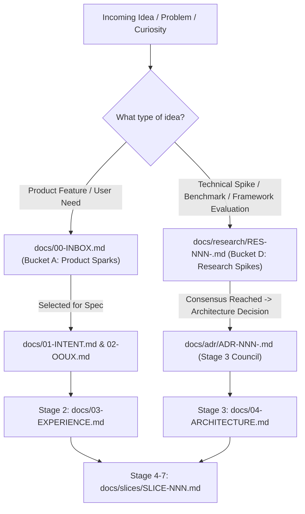

# docs/research/ — CGSpec Technical Spikes & Research Registry

> **Purpose:** This directory contains deep architectural spikes, technology benchmarks, framework evaluations, and feasibility investigations.

---

## The Knowledge Management Lifecycle in CGSpec

To prevent scattered notes, forgotten benchmarks, and bloated decision records, CGSpec categorizes ideas into 4 explicit buckets:

### When to write a Research Spike (`RES-NNN`):
1. **Comparing Frameworks / Libraries:** e.g., evaluating shadcn/ui vs Material Design 3 vs Ant Design.
2. **Database / Storage Benchmarks:** e.g., evaluating PostgreSQL vs ClickHouse vs SQLite for local telemetry.
3. **Protocol / Security Spikes:** e.g., testing WebAssembly sandbox boundaries, token attenuation methods.
4. **Feasibility Experiments:** e.g., investigating whether an external API supports real-time websockets or webhooks.

### Rules of Engagement:
- **Filename convention:** `RES-NNN-<kebab-case-title>.md` (e.g. `RES-001-ui-design-systems-and-surface-profiles-benchmark.md`).
- **Registration Invariant:** Every `RES-NNN` file must be indexed in [`docs/00-INDEX.md`](../00-INDEX.md) under Section 5 (`## 5. Technical Spikes & Research Compendiums`).
- **Status Lifecycle:** `EXPLORING` -> `CONCLUDED` -> `SUPERSEDED`.
- **Handoff:** When a research spike concludes with a concrete architectural commitment, it serves as the factual justification for a formal ADR (`docs/adr/ADR-NNN.md`).
