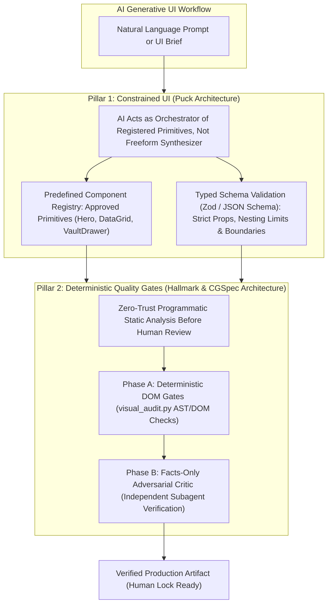

# RES-002: Anti-AI-Slop Architecture, Constrained Generative UI & Deterministic Quality Gates

> **CGSpec Technical Spike & Architecture Research Compendium**  
> **Status:** `CONCLUDED (OPERATIONALIZED IN VISUAL_AUDIT.PY & STAGE 2 SKILLS)`  
> **Author:** Antigravity Architect & BeOjefe Engineering  
> **Date:** October 2026  
> **Target Spines:** [`docs/03-EXPERIENCE.md`](file:///home/ojefe/Documents/Project/cgspec/docs/03-EXPERIENCE.md), [`skills/cgspec-ui-ux/SKILL.md`](file:///home/ojefe/Documents/Project/cgspec/skills/cgspec-ui-ux/SKILL.md), [`docs/.cgspec/01-script/visual_audit.py`](file:///home/ojefe/Documents/Project/cgspec/docs/.cgspec/01-script/visual_audit.py)  
> **Related Decisions:** [`ADR-001`](file:///home/ojefe/Documents/Project/cgspec/docs/.cgspec/04-adr/ADR-001-first-principles-spec-driven-sdlc-architecture.md), [`ADR-002`](file:///home/ojefe/Documents/Project/cgspec/docs/.cgspec/04-adr/ADR-002-reformed-cgspec-v2-spine-taxonomy-and-law-3-purity.md), [`RES-001`](file:///home/ojefe/Documents/Project/cgspec/docs/.cgspec/02-research/RES-001-ui-design-systems-and-surface-profiles-benchmark.md)

---

## 1. Problem Statement & Research Objective

In modern multi-agent software engineering, autonomous coding agents (Claude 3.7 Sonnet, GPT-4o, Gemini 2.0 Flash) produce code at unprecedented speed. However, when instructed to build web interfaces, dashboards, and prototypes, agents systematically converge on what the industry terms **"AI UI Slop"**:
1. **Visual Uniformity & Monoculture:** Every AI coding agent produces the identical generic aesthetic: default Inter font, purple-to-indigo hero gradients (`from-purple-600 to-indigo-600`), 3 centered floating feature cards, and disembodied heavy drop-shadows on flat dark containers.
2. **Unbounded Synthesis Breakdown:** Models synthesize raw, arbitrary HTML/JSX strings from scratch rather than orchestrating approved design system primitives. This introduces arbitrary margins, invalid component nesting, and non-deterministic DOM structures that break automated tests and force humans to do massive downstream refactoring.
3. **The Subjectivity Trap:** Traditional prompts attempt to prevent slop via adjectives ("make it beautiful", "clean aesthetic", "modern look"). AI models ignore or misinterpret subjective instructions. To achieve true production reliability, **anti-slop invariants must be programmatic, zero-trust, and deterministically verified**.

### Research References Analyzed:
- **Puck:** *AI Slop vs Constrained UI: Why Most Generative Interfaces Fail* (Amitesh Anand, 2026). [https://puckeditor.com/blog/ai-slop-vs-constrained-ui](https://puckeditor.com/blog/ai-slop-vs-constrained-ui)
- **Hallmark (Together AI / nutlope):** *Stop AI-Generated UI Slop in One Command in 2026* (Ramsis Hammadi, 2026). [https://dev.to/rams901/hallmark-stop-ai-generated-ui-slop-in-one-command-in-2026-3p9n](https://dev.to/rams901/hallmark-stop-ai-generated-ui-slop-in-one-command-in-2026-3p9n)

---

## 2. Deep Teardown: The Anatomy of AI UI Slop

AI UI Slop is not merely a lack of visual appeal; it is a structural architectural defect. Across thousands of agent iterations, the anti-patterns are unmistakable:

| Slop Anti-Pattern | Manifestation in Code | Architectural Consequence | Deterministic Programmatic Indicator |
| :--- | :--- | :--- | :--- |
| **The Purple/Indigo Gradient Crutch** | `bg-gradient-to-r from-purple-600 to-indigo-600` or `linear-gradient(135deg, #7c3aed, #4f46e5)` | Masks lack of brand identity with generic tech cliché; clashes with high-trust infrastructure. | Regex matching `from-(?:purple\|indigo\|violet)-` combined with `to-(?:indigo\|purple\|violet\|fuchsia)-`. |
| **The Floating Card / Disembodied Shadow** | `shadow-2xl` on dark background without 1px hairline border (`border-white/10`). | Heavy black drop-shadows are invisible or appear muddy on dark surfaces (`#09090b`), causing spatial ambiguity. | AST/Regex check: container with `shadow-2xl` / `shadow-xl` lacking `border` or tonal background contrast. |
| **The 3-Box Cookie-Cutter Grid** | `grid grid-cols-1 md:grid-cols-3` containing 3 cloned cards with centered circle icons and placeholder copy. | Bypasses actual domain object relationships (OOUX); forces every feature into an unnatural 3-column triad. | DOM tree check: 3+ sibling cards with identical tag/class depth and centered circle icon wrappers. |
| **Uncurated Default Typography** | Pure `font-sans` with no imported typeface, or sole uncurated Inter font everywhere. | Monotonous typographic hierarchy; tabular metrics and tokens lack monospace alignment. | Absence of typographic pairing (`@import` / `<link>` for display/serif or geometric grotesques) and missing `tabular-nums` on metrics. |
| **Naked Database Identifier Leakage** | Displaying `git_branch`, `USER_STATUS_PENDING`, or `dek_shred` in user buttons and badges. | Confuses end users by leaking physical backend schema names into human cognitive layers (violates Law 7). | Regex matching `\b[a-z]{2,}_[a-z0-9_]+\b` in rendered headings, buttons, and status tags. |
| **Happy-Path-Only Monolithic View** | Static mockups with zero state mechanics (missing Empty State, Loading Skeleton, Error State, Denied 403). | Fragile software; crashes or displays blank white screen when network fails or collections are empty. | HTML inspection: missing state conditional dispatcher (`st ===` / `data-state` / `?state=`). |

---

## 3. The Dual-Pillar Solution: Constrained UI + Deterministic Gates

To eliminate AI slop without human micromanagement, CGSpec adopts a **Dual-Pillar Architecture**:

### Pillar 1: Constrained Generative UI (The Puck Architecture)
As demonstrated by Puck, unbounded code synthesis always degrades over time. CGSpec operationalizes constrained UI through:
1. **Registered Primitive Scaffolding:** Wireframes and prototypes must assemble known components (Navigation Header, Data Table, Inspector Drawer, Metric Strip) rather than inventing chaotic custom layout blocks.
2. **Schema-Driven State Representation:** UI state transitions are modeled deterministically (e.g. `?state=populated`, `?state=skeleton`, `?state=empty`, `?state=error`).

### Pillar 2: Deterministic Anti-Slop Gates (The Hallmark Architecture)
Together AI's Hallmark proved that 65+ binary pattern gates can eliminate generic design monoculture in one pass without slowing down the agent with heavy LLM calls. CGSpec embeds these checks directly into [`docs/.cgspec/01-script/visual_audit.py`](file:///home/ojefe/Documents/Project/cgspec/docs/.cgspec/01-script/visual_audit.py).

---

## 4. Programmatic Verification Matrix & Anti-Overfitting Principles

### Guarding Against Overfitting:
A critical risk when writing programmatic linters is **overfitting**—flagging legitimate design variations as errors and stifling legitimate creative expression. CGSpec enforces three anti-overfitting rules:
1. **Errors vs. Warnings Separation:**
   - **Errors (Hard Fails):** Invariants that break usability, cause runtime crashes, or destroy information hierarchy (e.g. Phantom DOM IDs causing `Cannot read properties of null`, duplicate action controls, zero full-bleed height leaving 40% empty void, decorative Unicode emojis).
   - **Warnings (Aesthetic Heuristics):** Design taste indicators (e.g. purple gradient cliches, uncurated font stacks, 3-card repetition). These guide the agent toward craft excellence without blocking builds unless `--strict-slop` is explicitly enabled.
2. **Semantic Context Awareness:**
   - Monospace font is required for *technical tokens, hashes, metrics, and code*, but NOT for general body copy.
   - 1px hairline borders are required for *dark-mode elevated cards*, but not for seamless flat content strips.
3. **Deterministic Binary Execution:**
   - Checks are written in fast, zero-dependency Python (regex, AST, `html.parser`), ensuring sub-second execution on every commit.

---

## 5. Architectural Invariants Codified

1. **Law of Deterministic Anti-Slop:** Every HTML wireframe and prototype in `docs/.cgspec/05-prototype/` must pass `visual_audit.py` Phase A before being shown to human reviewers.
2. **Zero Purple/Indigo AI Slop:** Dashboards and workspace tools must use intentional brand anchors, tonal surface elevation (`#09090b` canvas -> `#121316` card), and 1px borders (`border-white/10`), not purple gradients.
3. **Multi-State Requirement:** Prototypes must implement a state switcher or URL query branch handling at least 3 states (`populated`, `empty`, `loading`/`error`).
4. **Typographic Craft:** Numerical metrics and system hashes must render with `tabular-nums` and monospace font pairings.
