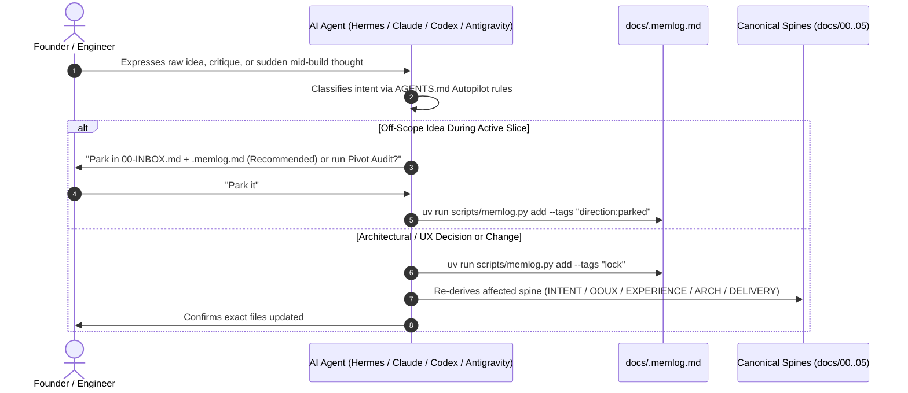

# 01-INTENT: Problem, Intent & Day-in-the-Life Journey

> **Stage 1 (Intent): Why CGSpec Exists, Who It Serves, Plain-English Glossary & Scope**

---

## 1. Problem Statement & Mission

Modern engineering teams increasingly rely on autonomous AI coding agents across diverse runtimes (Hermes, Claude Code, OpenAI Codex, Cursor, Windsurf, Google Antigravity). However, AI-native software development routinely breaks down due to three foundational failure modes:

1. **Context Drift & Hallucination Cascades:** When agents operate on conversational memory alone, critical constraints, user requirements, and architectural boundaries degrade after long sessions. Teams lack a deterministic, non-linear specification engine where changes in requirements automatically re-derive architecture and experience.
2. **Missing Multi-Agent Governance & Granular Permissions:** AI agents run with unbounded, dangerous permissions. There is no unified specification standard linking intent to explicit **Resource Ownership (`Owner`)** and **Granular Authorization (`read | invoke | propose_edit | write | share | admin`)**.
3. **The Premature Coding Trap:** Autonomous agents instinctively jump to writing backend code and physical database schemas before human intent, spatial zoning, and UI/UX flows are established.

**Mission:** **CGSpec (`cgspec`)** is a first-principles, vendor-neutral specification engine and governance bridge for AI-native software engineering. It enforces that human experience strictly precedes technical architecture (Law 3), logs all engineering events in an append-only verifiable ledger (`.memlog.md`), and operates through portable skills (`skills/cgspec-*/SKILL.md`) and AST integrity hooks (`doctor.py`).

---

## 2. Plain-English Glossary

| Term | Plain-English Meaning |
| :--- | :--- |
| **Autopilot Coach Mode** | The human talks naturally in any AI agent; the agent automatically logs decisions in `docs/.memlog.md` and derives the right spine files (`00-INDEX.md` .. `05-DELIVERY.md`) without forcing the user to memorize commands. |
| **`.memlog.md` (Event Ledger)** | Append-only decision and event log managed by `uv run scripts/memlog.py`. Stores `decision`, `assumption`, `crack`, `kill`, `direction:parked`, and `lock` entries. |
| **Derived Spine (`01`..`05`)** | Terse, AI-scannable specification files derived from `docs/.memlog.md` so any skill can run in **any order** without merge drift. |
| **`.working/` Workbench** | Temporary visual exploration folder (`docs/.working/`) for Excalidraw wireframes, HTML color themes, design directions, and raw debate transcripts before locking the final spec. |
| **Granular Authorization & Ownership** | Every resource in a team environment has an explicit **`Owner`** (`User` or `Team`) and explicit **Permissions** (`read`, `invoke`, `propose_edit`, `write`, `share`, `admin`). |

---

## 3. Protagonists & Autopilot Flow

1. **The Visionary Founder / Solo Creator:** Brainstorms freely, challenges architecture, and drops mid-stream ideas without breaking the active sprint or memorizing commands.
2. **The Multi-AI Engineering Team:** Engineers using heterogeneous agents on the same repository who need shared truth in `docs/` and verified governance.

---

## 4. Scope & Invariants

### In Scope for `v0.1`
- Complete, vendor-neutral **CGSpec Blueprint Repository** (`/home/ojefe/Documents/Project/cgspec/`).
- Universal **`AGENTS.md`** + 1-line DRY **`CLAUDE.md`** pointer.
- Portable **`skills/cgspec-*/SKILL.md`** suite + **`scripts/memlog.py`**, **`scripts/doctor.py`**, **`scripts/ingest.py`**.

### Explicit Non-Goals
- **NEVER** lock skills or project artifacts to a single proprietary directory.
- **DO NOT** require external server daemons for local usage (local Git `.memlog.md` works 100% offline).
