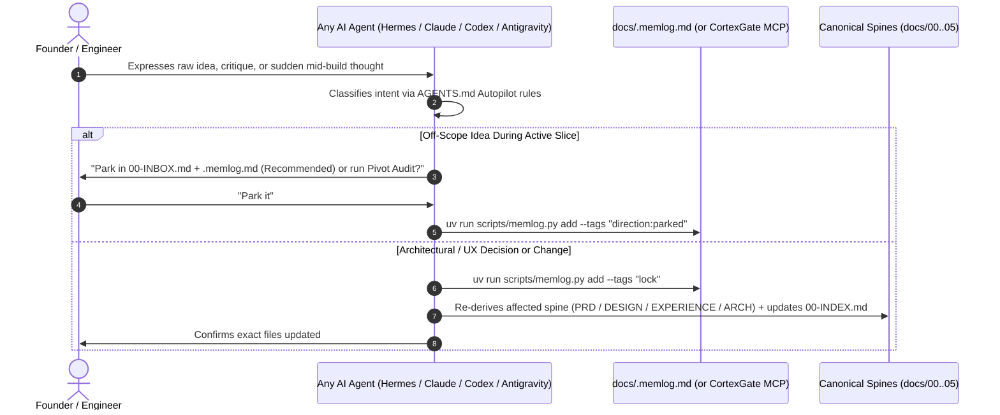

# docs/01-PRD.md — CGSpec (`cgspec`) Product Requirements Document

> **Pillar 1: Why CGSpec Exists, Who It Serves, Plain-English Glossary & `v0.1` Scope**

---

## 1. Problem Statement & Core Mission

Modern engineering teams use multiple AI coding agents (**Hermes, Claude Code, OpenAI Codex, Cursor, Windsurf, and Google Antigravity**). While existing frameworks like **`BMAD-METHOD` (v7)** prove the power of append-only `.memlog.md` decision logs and derived specs (`DESIGN.md`, `EXPERIENCE.md`, `ARCHITECTURE.md`), teams still face three critical gaps:

1. **No Team Governance or MCP Sync:** Local Markdown frameworks (`BMAD-METHOD`, `OpenSpec`) are single-player local files—they lack native integration with a centralized MCP governance plane (**CortexGate**) with explicit **Resource Ownership (`Owner`)** and **Granular Authorization (`read | invoke | propose_edit | write | share | admin`)**.
2. **High Manual Ceremony:** Remembering 15+ separate role commands (`bmad-forge-idea`, `bmad-prd`, `bmad-ux`, `bmad-architecture`, `bmad-spec`, `bmad-ticket`, `bmad-correct-course`...) creates cognitive friction during fast iteration.
3. **Vendor Lock-In Risk:** Putting rules or artifacts inside a single vendor's proprietary directory (such as `.gemini/` or `.cursor/`) breaks portability when switching between **Hermes, Claude Code, Codex, and Antigravity**.

**Mission:** **CGSpec (`cgspec`)** combines the scientifically proven mechanics of `BMAD-METHOD` v7 (`.memlog.md` non-linear spine derivation, Google Labs `DESIGN.md` + `EXPERIENCE.md`, Excalidraw/HTML `.working/` explorations, and supervised multi-agent peer review) into a **100% vendor-neutral Open Skill Suite (`skills/cgspec-*/SKILL.md` + `AGENTS.md`)** that runs in **Autopilot Coach Mode** today and connects natively to **CortexGate MCP** tomorrow.

---

## 2. Plain-English Glossary (Anti-Jargon Law)

| Term | Plain-English Meaning |
| :--- | :--- |
| **Autopilot Coach Mode** | The human talks naturally in any AI agent (Hermes, Claude, Codex, Antigravity); the agent automatically logs decisions in `docs/.memlog.md` and derives the right spine files (`00-INDEX.md` .. `05-EXPERIENCE.md`) without forcing the user to memorize commands. |
| **`.memlog.md` (Chronological Log)** | Append-only decision and event log managed by `uv run scripts/memlog.py`. Stores `decision`, `assumption`, `crack`, `kill`, `direction:parked`, and `lock` entries. |
| **Derived Spine (`01`..`05`)** | Terse, AI-scannable specification files derived from `docs/.memlog.md` so any skill can run in **any order** without merge drift (*backed by Liu et al., TACL 2024, "Lost in the Middle"*). |
| **`.working/` Workbench** | Temporary visual exploration folder (`docs/.working/`) for **Excalidraw** wireframes, HTML color themes, design directions, and raw debate transcripts before locking the final spec. |
| **Granular Authorization & Ownership** | Every resource in a team/CortexGate environment has an explicit **`Owner`** (`User` or `Team`) and explicit **Permissions** (`read`, `invoke`, `propose_edit`, `write`, `share`, `admin`)—never vague `L1/L2/L3` tier numbers. |

---

## 3. Target Personas & Autopilot UX Flow

1. **The Visionary Founder / Tech Lead:** Wants to brainstorm freely, challenge architecture, and drop mid-stream ideas without breaking the active sprint or memorizing 15 commands.
2. **The Multi-AI Engineering Team:** Engineers using **Hermes**, **Claude Code**, **Codex**, and **Antigravity** on the same repository (or polyrepo) who need shared truth in `docs/` + **CortexGate MCP** governance.

---

## 4. `v0.1` Scope (Must Ship Now) vs. Non-Goals

### In Scope for `v0.1`
- [x] Complete, vendor-neutral **CGSpec Blueprint Repository** (`/home/ojefe/Documents/Project/cgspec/`).
- [x] Universal **`AGENTS.md`** + 1-line DRY **`CLAUDE.md`** pointer.
- [ ] Portable **`skills/cgspec-*/SKILL.md`** suite + zero-dependency **`scripts/memlog.py`** (`uv run`).

### Explicit Non-Goals for `v0.1`
- **NEVER** lock skills or project artifacts to `.gemini/` or any single AI vendor directory.
- **DO NOT** require a running CortexGate server for local `v0.1` usage (local Git `.memlog.md` works 100% offline and upgrades seamlessly to CortexGate MCP in `v0.2`).
