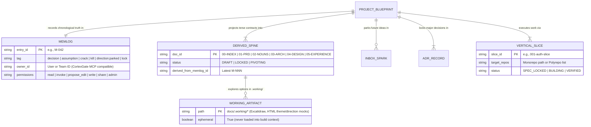
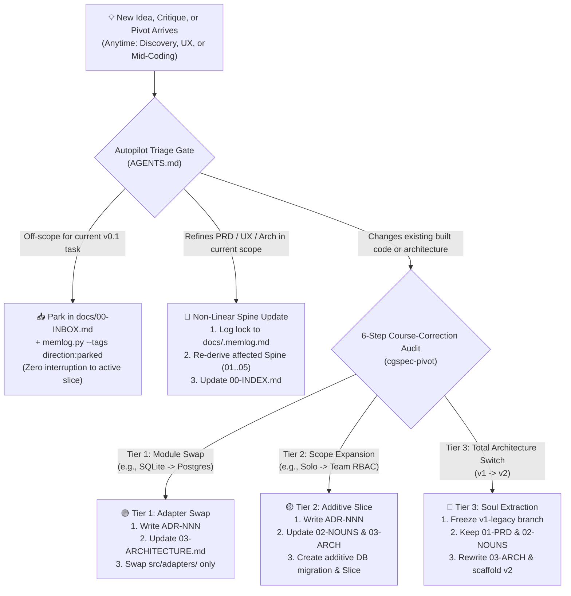

# docs/02-NOUNS-AND-FLOWS.md — CGSpec (`cgspec`) Domain Model, Non-Linear Flow & Multi-Repo Topology

> **Pillar 2: Core Objects, Non-Linear `.memlog.md` Loop, 3-Tier Pivot Engine, and Monorepo vs. Polyrepo Layout**

---

## 1. Core Domain Objects ("The Nouns of CGSpec")

Every artifact managed by `cgspec` (both in local Git files today and via **CortexGate MCP** tomorrow) maps to 7 explicit nouns with built-in **Ownership & Granular Permissions**:

---

## 2. Dynamic Non-Linear Flow & 3-Tier Pivot Engine

By combining **BMAD v7's `.memlog.md` non-linear derivation** + **`bmad-correct-course`'s 6-step impact audit** + **CGSpec's 3-Tier Migration Engine**, you can change direction at **any moment** without losing structure:

---

## 3. Monorepo vs. Multi-Repo (Polyrepo) + Database Migrations

Adopted and enhanced from [`BMAD-METHOD`'s Polyrepo & Worktrees pattern](file:///home/ojefe/.gemini/antigravity/brain/fe188afb-593e-4644-85a6-ef222a1f5bc4/scratch/BMAD-METHOD/skills/bmod-method/help/monorepo-and-polyrepo.md):

- **Mode A: Monorepo (Default for Single-Repo Projects):**
  - `docs/` (including `docs/.memlog.md` and `docs/.working/`) lives at the repo root alongside `AGENTS.md`, `CLAUDE.md`, `db/migrations/`, and `src/`.
- **Mode B: Multi-Repo / Polyrepo Workspace (For Multi-Team Companies & CortexGate):**
  - A central **`<project>-blueprint/` Git repository** at the workspace root holds `AGENTS.md`, `docs/.memlog.md`, `docs/00..05-*.md`, `docs/adr/`, and cross-repo slice specs.
  - **Where Database Docs & Migrations Live:**
    - The **Global Entity-Relationship Contract** lives in the Blueprint Hub (`docs/02-NOUNS-AND-FLOWS.md` & `docs/03-ARCHITECTURE.md`).
    - The **Executable SQL/ORM Migration Files** (`db/migrations/001_init.sql`) live **inside the specific service repo that owns that database** (e.g., `cortexgate-core/db/migrations/`), linked by Slice ID!
    - When **CortexGate MCP** is connected, editing a spec in the CortexGate UI or any AI agent creates a governed branch/PR against `<project>-blueprint` automatically.
