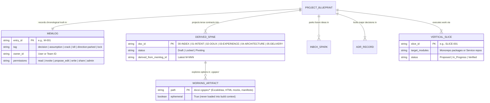
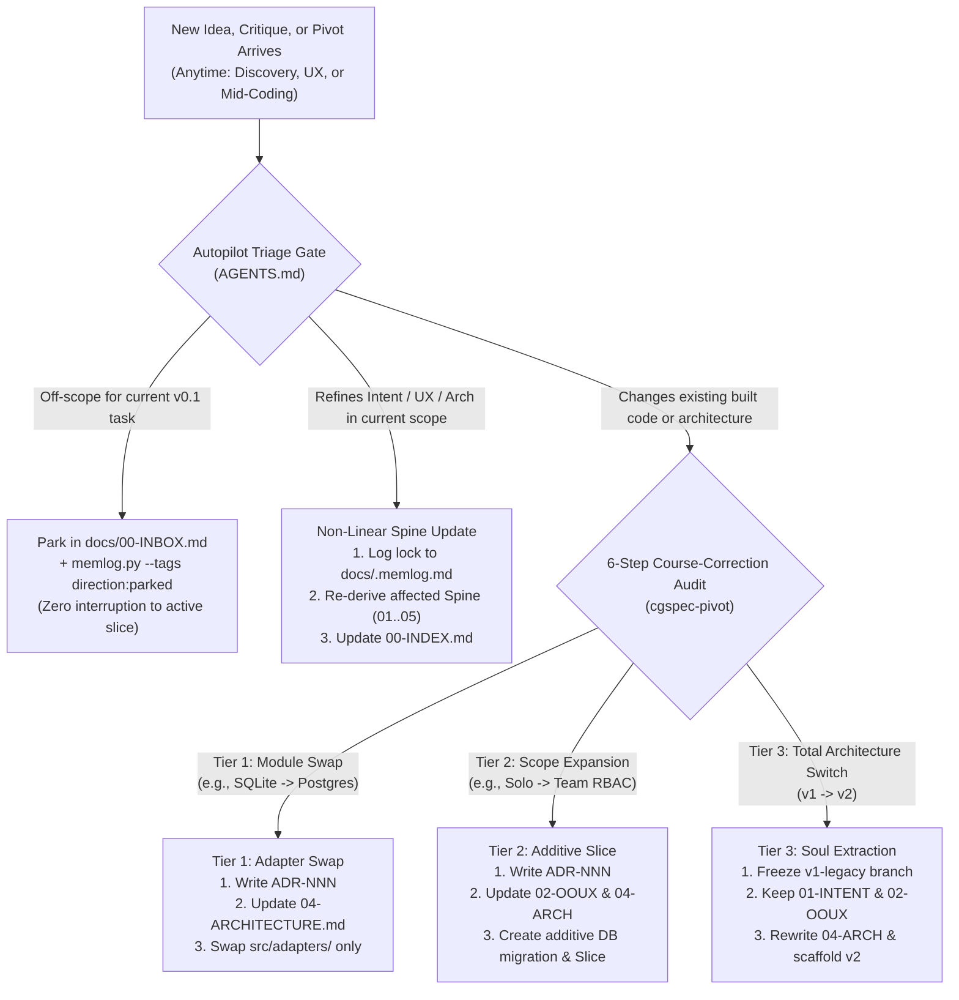

# 02-OOUX: Domain Mental Model, Nouns & Core Flows

> **Stage 1 (Domain Model): Sophia Prater Object-Oriented UX, Granular Permissions & Lifecycle Flows**

---

## 1. Domain Nouns & Object Relationships

Every artifact managed by `cgspec` maps to 6 core domain nouns governed by explicit **Resource Ownership (`Owner`)** and **Granular Permissions (`read | invoke | propose_edit | write | share | admin`)**:

---

## 2. Event-Sourced Spine Derivation & 3-Tier Pivot Engine

CGSpec uses an append-only event ledger (`.memlog.md`) as the single source of truth. Spines are continuously derived from locked ledger entries, ensuring that any idea, challenge, or pivot can be triaged without context drift:

---

## 3. Topology Neutrality

CGSpec operates neutrally across all repository layouts without dogmatically imposing monorepo or polyrepo structures:

- **Mode A (Monorepo):** `docs/` lives at the repo root alongside code packages, services, and workers.
- **Mode B (Multi-Service Blueprint Hub):** A dedicated blueprint repository holds shared intent, OOUX nouns, architecture contracts, and mounts satellite microservice repos.
- **Mode C (Service Satellite Repo):** A standalone service repository containing local code and migrations, consuming shared contracts from an upstream blueprint or MCP gateway.
