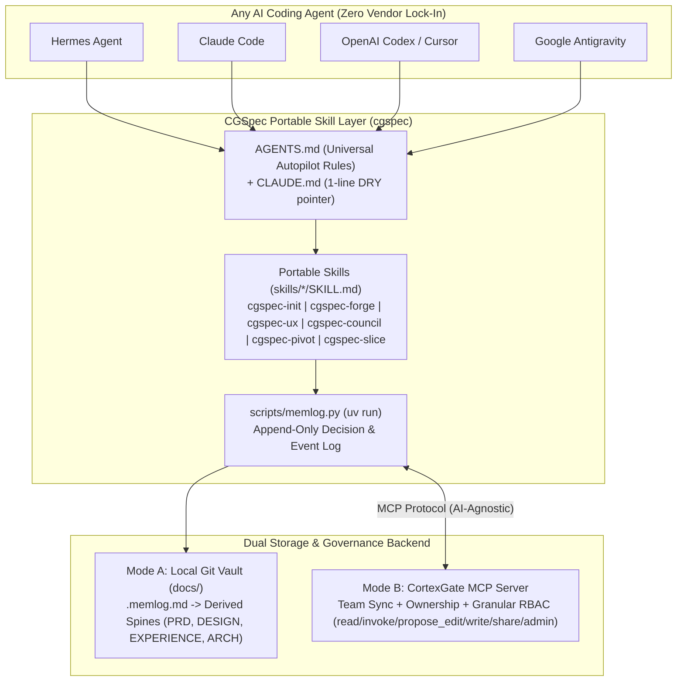
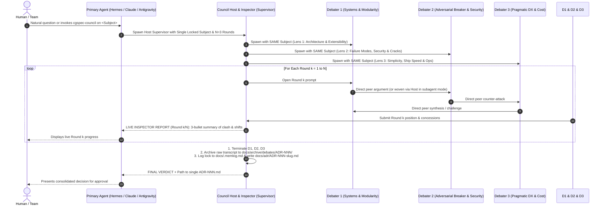

# docs/03-ARCHITECTURE.md — CGSpec (`cgspec`) Cross-AI Skill & CortexGate MCP Architecture

> **Pillar 3: Vendor-Neutral Skill Architecture (`skills/*/SKILL.md` + `AGENTS.md` + CortexGate MCP Bridge)**

---

## 1. Why Vendor-Neutral Open Skills + MCP? (Zero `.gemini` or Single-Vendor Lock-In)

AI coding tools evolve rapidly (e.g., Gemini CLI $\rightarrow$ Antigravity, Claude Code, Hermes, OpenAI Codex, Cursor). If a methodology locks its skills or artifacts into a single vendor's proprietary folder (such as `~/.gemini/config/plugins/` or `.gemini/antigravity/`), switching AI agents—or running a mixed team where one engineer uses **Claude Code**, another uses **Hermes**, and another uses **Antigravity**—breaks the workflow.

Therefore, **CGSpec (`cgspec`)** is architected on **3 100% Universal Open Standards**:
1. **`AGENTS.md` (+ 1-line DRY `CLAUDE.md` pointer):** The universal root constitution read automatically by Hermes, Claude Code, Codex, Cursor, and Antigravity.
2. **Standard Portable `skills/<skill-name>/SKILL.md` Directories:** Pure Markdown + YAML frontmatter following the open `SKILL.md` specification, plus portable `uv run` Python helper scripts (`scripts/memlog.py`). Can be symlinked or discovered by **any** agent runtime.
3. **Dual Storage Adapter (Local Git Files $\leftrightarrow$ CortexGate MCP):**
   - **Standalone / Local Mode (Today):** Reads and writes `docs/.memlog.md` and `docs/00..05-*.md` directly in Git.
   - **Connected Team Mode (With CortexGate MCP):** Reads and writes decisions, specs, and ADRs through **CortexGate MCP tools**, enforcing **Resource Ownership (`Owner`)** and **Granular Authorization (`read | invoke | propose_edit | write | share | admin`)** across every AI agent in the company.



---

## 2. Portable Repository & Skill Layout

`cgspec` contains zero vendor-specific paths. It can live inside a project (`_cgspec/` or `skills/`) or be shared company-wide via Git / CortexGate:

```text
cgspec/
├── AGENTS.md                            # Universal Autopilot Coach Constitution (All AIs)
├── CLAUDE.md                            # DRY 1-line pointer: "Read and follow ./AGENTS.md"
├── README.md                            # Architecture, Science Backing & Quickstart
├── scripts/
│   └── memlog.py                        # Zero-dep Python (uv run) append-only log & spine helper
├── skills/
│   ├── cgspec-init/SKILL.md             # Scaffolds Monorepo or Polyrepo Blueprint Hub
│   ├── cgspec-forge/SKILL.md            # Adversarial Idea Pressure-Tester + Non-Linear Spec Hub
│   ├── cgspec-ux/SKILL.md               # Dual Spine (Google Labs DESIGN.md + EXPERIENCE.md) + Excalidraw/HTML .working/
│   ├── cgspec-council/SKILL.md          # Supervised 3-Agent Peer Debate + Live Round Inspector
│   ├── cgspec-pivot/SKILL.md            # 6-Step Impact Audit + 3-Tier Migration Engine
│   └── cgspec-slice/SKILL.md            # Atomic Vertical Slice Builder + Real Browser Visual Verification
└── custom/
    └── config.toml                      # Zero-fork team/project overrides (language, stack, MCP endpoint)
```

---

## 3. Non-Linear `.memlog.md` Hub & Spine Derivation (Adopted from BMAD v7 + *Lost in the Middle*)

Instead of a rigid waterfall where editing UX breaks the PRD or Architecture, `cgspec` uses **Append-Only Chronological Logging + Terse Spine Derivation** (proven by *Liu et al., TACL 2024, "Lost in the Middle", arXiv:2307.03172*):

1. **Every Decision is Logged Atomically:**
   - Whenever the user or team makes a decision, rejects an option, or parks a mid-stream idea, `scripts/memlog.py` appends a timestamped entry to `docs/.memlog.md` with tags (`decision | assumption | crack | kill | direction:parked | lock`) and `owner` metadata.
2. **Spines Are Derived, Never Hand-Merged:**
   - The canonical documents (`01-PRD.md`, `02-NOUNS-AND-FLOWS.md`, `03-ARCHITECTURE.md`, `04-DESIGN.md`, `05-EXPERIENCE.md`) are **derived projections** of the active `lock` and `decision` entries in `docs/.memlog.md`.
   - Therefore, skills can run in **any order** (UX first, Architecture second, PRD third, or jumping back mid-sprint) with **zero merge drift**.

---

## 4. Supervised Multi-Agent Peer Council (`cgspec-council`)

Backed by *Du et al. (ICML 2024, arXiv:2305.14325)* and *Cemri et al. (2025, arXiv:2503.13657)* on preventing multi-agent sycophancy ("groupthink"):


