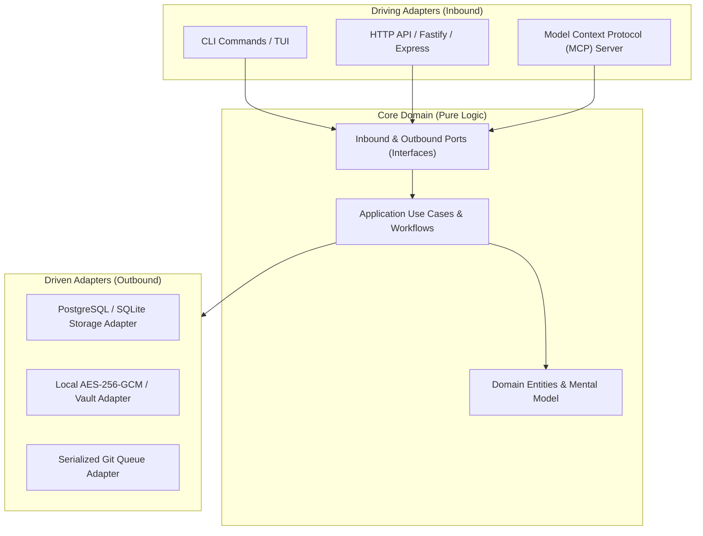
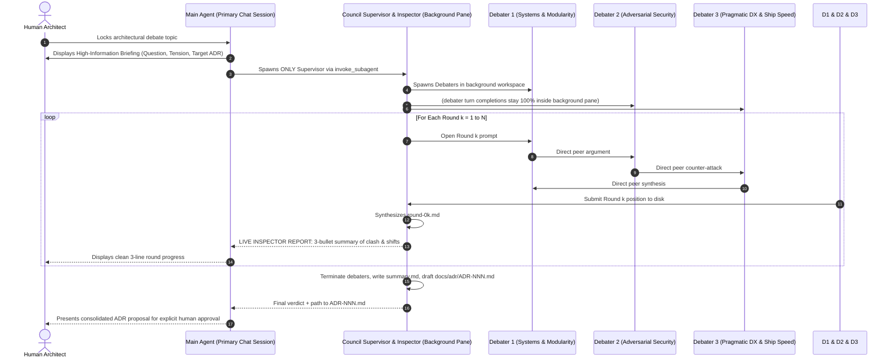

# 04-ARCHITECTURE: Physical System Architecture, Ports & Adapters & Governance

> **Stage 3 (Architecture): Modular Topology, Interface Decoupling, Physical DDL & MCP Bridge**

---

## 1. Modular Boundaries & Ports & Adapters (Hexagonal Architecture)

CGSpec enforces strict separation between domain logic and external infrastructure across all projects:

- **Hexagonal Isolation:** The core domain logic has zero dependencies on databases, ORMs, or third-party web frameworks.
- **Interchangeable Adapters:** Infrastructure can be swapped (e.g. SQLite to PostgreSQL, or Local FS to S3) via Tier 1 module swaps without altering domain models or UI screens.

---

## 2. Multi-Agent Governance & Supervised Peer Council Architecture

To eliminate single-model sycophancy and architectural blind spots, major technical choices are evaluated by a Supervised 3-Agent Peer Debate Council:

- **Main Chat Insulation:** The Main Agent spawns **only** the `Council Supervisor & Inspector`. Zero debater turn completions touch the user's primary chat.
- **Atomic ADR Gate (Law 7):** The debate produces a draft ADR with `Status: Proposed`. It only transitions to `Status: Accepted` upon explicit human sign-off.

---

## 3. Dual Storage & MCP Integration

CGSpec supports two operational modes without vendor lock-in:

1. **Local Mode (Offline Git Repository):**
   - Decisions logged to `docs/.memlog.md`.
   - Spines derived into `docs/00..05-*.md`.
   - Integrates with any AI coding agent via standard Markdown.

2. **Connected Team Mode (CortexGate MCP):**
   - Synchronizes specs and decisions across multiple agents and squad members.
   - Enforces **Resource Ownership (`Owner`)** and **Granular Permissions (`read | invoke | propose_edit | write | share | admin`)**.
