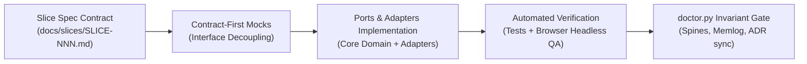

# 05-DELIVERY: Vertical Slices, Verification & Delivery Runbook

> **Stage 4 (Delivery): Atomic Vertical Slices, Ports & Adapters Scaffolding, Doctor Invariant Gates**

---

## 1. Atomic Vertical Slices (Law 6)

CGSpec delivers software exclusively through atomic, bounded vertical slices. An AI agent is strictly forbidden from writing widespread, speculative code without an approved slice specification.



---

## 2. Bounded Slice Specification Template (`docs/slices/SLICE-NNN-<slug>.md`)

Every slice produces a formal contract before code is scaffolded:

```markdown
# SLICE-NNN: <Plain-English Title>

## 1. Context & Bounded Scope
- **Target Spines:** Which requirements in 01-INTENT, 02-OOUX, and 03-EXPERIENCE are implemented?
- **Governing ADRs:** Which accepted ADRs in `docs/adr/` constrain this slice?
- **Modules in Scope:** Explicit list of packages or directories (`packages/core/`, `apps/studio/`).

## 2. Inbound & Outbound Ports (Contract-First)
- **Inbound Port:** Interface for caller (CLI handler, HTTP route, MCP tool).
- **Outbound Port:** Storage, crypto, or external network client interface.

## 3. Verification Criteria
- [ ] Unit & integration tests pass with zero warnings.
- [ ] Live browser screenshot inspection confirms 7-state UI fidelity.
- [ ] `python3 scripts/doctor.py .` returns exit code 0.
```

---

## 3. Delivery Integrity Hooks

### A. The CGSpec Doctor (`scripts/doctor.py`)
The automated doctor hook runs pre-flight and post-slice:
- Verifies existence of all 6 core spines (`00-INDEX.md`, `01-INTENT.md`, `02-OOUX.md`, `03-EXPERIENCE.md`, `04-ARCHITECTURE.md`, `05-DELIVERY.md`).
- Enforces strict chronological continuity of `docs/.memlog.md` (`M-001` .. `M-NNN`).
- Verifies bidirectional ADR status parity (status on disk matches table in `00-INDEX.md`).
- Scans for banned decorative emojis.

### B. The Brownfield Ingestion Engine (`scripts/ingest.py`)
For existing or legacy repositories, `scripts/ingest.py` performs deterministic AST extraction:
- Python standard library `ast` parsing for FastAPI/Flask/Django routes and Pydantic/SQLAlchemy models.
- TypeScript/JavaScript pattern extraction for Express/NestJS/Prisma/Drizzle.
- Go route and struct scanning.
- Live database schema parsing (`--live-schema <schema.sql>`).
- Bounded subsystem scoping (`--subsystem <path>`) following the Strangler Fig pattern.
- Generates `docs/.working/brownfield-manifest.json` conforming to `brownfield-manifest.schema.json`.
- Automatically codifies legacy baseline into `docs/adr/ADR-000-legacy-baseline-adoption.md`.
