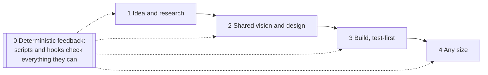
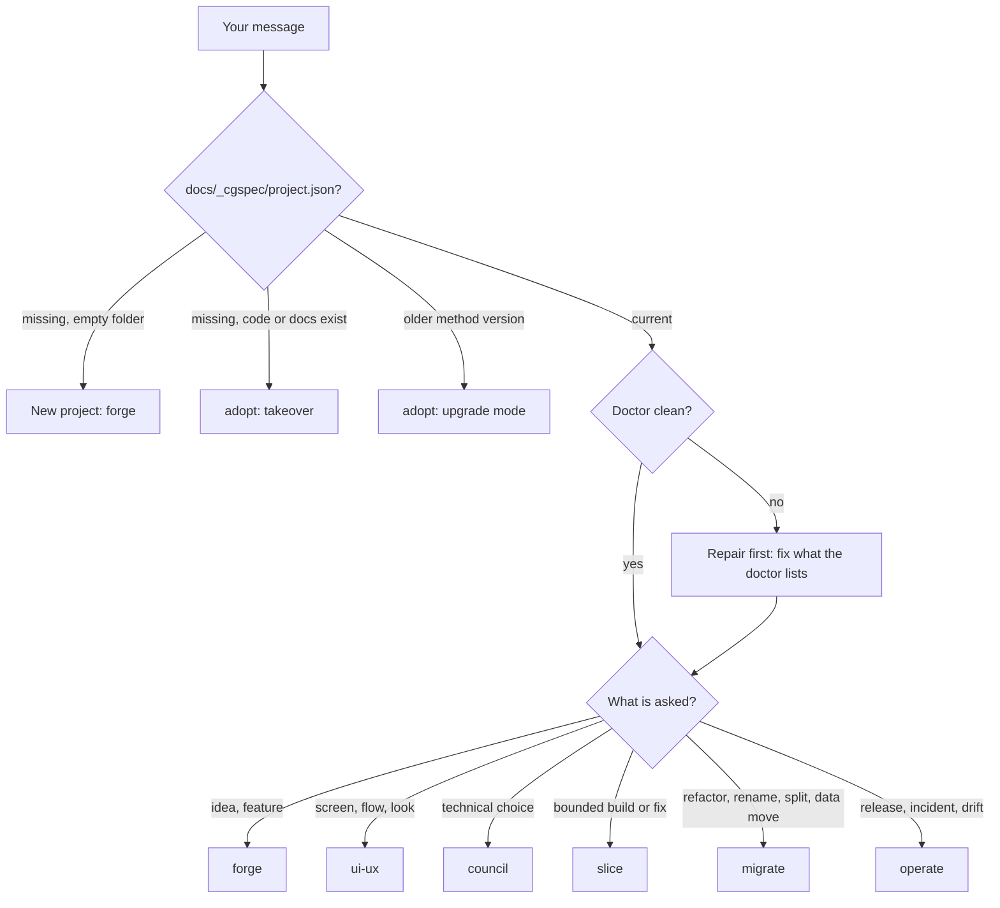
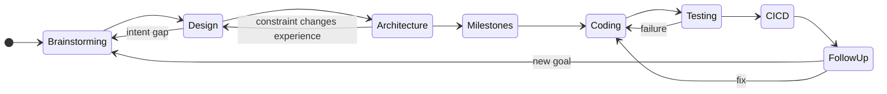
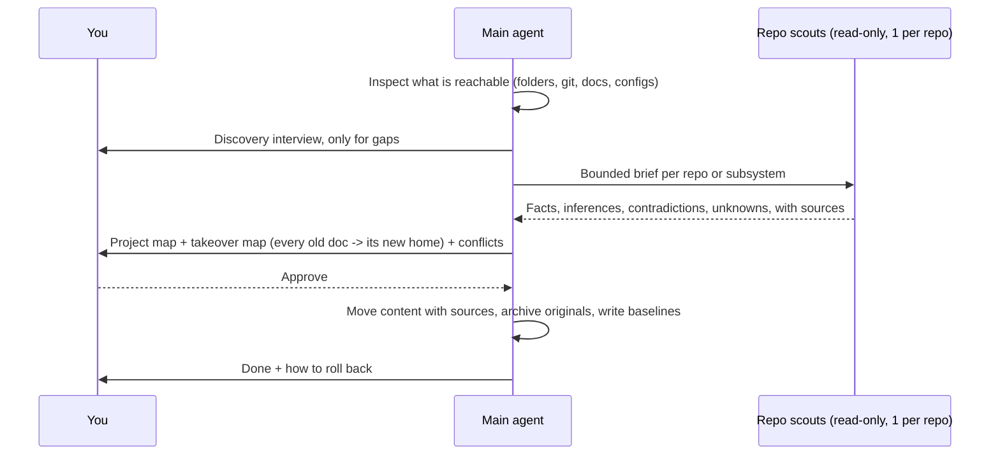
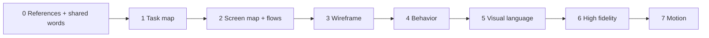
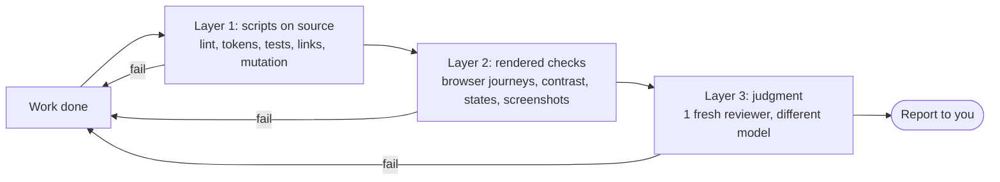
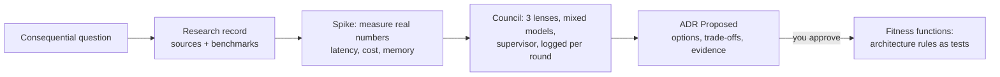
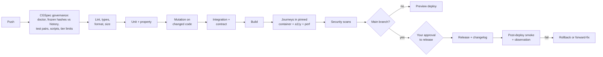
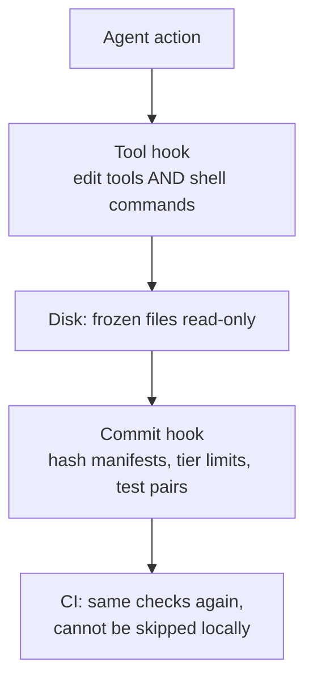
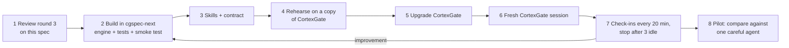

# CGSpec Method v2 — Specification

Oct 18, 2026 · @Jean Franck · Replaces "CGSpec Method v1 — Architecture". Source for the rebuild in `cgspec-next`.

**CGSpec is one package installed into a project: the AI carries the method, you set goals and judge results, and every rule that can be checked by a machine is enforced by one, not left to the AI's goodwill.** It works for a one-page site up to many independent repos, and for new or half-finished projects. Each rule below is stated once; other sections link to it.

| Pillar | Rule |
| --- | --- |
| 0 Deterministic feedback | The AI turns every checkable rule into a script in `docs/_cgspec/04-checks/`, registered through the flow in section 8, and runs them on every change. AI judgment is used only for what no script can measure. |
| 1 Idea and research | Goal type first (money, learning, personal, client). A money goal requires a sourced market research record before design. |
| 2 Shared vision and design | The AI leads with references it finds itself, helps you name what you feel, and walks a fixed layer path from tasks to motion (section 6). |
| 3 Build | A failing test before code, every test kind the profile supports, small single-purpose files, no duplicated logic (DRY). |
| 4 Any size | Same method from one page to many repos; each repo stays independent. CortexGate is an optional extra, never required. |

What changed from v1: every round-1 and round-2 review finding is resolved in the section it concerns (not in a side table); the review setup follows the evidence (scripts + one reviewer from a different model, big teams only for big steps); enforcement holds even against shell commands; packaging, paths and every cap now have exact values.

## 1. Collaboration contract

**You decide goals, taste and consequential choices; the agent does everything else and is responsible for the method being followed.** You never need to learn the method, and a skipped step or a change of mind is absorbed by the agent, not by you.

| Area | You | The agent alone | The agent must ask |
| --- | --- | --- | --- |
| Product | Goals, audience, scope | Turns words into intent, actors, nouns, flows; finds gaps | Conflicting goals, scope growth |
| Design | Taste, priorities, chosen direction | Finds references (up to 6), proposes, builds, checks, iterates | Choice between real alternatives |
| Architecture | Constraints (cost, hosting, privacy, licenses) | Researches, spikes, writes decisions | Consequential or hard to reverse |
| Delivery | What ships first | Slices, tests, code, evidence | Irreversible actions (data deletion, production, publishing) |
| Method | Nothing | Follows it, repairs drift, keeps records, manages budget | Never |

How the agent talks to you:

- Plain English first; every term explained by its behavior; no unexplained product names.
- The one-line compass (`Where we are: Brainstorming > [Design] > ...`) opens substantive replies about the part being discussed; the index holds the per-part matrix. Quick exchanges skip it.
- Decisions come as structured choices: concrete options, recommended one first, one decision at a time.
- Clear feedback is applied, not interviewed. Only ambiguous or intent-changing feedback gets one focused question.
- Diagrams (Mermaid) over walls of text; details live in files.
- No decorative emojis in chat, docs or code (enforced by the commit hook).

**No hidden decisions.** You can hand any choice to the agent. Then it is recorded with status `Delegated` (section 2): what was chosen, the other options, why, and whether it can be undone. Every report ends with "Decisions I made for you" with links; you can reverse any of them. Choices made by helper agents reach you through the same list. A decision counts as significant when it would surprise you later, cost time to undo, or limit future options.

## 2. Paths and statuses (single source)

**This table is the only definition of where things live and what states they can have; the doctor checks every project against it and fails on anything else.** Collections are plural; engine folders are numbered; engine and machine files start with `_` so they stay visible to search but out of the way.

| Path | Holds | Written by |
| --- | --- | --- |
| `AGENTS.md`, `CLAUDE.md` | Thin entry points (tools auto-load them) pointing to the contract | Install only |
| `docs/00-INDEX.md` | Navigation and status matrix per part; no duplicated text | Doctor `--fix` |
| `docs/00-INBOX.md` | Raw captured ideas and requests, secrets scrubbed | Inbox hook |
| `docs/spines/01-INTENT.md` … `05-DELIVERY.md` | Why, what (OOUX nouns, attributes, hierarchy), experience, architecture, delivery | Main agent |
| `docs/adrs/ADR-NNN-<slug>.md` | Decisions | Council or main agent |
| `docs/slices/SLICE-NNN-<slug>.md` | Bounded changes with file scope and acceptance tests | Slice workflow |
| `docs/prototypes/<screen>/` | Living prototype source (shell + components) | Builders |
| `docs/prototypes/_snapshots/<screen>-vN.html` | Frozen milestone snapshots | Bundler only |
| `docs/prototypes/_vision/` | Shared vision board: references, your images and videos, captions | Main agent |
| `docs/_memlog.md` | Append-only ledger | `memlog.py` only |
| `docs/_cgspec/project.json` | Version marker: method version, profile, topology | Install and upgrade |
| `docs/_cgspec/01-engine/` | Vendored engine scripts, pinned version, hash manifest | Install only |
| `docs/_cgspec/02-research/RES-NNN-<slug>.md` | Research with sources | Any, via main agent |
| `docs/_cgspec/03-councils/COUNCIL-NNN-<slug>/` | One folder per council: `00-brief`, one file per round, `99-outcome` | Council |
| `docs/_cgspec/04-checks/` | Registered project checks + `manifest.json` (hashes) | Registration flow (section 8) |
| `docs/_cgspec/05-runs/<run-id>/` | Team work per task: `run.json` (units, owners, allowed paths, criteria hash), outputs, reports | Inspector |
| `docs/_cgspec/06-evidence/` | Check and review results, each with revision and verdict | Whoever ran it |
| `docs/_cgspec/07-state/` | `checkpoint.json`, `budget.json`, `frozen.json`, `tier.json` | Hooks and main agent |
| `docs/_cgspec/_archive/` | Superseded material, with a redirect table | Main agent |
| `.cgspec-scratch/` (git-ignored) | Throwaway work, cleaned automatically | Anyone |
| docs/\_cgspec/07-state/quota.json, legacy-baseline.json | Quota reading from the tool; list of legacy files exempt from size and test rules | Status-line script; adopt |
| docs/spines/\<NN-NAME>/INDEX.md | Folder form of a spine once it outgrows one file | Main agent |
| docs/00-REGISTRY.md (governance repo), packages/\<x>/docs/ (large monorepo) | Multi-repo registry; package-local docs | Adopt; slice workflow |

IDs: ledger entries `M-YYYYMMDD-xxxx` (date + 4 random hex), so parallel branches and repos never collide. ADRs and slices keep sequential numbers for readability: drafts on a branch use `ADR-draft-<slug>`, and the number is assigned when merged. In multi-repo setups every ID gets the repo prefix (`api:ADR-004`).

| Record | Statuses |
| --- | --- |
| Decision | Draft, Proposed, Approved, Delegated, Rejected, Superseded, Imported |
| Slice | Draft, Approved, In progress, Done, Blocked |
| Design layer | Open, Locked, Reopened |
| Evidence | Fresh, Stale |
| Verdict | PASS, FAIL, PARTIAL, BLOCKED, NOT\_APPLICABLE |

## 3. Routing and change tiers

**The agent reads the version marker, then sizes every change into a tier written to disk before editing; the hooks enforce the tier, so no change can skip gates by calling itself small.**

A doctor failure leads to repair, never to an upgrade; only the version marker triggers upgrade mode.

| Tier | Limits (all must hold) | Records | Review |
| --- | --- | --- | --- |
| T0 Tweak | ≤ 3 files, ≤ 40 changed lines, no new file, no change to schema, API, auth, dependencies or a locked design structure | `tier.json` entry listing the files + one ledger line | Deterministic checks only |
| T1 Bounded | Inside one approved slice's file scope; ≤ 400 changed lines | Short slice + ledger | Checks + 1 reviewer (different model when available) |
| T2 Feature | New screen, flow, service or data model piece | Spines + full slice + ADR if a real choice exists | Checks + 1 different-model reviewer; up to 2 specialist checks as scripts; max 3 helper agents at once |
| T3 Structural | New product, architecture change, migration, repo split, auth or data change, anything irreversible | Full flow + migration contract + recovery plan | Checks + inspector team + council with mixed models; max 6 helper agents at once |

The before-tool hook reads `tier.json`: a T0 entry unlocks only its listed files, and the commit hook rejects the commit if the line count is exceeded. Exceeding any limit escalates the tier automatically. A no-GUI project gets no prototype; its "experience" is API, CLI or event behavior.

`project.json` lists path classes as globs set at install (schema, api, auth, deps, code, tests, docs); the hook uses them to recognize forbidden T0 changes. **Small-project profile** (one page, landing site, single script): a new product is T2, not T3; design layers 1–2 and 5–7 are merged; no council and no inspector.

## 4. Stages and gates

**Eight stages form a map with loops, not a corridor; each has an exit gate made of checkable items, and different parts of the product can sit in different stages.**

| Stage | Exit gate (all items present and approved) | Workflow |
| --- | --- | --- |
| 1 Brainstorming | Goal type; for a money goal a `RES-NNN` market record (competitors, who pays, price, demand evidence, risks) with sources; intent, actors, anti-goals; OOUX nouns with attributes, relations and hierarchy (workspace, organisation, project...); permissions; v0.1 scope with later ideas parked | forge |
| 2 Design | Layers 0–7 locked for the screens in scope (section 6). Headless profile: API draft, examples and error model instead | ui-ux |
| 3 Architecture | ADR for every consequential choice; data model; contracts; feasibility spikes done | council |
| 4 Milestones | Ordered slices, each with file scope, interfaces and acceptance tests | slice |
| 5 Coding | Code inside slice scope; a failing test recorded before each change; unit tests pass | slice |
| 6 Testing | All test kinds the profile requires pass at a named revision (section 7) | slice |
| 7 CI/CD | The same tests run automatically on every push (set up with the first slice); release, rollback or forward-fix plan | operate |
| 8 Follow-up | Observation period, incidents triaged, learnings in the ledger | operate |

Before any gate closes, the agent runs coverage checks (every noun has a place, every screen traces to a task, nothing orphaned) and asks: "Here is what I think might still be missing. Anything else before I lock?" Feasibility spikes are allowed before design locks; spike code lives in `.cgspec-scratch/` and never reaches production.

## 5. Adoption: takeover and upgrade

**Adoption builds a trustworthy picture of what exists, then makes CGSpec the project's only method with every fact mapped to a new home before anything is archived, and can be rolled back until you confirm.**

Discovery interview (asked only where inspection left a gap): one repo or several and is that everything; which docs are current; renames, splits, incidents or past decisions that constrain us; access to every repo and whether git history is complete; where each part runs (provider, region, environments, databases, domains, identity, monitoring); what adoption should deliver first.

Takeover rules:

- `AGENTS.md` and `CLAUDE.md` become thin entry points; their old rules move into the contract or spines, each with its source.
- Old docs are archived in `docs/_cgspec/_archive/` with a redirect table; nothing is archived until every fact in it has a new home.
- Legacy code gets a baseline: `SLICE-000-baseline` lists existing files as legacy. Legacy files may change only through a new slice that names them, and size and test rules apply only to new or changed lines, listed in `07-state/legacy-baseline.json`.
- Existing decisions are imported with status `Imported` and their source; they become `Approved` only after your review.
- Ingestion reports unsupported languages and partial coverage; a missing folder is an error; it never writes `Approved` decisions.
- Rollback until you confirm: restore the archive, and export any ledger entries written since adoption to a file so no later work is lost.
- Midway projects keep their real stage per part.

Upgrade mode (older CGSpec version): a path map from old to new locations, a link rewrite, a doctor run that must pass, and the version marker updated last. CortexGate goes through this mode.

## 6. Design path

**Design walks eight layers, UX before UI, each with a fixed deliverable and a list of what is deliberately left out; the AI leads with references and never polishes a lucky AI screen into the product.** Design can take days; code is no longer the hard part.

| Layer | You see | Not in it yet | Lock scope |
| --- | --- | --- | --- |
| 0 References + words | AI-found references (up to 6, deliberately contrasting) as links + screenshots, each captioned; your words, images, videos; shared glossary; 0–3 existing design systems that passed the enforceability check (6b) | Any design of ours | Global |
| 1 Task map | What each actor does, v0.1 only | Visuals | Global |
| 2 Screen map + flows | Every screen, its purpose, how you move between them | Layout | Global |
| 3 Wireframe | Grey boxes with real labels: shared shell first (header, side bars), then each screen; named zone IDs | Color, fonts, icons, animation | Shell global, then per screen |
| 4 Behavior | Clickable grey prototype: navigation, every state, actions; test IDs on every interactive element; motion described in words + a reference clip | Final look | Per screen |
| 5 Visual language | One token sheet (DTCG format): type, color, spacing, radius, icons, motion durations and easings; project "avoid list" of generic defaults | Screens | Global, opens after layer 4 is locked for all v0.1 screens |
| 6 High fidelity | Real frontend screens (chosen stack, mocked data) matching the locked wireframes, tokens applied | Layout changes | Per screen |
| 7 Motion | Layer 4 behaviors animated with motion tokens, in the real frontend | New behaviors | Per screen |

Rules:

- **The AI leads.** It brings references first because it can search far more than you; you react ("this is mine", "not this", "mix 2 and 4"). Feedback by sketching on a screenshot is preferred over ranking options. With no idea at all, up to 6 quick contrasting sketches are shown side by side and then thrown away (sketch agents count toward the tier cap; beyond it they run one after another).
- **Naming what you feel.** If you like an animation or effect without knowing its name, the AI names it, or asks for a screen recording; if the model cannot watch video, it sends you to a tool that can (for example Gemini) and records the answer.
- **Tweaks vs changes.** A tweak inside approved tokens and zones is applied directly (T0). Changing a zone, a flow or a token reopens that layer; a token change reopens layers 6 and 7 on every screen.
- **Constrained UI.** Prototypes assemble registered components with typed props instead of inventing layouts each time (RES-002), which keeps results stable and repeatable.
- **Generic-look tells.** The audit flags known AI-default patterns (RES-004: untouched component-library look, unprompted purple, gradient text, neon glows, centered hero + three cards, cream + serif "tasteful default") as warnings; usability breakers are errors.
- **Versions.** Living source in `docs/prototypes/<screen>/`; a new snapshot `vN` is cut only when a layer is locked for that screen, by the bundler, recorded in the ledger. Snapshots are frozen (section 8).

**From layer 5 on, design is built in the real frontend.** Layers 0–4 stay a throwaway grey prototype, because screens and flows change many times and each change must stay cheap. When layer 4 is locked for the v0.1 screens, the agent runs a short frontend-stack decision (one ADR; a council only if the profile is T3) using the design system chosen at layer 0 when there is one. Layers 5–7 are then built directly as the real frontend with mocked data behind typed interfaces, so stage 3 only decides and connects the backend and nothing is rebuilt. What carries over from the grey prototype: (1) the journeys written at layer 4 against test IDs run unchanged against the real frontend; (2) the token sheet is the app's real tokens, enforced by Stylelint; (3) checks use behavior and state assertions, not pixel equality with the grey prototype. If the real frontend behaves differently from what you approved at layer 4, the build fails. If stage 3 later finds a backend constraint the frontend cannot meet, the frontend ADR is reopened like any other (section 7b).

UX regression: each locked screen keeps a baseline (journeys + screenshots per state, generated in one pinned container). Every later change re-runs them; a difference fails unless you approve a new baseline.

### 6b. Building on an existing design system

**At layer 0, the AI may propose an existing design system to speed things up, but only one it can enforce with scripts; a design system it cannot check mechanically is never presented as an option.** The reason: AI agents that read a design system's website and re-create it from memory drift, even when the system is fully open source. What works is giving the agent the system's real code and machine-readable interface, then checking the output mechanically.

Where the AI looks: its own web search first, plus your lists ([your fork of awesome-design-systems](https://github.com/mrojefe/awesome-design-systems), [Open Source Design resources](https://opensourcedesign.net/resources/links/)). It shows each candidate next to the visual references, with screenshots of its real components.

**Enforceability check** (a script scores each candidate; it is proposed only if items 1, 2 and 5 pass):

| # | Item | Why it matters |
| --- | --- | --- |
| 1 | Installable package with typed components (npm, PyPI...) | The agent uses the real components instead of re-drawing them; the type checker rejects invented props |
| 2 | Official tokens in a machine-readable file (DTCG JSON, CSS variables, JS) | Token values come from the package, never typed from the docs |
| 3 | Official lint rules (for example Atlassian `ensure-design-token-usage`, Primer and Carbon lint configs) | Ready-made checks; otherwise CGSpec generates them from the token file |
| 4 | Machine-readable docs: MCP server, `llms.txt` or agent skill | The agent asks for exact props and tokens while building instead of guessing |
| 5 | Permissive license (section 12) | No forced disclosure |
| 6 | Reference renders (Storybook or a docs site per component) | Lets layer 2 compare our screens to the system's own components |

For a reference that has no package (a closed product's look), the design system is extracted instead: tokens and component recipes are reverse-engineered by the specialist team, every value traced to its source, and the result becomes the project's own token sheet. The `getdesign` skill you are building is that extractor.

**How adherence is enforced** (all registered checks, section 8):

1. **Use, don't re-implement.** Components come only from the design system's package. A lint rule built from its component list refuses raw elements it already covers (a hand-made `<button>` when it ships `Button`) and imports from other UI libraries. A custom component must be built from the system's primitives and approved in a slice.
2. **Tokens only.** The official lint plugin when one exists; otherwise a Stylelint rule generated from the token file rejects any raw color, size, spacing, radius, shadow or duration, and any Tailwind arbitrary value.
3. **Correct usage.** Strict type checking against the package types; the design system's MCP server or `llms.txt` is queried during the build; mechanical Do/Don't rules from its guidelines become lint rules, and the rest go into the reviewer's frozen criteria.
4. **Rendered conformance.** In the browser, a script reads the computed style of every element on every state and fails if a color, font size, spacing, radius or motion value is not a token value. Each used component is screenshot-compared with the design system's own render of the same component and props.
5. **Version pin.** The design system version is pinned; upgrading it is a T2 change that re-runs every baseline.

A screen cannot lock at layers 5–7 with a conformance error. The report shows a per-screen conformance count, so drift is visible instead of discovered later.

## 7. Verification

**Checks run in three layers, cheapest first; an AI judges only what scripts cannot measure, and the one who did the work never decides how it is judged.** This follows the research: self-review without outside feedback does not work, AI judges favor their own model, and bigger review teams do not find more bugs on routine work.

**Default review (T1 and above; T0 is scripts only):** layers 1–2 always; layer 3 is one reviewer with a clean context, from a different model when available (for example Claude builds, Codex reviews through its command-line mode). Reviewer findings block only on correctness or a stated requirement; taste remarks are listed as optional.

**When only one AI is available** (a team member with a single tool, no second model): the reviewer is a fresh helper of the same tool with a clean context and only the frozen criteria, and the report labels it "same-model review" so nobody mistakes it for independent. Layers 1–2 carry the weight: they need no second model. Teams can add a human reviewer through the normal pull request, which counts as the independent layer 3. Optional: one cheap API key for a second model unlocks cross-model review without installing another tool.

**Team review, on demand.** The `cgspec-team-review` skill runs the full team on any work, at any tier, whenever you call it: an inspector supervises specialists (UI, UX, accessibility, typography, motion, performance... chosen for the work), then adversarial reviewers, then one integrated verdict. It runs automatically only at T3; at whole-app design locks (layers 2, 3-shell, 5) the agent suggests it and you decide. Specialists also propose new deterministic checks, registered as described in section 8. On tools where helpers cannot start helpers, the inspector writes the job queue and the main agent only dispatches it, never judging; the report says so.

**Criteria come first and are frozen.** Acceptance criteria and checks are written before work starts by someone other than the author, approved by you, and their hashes stored in `run.json`. The CI and commit hooks fail if they change during the run (section 8). Reviewers get the criteria and the artifact, never the author's explanation.

**Caps.** At most 3 review rounds per unit in total; after 2 rounds on the same defect the agent changes approach (smaller scope, spike, other builder). When the cap is hit the result is BLOCKED with the remaining defects listed, never PASS. Every BLOCKED or PARTIAL exit is written to the ledger with its reason and the missing input, shown in your report, and counted by the doctor until resolved.

**Test-first, enforceably.** For T1 and above, every change to files in the `code` path class needs a test pair in `06-evidence/`: test ID, the revision where it failed, the files it covers. CI checks out the parent commit and re-runs the test to confirm it really failed, so the record cannot be faked. T0 is exempt. Test files are hashed into `run.json` and read-only to the code author once criteria are frozen, so a weakened test fails CI. The minimum checks per profile and tier are in the single table in section 7b.

Never "zero defects": the claim is always "these checks passed at this revision; these were not run".

## 7b. Architecture, coding and CI/CD

**Architecture is researched and debated, never assumed; code is tested to the maximum the project allows; and the pipeline runs every check again on every push.**

### Architecture (stage 3)

- **Every consequential choice gets a council** (stack, data store, auth, hosting, service boundaries, sync model): three lenses (simplicity and cost; security and reliability; scale and maintainability), debaters from at least two different models (with only one model available the council is marked PARTIAL), a supervisor; a council has its own cap of 4 agents, outside the tier helper cap, one log file per round, outcome as a Proposed ADR you approve.
- **Backed, not opinion:** each option cites sources, and where numbers matter a spike measures them (latency, memory, cost per month) instead of guessing.
- **Deliverables:** Mermaid diagrams at three zoom levels (system context, containers, components); data model; contracts (OpenAPI, AsyncAPI or JSON Schema); budgets for latency, memory and cost with how each is measured; a threat model for anything touching auth, money or personal data.
- **Architecture enforced as tests (fitness functions):** layer and dependency rules checked on every commit (dependency-cruiser for JS/TS, import-linter for Python); ports and adapters where boundaries are expected to change; other stacks use their equivalent (for example ArchUnit for Java). An ADR is reopened when a measured budget is breached in production or a constraint behind it changes.

### Coding (stages 5–6)

Minimum checks (the single source; the agent cannot choose less). Cells give the lowest tier where each check becomes mandatory; — means not applicable.

| Check | Website | Web workspace | Mobile app | CLI | Headless service | Tools |
| --- | --- | --- | --- | --- | --- | --- |
| Lint, types, format, size, duplication | T0 | T0 | T0 | T0 | T0 | linters, jscpd |
| Unit, failing first | T1 | T1 | T1 | T1 | T1 | Vitest, pytest |
| Property-based (logic with many inputs) | T1 | T1 | T1 | T1 | T1 | fast-check, Hypothesis |
| Security: dependencies, secrets, static analysis | T1 | T1 | T1 | T1 | T1 | osv-scanner, gitleaks, Semgrep |
| Integration with real dependencies | T2 | T2 | T2 | T2 | T2 | Testcontainers |
| Contract tests (any API) | T2 | T2 | T2 | T2 | T2 | Spectral, schema tests |
| Command contract tests | — | — | — | T2 | — | CLI test harness |
| End-to-end journeys | T2 | T2 | T2 (simulator: Maestro, Espresso; iOS needs a Mac, else reported untested) | — | — | Playwright, Maestro |
| Accessibility + performance budgets | T2 | T2 | T2 | — | — | axe-core, Lighthouse CI |
| Load tests against latency budgets | — | T2 | — | — | T2 | k6 |
| Data migration up and down tests | T2 | T2 | T2 | T2 | T2 | migration harness |
| Mutation on changed code, score ≥ 70% | T2 | T2 | T2 | T2 | T2 | Stryker, mutmut |
| Visual regression baseline | T2 | T2 | T3 | — | — | Playwright screenshots |
| Device run | — | — | T3 | — | — | real device |
| Team review | T3 | T3 | T3 | T3 | T3 | `cgspec-team-review` |

Code rules, all enforced by lint or the commit hook: strict typing; formatter; files ≤ 400 lines and functions ≤ 60 lines for new or changed code; complexity limit; duplicated code detection (jscpd); stack best practices via each linter's recommended configuration; no test may be skipped, emptied or weakened to make a build pass.

### CI/CD (stage 7, set up with the first slice)

Pipeline on GitHub Actions by default; the CGSpec governance stage runs first and cannot be skipped. Releasing to production waits for your approval (section 1). Preview deploys only for profiles that have something to preview. Database migrations run only through the migration contract (section 10). Every release has a rollback or forward-fix plan written before it ships, and a smoke test runs right after deploy.

## 8. Enforcement engine

**Every hard rule is enforced by at least two independent layers, so an agent cannot route around one (the CortexGate snapshot incident came from a rule that existed only as text).**

| Rule | Tool hook | Disk | Commit hook | CI |
| --- | --- | --- | --- | --- |
| Frozen snapshots and criteria never change | Refuses edits, and shell commands that write to listed paths (`sed -i`, redirects, `cp`, `mv`, python writes; best effort, the disk lock and hashes are the real guarantee) | Files set read-only | Hashes vs `07-state/frozen.json` | Same check |
| No code outside the active tier or slice scope | Checks `tier.json` / slice file list | — | Line counts, file list | Same check |
| Test-first | — | — | Failing-then-passing pair required | Same check |
| Only registered scripts | Refuses new `.py`/`.js`/`.sh` outside `src/`, tests, `04-checks/` or `.cgspec-scratch/` | — | Unregistered scripts rejected | Same check |
| Your input is captured | Inbox hook saves your message (secrets scrubbed first) | — | Decisions have ledger lines | Doctor |
| No emojis | Refuses them in written content | — | Staged files scanned | Same check |

**Script registration** (so pillar 0 keeps working): a new check starts in the run folder as a proposal → the inspector or reviewer shows it to you with what it checks → you approve → it is registered in `04-checks/` with its hash in `manifest.json` and starts running as a gate. Anything else, like an ad-hoc `generate_v15_screenshots.py` in a docs folder, is refused.

**Ownership without trusting identity.** Each run lists units, owners and allowed paths in `run.json`. Where the tool passes the agent's identity to hooks, writes outside an owner's paths are refused. Everywhere, frozen criteria are protected by hashes checked at commit and in CI, which needs no identity at all.

**Trust root.** The agent can write files, so files it writes cannot be the final authority. CI compares `frozen.json` and `manifest.json` against git history and rejects any change to an existing entry; only new entries may be added. Approvals of slices, criteria and checks are recorded only by the hook that sees your own message ("approved" in your words), or by a commit trailer you add yourself (`Approved-by: you`), never written by the agent. On tools without a message hook (Antigravity, Codex, Cursor), the trailer is the only way, and your messages are captured at the start of each tool batch. CI workflow files are listed in `frozen.json`, and branch protection with the CGSpec checks as required is set up at install.

**Session lifecycle hooks:**

| Moment | Action |
| --- | --- |
| Session start (and again after compaction) | Load the session pack: goal, stage per part, open decisions, latest checkpoint, what changed on disk since; run the session check (cgspec\_hook.py session-check) |
| Your message | Scrub likely secrets, save to inbox |
| Before compaction | Write the checkpoint |
| Before a tool | Gates above |
| After a tool | Update index, run related checks, mark affected evidence stale, count budget |
| Stop | Refuse to end until doctor passes, ledger updated, checkpoint fresh, decisions list written; allowed to end with a recorded BLOCKED or PARTIAL; respects the tool's loop flag (`stop_hook_active`) and a retry counter on disk (max 2) |

| AI tool | What it supports | Fallback |
| --- | --- | --- |
| Claude Code | All events above, including compaction; helpers can start their own helpers (3 levels) | — |
| Antigravity | Session start, before/after tool, stop; no compaction event | Checkpoint after every batch |
| Codex | No hooks | Git hooks + CI; checkpoint after every batch |
| Cursor | Rules file | Git hooks + CI |

On tools without hooks, the commit hook and CI still enforce every rule in the first table; only the instant feedback is lost.

## 9. Tokens, checkpoints and resume

**Zero brutal stops (target): the agent lands safely before a limit instead of stopping mid-turn, saves, tells you, and wakes up only when it is allowed to.** These are your rules; the quota reading comes from the tool when it provides one (Claude Code status line `rate_limits`, written to `07-state/quota.json` for hooks), otherwise the agent works in bounded mode and says the reading is unavailable.

| 5-hour window remaining | Action |
| --- | --- |
| Above 25% | Normal work |
| 25% | Frugal: core acceptance work only; no tangents, optional tests or refactors |
| 15% | Safe harbor: no new files or sub-tasks; finish the atomic unit, check syntax, write checkpoint, tell you, schedule resume |
| 5% | Emergency reserve: only commit, save logs, alert. No code generation |

| Weekly window remaining | Resume |
| --- | --- |
| Above 10% | Wake-up scheduled for when the 5-hour window refills |
| 10% or less | No wake-up at all; workers parked; waits for your decision |

Standing rules: pre-flight quota check before any expensive task (near 15%: park and write the plan); chunked output; no brute-force retry loops when quota is tight; never weaker tests to save tokens; per-task budget in `07-state/budget.json` (helper agents, review rounds, research passes) counted by hooks.

Checkpoint (`07-state/checkpoint.json`, committed): goal, stage per part, accepted constraints, revisions, evidence done, pending changes, open issues, owners, next action, and an "in flight" note written before each batch so a crash leaves a clear trail. Commit points: after every green slice, every locked design layer, and every checkpoint at 15%; never auto-commit unrelated changes.

| Tool can... | Wake-up |
| --- | --- |
| Schedule itself (Claude, Antigravity) | Its own scheduled task; ID recorded in the checkpoint |
| Run from the command line (Codex `exec`, `exec resume`) | System timer that relaunches it with the checkpoint; pre-approved, you are told it was set; never above the weekly limit |
| Neither | The checkpoint plus one line to paste and when to come back |

The agent always says which wake-up it set.

**Memory and late changes.** Every message is triaged: current step (apply now), other screens or later UX (experience spine), backend or future scope (OOUX, architecture or inbox), research (`RES-NNN`); each lands with a ledger line. A late idea or change of mind goes through the change flow: capture → ask whether more is coming → impact script (follows the index links from nouns, screens, layers and baselines; plain code, no AI context) → impact map shown to you → approve → all records updated together → affected evidence marked stale and re-run. On big projects, one scout per repo reads only the affected files.

## 10. Scale, migration and operations

**The same backbone works at every size; what changes is where shared truth lives and who may write it.**

| Topology | Backbone | Rules |
| --- | --- | --- |
| One repo / monorepo | `docs/` at the root | Spines become folders with an index past 500 lines or when several teams own parts |
| Large monorepo | Root `docs/` for global truth; `packages/<x>/docs/` for local slices | Packages link up, never copy |
| Polyrepo | A central governance repo (`00-REGISTRY.md`, global ADRs, versioned contracts) + a thin `docs/` in each repo | Each repo works alone with its own ledger and tests; it pins the contract versions it uses; registry changes go through pull requests; unreachable repos are listed as `access: none` and conclusions say what they exclude; cross-repo links that cannot be resolved are PARTIAL, not FAIL |

**Migration contract** (refactor, rename, split, data move): baseline behavior and tests, target, affected repos (including unreachable ones), behavior to preserve, intended changes, data transformation and validation, old/new side-by-side rules, deployment order, checkpoints, recovery proven before any irreversible step, performance and security acceptance, observation period, owners. A repo rename updates registry aliases, imports, CI paths, remotes and links in one tracked change.

**Operate workflow:** release (pipeline, notes, rollback or forward-fix), observation, incidents (straight to triage, then a ledger entry that becomes a constraint), drift (code vs docs vs deployment disagreements shown, never silently resolved), retirement. Runbooks (step-by-step guides for deploy, restore, known failures) live in `docs/spines/05-DELIVERY.md` or its folder. Access to infrastructure never implies permission to change it.

**When CGSpec suggests CortexGate** (once, as an optional suggestion, never a requirement; CGSpec keeps working fully without it):

| Signal (any one) | Why CortexGate helps |
| --- | --- |
| 3 or more repos in the registry | One governed place to browse and search docs across repos |
| 2 or more people or AI tools working on the project in parallel | Shared memory and access control, so each AI only sees what it should |
| Several AI tools need the same project context (Claude, Codex, Antigravity...) | One MCP endpoint serving the same context to all of them |
| Need to review what AI sessions did (audit, lessons learned) | Session transcripts and activity in one place |

The suggestion is recorded in the ledger with these reasons; if you decline, it is not repeated unless a new signal appears.

## 11. Package and install

**The plugin ships each script exactly once, uses no symlinks, and must pass an install smoke test before it touches any real project.** The 24 broken links in live CGSpec came from copying scripts into each skill through symlinks; that pattern is banned.

Plugin repository layout:

| Path | Content |
| --- | --- |
| `.claude-plugin/plugin.json` | Claude Code manifest |
| `skills/<name>/SKILL.md` | The 9 skills (section 12); they call the engine, they never contain copies of it |
| `agents/<role>.md` | Role definitions |
| `engine/` | The only copy of every script (doctor, memlog, ingest, audit, journey, bundler, hook, impact, install) |
| `adapters/claude/hooks.json`, `adapters/antigravity/hooks.json`, `adapters/git/` (pre-commit via Lefthook), `adapters/ci/` | Per-tool wiring |
| `templates/` | Project skeleton matching section 2, one per topology |
| `tests/` | Unit tests + negative fixtures + the smoke test |

Install into a project (`engine/install.py`): copies `engine/` to `docs/_cgspec/01-engine/` with a hash manifest and the plugin version (vendored, so a project never breaks when the plugin moves); writes the version marker; wires the adapters for the tools present; writes the thin entry points; records every file it created in an owned-files list for uninstall. Running it twice changes nothing.

Smoke test, required to pass in the plugin's CI before step 5 of the plan:

1. Fresh empty repo → install → doctor PASS on each template.
2. Doctor FAILs on each seeded defect: empty spines, duplicate ledger IDs, index-only ADR, broken link, edited or unlisted frozen snapshot, unregistered script. Code outside slice scope and a missing failing-test record need git history, so the commit hook and CI catch them (item 3).
3. Simulated hook payloads: each gate in section 8 blocks its case and allows the valid one; shell writes to frozen files are refused.
4. Install twice → identical tree. Uninstall → only owned files removed.
5. Upgrade fixture of an old-layout project (copy of CortexGate's structure) → all links resolve, doctor PASS.

## 12. Skills, roles, tools, licenses

**Nine short skills, eight roles, nine engine tools; shared rules live in one contract file that every skill links to instead of repeating.** The contract stays short on purpose: instruction-following drops as instruction count grows, so rules move into hooks wherever possible.

| Skill | Owns |
| --- | --- |
| `cgspec-init` | Install, update, uninstall; adapters |
| `cgspec-adopt` | Discovery, takeover, upgrade mode, midway import |
| `cgspec-forge` | Goal type, research, intent, OOUX nouns, attributes, hierarchy, permissions |
| `cgspec-ui-ux` | Design layers 0–7, references, vision board, handoff contract |
| `cgspec-council` | Consequential choices and architecture assembly; logs per round |
| `cgspec-slice` | Bounded change: contract, failing test, code, evidence |
| `cgspec-migrate` | Refactors, renames, splits, data moves (`cgspec-pivot` kept as alias) |
| `cgspec-operate` | Release, observation, incidents, drift, runbooks, retirement |
| `cgspec-team-review` | Full team review on demand, on any work, any tier |

| Role | Job | Never |
| --- | --- | --- |
| Main agent | Talks to you, routes, owns ledger and spines | Builds or judges inside a team run |
| Inspector | Supervises a team run, returns one report | Talks to you directly |
| Scout | Read-only discovery of one repo or area | Edits |
| Builder | Builds one unit inside its allowed paths | Edits its own criteria |
| Reviewer | Judges against frozen criteria, clean context, different model when available | Fixes the work |
| Specialist | One area (UI, UX, accessibility, typography, motion, performance...): proposals + new checks | Is added without value |
| Debater | One lens in a council | Decides for you |
| UX regression auditor | Re-runs baselines on locked screens | Approves a new baseline |

| Engine tool | Guarantees |
| --- | --- |
| `doctor.py` | Read-only by default (`--fix` to repair); paths vs section 2, links, ID uniqueness, index ↔ files both ways, non-empty spines, status consistency, frozen hashes, unresolved BLOCKED count; non-zero exit on error |
| `memlog.py` | Collision-free IDs, lock, duplicate rejection, keeps file permissions |
| `ingest.py` | Error on missing target; never runs git hooks; rejects non-regular files; reports unsupported syntax and partial coverage; merges several repos into the registry |
| `visual_audit.py` | Profile-aware; detects missing handlers and phantom IDs; generic-look tells as warnings; PARTIAL when no browser |
| `journey.py` | Playwright journeys with assertions per state, against test IDs |
| `bundle_prototype.py` | Builds snapshots, records hash in `frozen.json`, sets them read-only |
| `impact.py` | Change impact from index links |
| `cgspec_hook.py` | All hook events of section 8 |
| `install.py` | Install, upgrade, uninstall as in section 11 |

**Licenses.** Reuse open source whenever it beats custom code, always explaining what it solves, how it is used, the exact version, obligations, and an alternative. Permissive (MIT, BSD, Apache-2.0, ISC): use, keep notices. Weak copyleft (LGPL, MPL-2.0): use unmodified; ask before modifying or bundling. Strong copyleft (GPL, AGPL): ask first with the concrete obligation and a permissive alternative. No license: never used silently; the agent asks with its view of the risk. Planned tools: Playwright (Apache-2.0), axe-core (MPL-2.0, unmodified), Lighthouse CI (Apache-2.0), Lefthook (MIT), Stylelint (MIT), lychee (Apache-2.0/MIT), Stryker (Apache-2.0), mutmut (BSD-3-Clause), Spectral (Apache-2.0), Testcontainers (MIT), fast-check (MIT), Hypothesis (MPL-2.0, unmodified), osv-scanner (Apache-2.0), gitleaks (MIT), Semgrep CE (LGPL-2.1, used as a tool), jscpd (MIT), dependency-cruiser (MIT), import-linter (BSD-2-Clause). Each license is re-checked at install.

## 13. Traceability

**Every requirement you stated (Codex session, Antigravity session, and today's comments) maps to a section of this spec; none is live yet except where noted.** "Live" refers to CGSpec revision `716306b`.

| Your requirement | Where | Live |
| --- | --- | --- |
| Maximum deterministic feedback; AI writes its own checks | 0, 7, 8 | Partial (visual audit, weak doctor) |
| One method from one page to many independent repos | 3, 10 | No |
| Easy adoption of a whole project, incl. polyrepo; full takeover of old docs | 5 | No |
| Survive big refactors; join projects midway | 5, 10 | No |
| Discovery questions (repos, docs, renames, incidents, access, git completeness, infra) | 5 | No |
| One scout per repo for fast full state | 5 | No |
| Money goal → real market research | 4 | No |
| AI leads design with references; you never search alone; up to 6 | 6 | Written only |
| Shared words, images and video; naming animations; video fallback via another tool | 6 | No |
| UX before UI; wireframe before behavior; layered path | 6 | Partial |
| What you approve in design is what you get in code | 6 handoff | No |
| Specialist team review, available as a skill | 7, 12 | Partial (roles exist) |
| The author never sets its own criteria | 7, 8 | No |
| Independent adversarial check before claiming done | 7 | Partial |
| Tests first, all test kinds, mutation, no test shortcuts | 7, 9 | No |
| Small single-purpose files, DRY | 0; lint: new or changed files over 400 lines fail | No |
| No hidden decisions | 1 | No |
| Token rules: 25/15/5% and weekly 10%, zero brutal stops | 9 | No |
| Resume by scheduler where available, otherwise a timer or a paste line | 9 | No |
| Nothing said is lost; disk first; four buckets | 8, 9 | Partial |
| Late changes handled; impact shown before update | 9 | No |
| Interruptions survived | 8, 9 | Partial (Antigravity session hook) |
| Snapshots frozen; living source vs snapshots | 2, 6, 8 | Partial (rule written, not enforced) |
| No ad-hoc patch scripts | 8 | Partial (edit hook only) |
| No emojis | 1, 8 | Partial |
| Council logged per run (brief, rounds, outcome) | 2, 12 | No |
| Prototype version bump rule | 6 | No |
| OOUX attributes and hierarchy stage (workspace, organisation...) | 4 | No |
| Open source explained; avoid forced disclosure | 12 | No |
| Diagrams over text; plain English; structured choices; compass | 1 | Partial |
| Works across Antigravity, Claude, Codex, Cursor | 8, 11 | Partial |
| CortexGate optional, both independent | 0 | Yes |
| Hidden-but-searchable engine folder, underscore names, numbered | 2 | Partial |
| 20-minute follow-up of test sessions | 14 | Not yet installed |
| Propose existing design systems only if enforceable; guarantee the system is respected | 6, 6b | No (getdesign skill in staging) |

## 14. Evidence base and plan

**The design choices below rest on published evidence where it exists; where it doesn't, the CortexGate pilot measures it.** Full research with all links: `cgspec-audit-2026-10-18/13-RESEARCH-PASS.md`.

| Choice | Evidence |
| --- | --- |
| Scripts first, AI judgment last | Self-correction without outside feedback doesn't help ([Huang et al.](https://arxiv.org/abs/2310.01798)); it does with tests and tools ([TACL survey](https://arxiv.org/abs/2406.01297)) |
| Reviewer from a different model | AI judges favor their own outputs ([Panickssery et al.](https://arxiv.org/abs/2404.13076)); mixing models is what helps debate ([study](https://arxiv.org/abs/2502.08788)) |
| Small default team; full team on demand or at T3 | Debate rarely beats single-agent baselines; multi-agent runs cost about 15x tokens ([Anthropic](https://www.anthropic.com/engineering/multi-agent-research-system)) |
| Tests read-only to the author; BLOCKED allowed | Read-only tests and an abort option cut test cheating ([ImpossibleBench](https://arxiv.org/abs/2510.20270)) |
| Mutation testing at T2+ | Mutation score tracks real faults better than coverage ([Just et al.](https://homes.cs.washington.edu/~mernst/pubs/mutation-effectiveness-fse2014-abstract.html)) |
| Short contract, rules in hooks | Instruction-following drops as instructions grow ([IFScale](https://arxiv.org/abs/2507.11538)) |
| Checkpoint, JSON state, smoke test at session start | [Anthropic long-running agents](https://anthropic.com/engineering/effective-harnesses-for-long-running-agents) |
| Sketch feedback over ranking | Revisions agree with experts far more than rankings ([study](https://arxiv.org/abs/2509.16779)) |
| Token sheet in DTCG format | [W3C Design Tokens 2025.10](https://www.w3.org/community/reports/design-tokens/CG-FINAL-format-20251028/) |
| References first (your choice) | Research warns of fixation on first examples ([CHI study](https://arxiv.org/abs/2403.11164)); mitigated by deliberately contrasting references |

No published evidence yet for: wireframe-first and style tiles (practitioner consensus only), your quota thresholds, and CGSpec's benefit over one careful agent. The pilot measures the last one.

**Plan:**

Step 2 starts with the file formats (tier.json, run.json, frozen.json, evidence records) and the command-line and exit-code contract of cgspec\_hook.py, then install, doctor and memlog; the section 8 gates come after. Step 7 uses chained one-off reminders (recurring tasks here are normally at most hourly). Step 8 measures escaped defects, rework, your interruptions, tokens and time, not the method's own PASS count.
