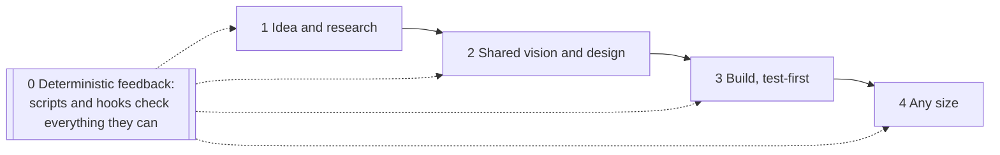
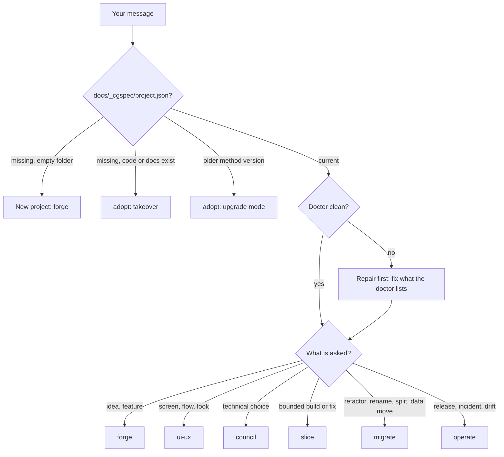
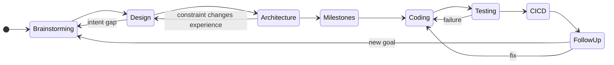
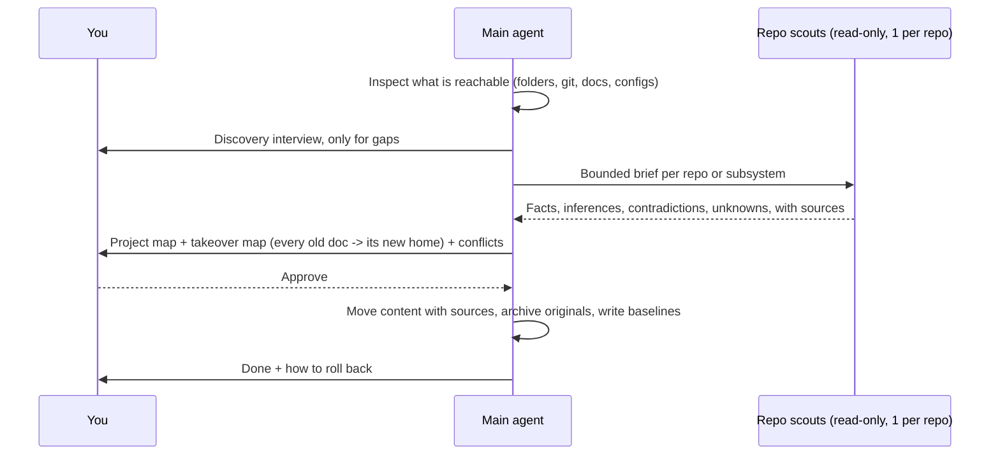
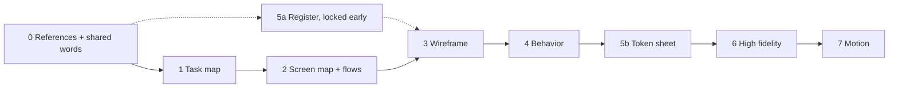
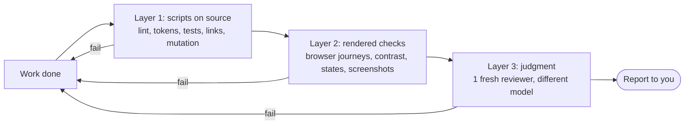
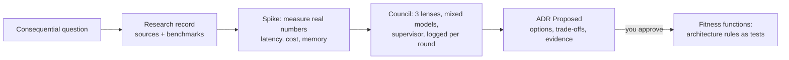
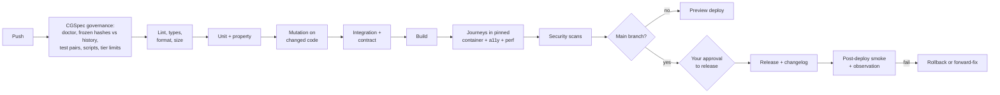
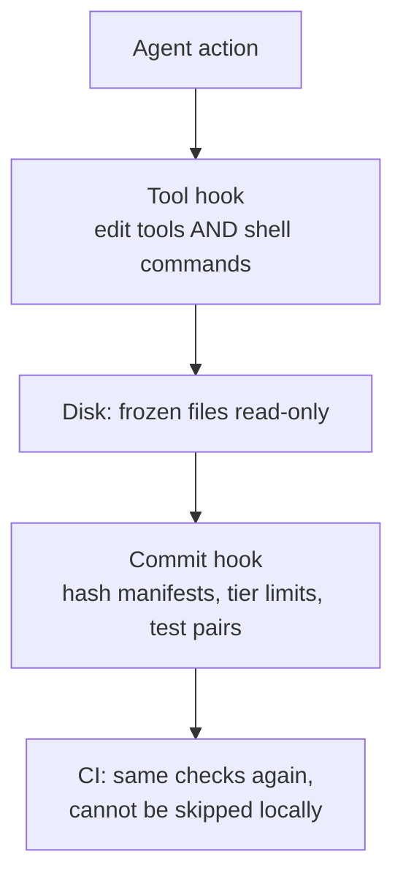
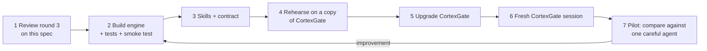

# CGSpec Method — Current Specification
Created: unknown · Last edited: 2026-10-30T00:30:00Z

Oct 18, 2026 · @Jean Franck · Replaces "CGSpec Method v0.1 — Architecture". The method specification evolves independently of package release numbers; Git history and the changelog identify exact revisions. Built in this repository; there is no second development checkout (see `AGENTS.md`).

**CGSpec is one package installed into a project: the AI carries the method, you set goals and judge results, and every rule that can be checked by a machine is enforced by one, not left to the AI's goodwill.** It works for a one-page site up to many independent repos, and for new or half-finished projects. Each rule below is stated once; other sections link to it.

| Pillar | Rule |
| --- | --- |
| 0 Deterministic feedback | The AI turns every checkable rule into a script in `docs/_cgspec/04-checks/`, registered through the flow in section 8, and runs them on every change. AI judgment is used only for what no script can measure. |
| 1 Idea and research | Goal type first (money, learning, personal, client). A money goal requires a sourced market research record before design. |
| 2 Shared vision and design | The AI leads with references it finds itself, helps you name what you feel, and walks a fixed layer path from tasks to motion (section 6). |
| 3 Build | A failing test before code, every test kind the profile supports, small single-purpose files, no duplicated logic (DRY). |
| 4 Any size | Same method from one page to many repos; each repo stays independent. CortexGate is an optional extra, never required. |

What changed from v0.1: every round-1 and round-2 review finding is resolved in the section it concerns (not in a side table); the review setup follows the evidence (scripts + one reviewer from a different model, big teams only for big steps); enforcement holds even against shell commands; packaging, paths and every cap now have exact values.

## 1. Collaboration contract

**You decide goals, taste and consequential choices; the agent does everything else and is responsible for the method being followed.** You never need to learn the method, and a skipped step or a change of mind is absorbed by the agent, not by you.

| Area | You | The agent alone | The agent must ask |
| --- | --- | --- | --- |
| Product | Goals, audience, scope | Turns words into intent, actors, nouns, flows; finds gaps | Conflicting goals, scope growth |
| Design | Taste, priorities, chosen direction | Finds references (up to 6), proposes, builds, checks, iterates | Choice between real alternatives |
| Architecture | Constraints (cost, hosting, privacy, licenses) | Researches, spikes, writes decisions | Consequential or hard to reverse |
| Delivery | What ships first | Slices, tests, code, evidence | Irreversible actions (data deletion, production, publishing) |
| Method | Nothing | Follows it, repairs drift, keeps records, manages budget | Never |

**The agent carries the definition; you only have to say what you want, in your own words.** Rework comes from building on an unclear goal, a missing decision or a broken environment, so the agent writes the minimum definition from what you say (a definition it wrote is not your approval: anything beyond small work waits for you to approve it), proposes the architecture, keeps the records and the environment, and absorbs new ideas and changes of mind as they come: it applies what fits, parks what does not with a reason, and explains the effect when a new thought contradicts something already approved. You are never asked to reconcile earlier decisions or to phrase things in method terms. The agent pushes back on actions, not on you: building on a costly guess, a consequential approval whose effect you have not seen, or a skipped setup the next step needs. It says so once, in plain words, with the cost and the smallest fix, which is usually something it does itself. Before a consequential approval it shows the exact change and checks that its effect was understood, so read what you approve when it matters. It stops only when continuing would build on an expensive or unsafe guess, and then asks one question. You can overrule it; your decision is then recorded as an accepted risk. The agent never argues against a taste choice you made knowingly. The rule is in the contract, under "Push back when the work is at risk".

How the agent talks to you:

- Plain English first; every term explained by its behavior; no unexplained product names.
- Orient once when starting a new goal. During longer work, use a brief progress line only when it adds useful orientation, such as when the current step changes, after a long interruption, or when the user asks where things stand. Do not prepend it to every design answer or repeat the full path; answer quick questions and clear feedback directly.
- Decisions come as structured choices: concrete options, recommended one first, one decision at a time.
- Clear feedback is applied, not interviewed. Only ambiguous or intent-changing feedback gets one focused question, and a consequential or hard-to-undo approval gets one short understanding check (contract, "Push back when the work is at risk").
- Diagrams (Mermaid) over walls of text; details live in files.
- No decorative emojis in chat, docs or code (enforced by the commit hook).
- No secrets (keys, tokens, passwords, private keys) in files, and no reading credential stores (shell history, `.ssh/`, `.aws/credentials`, `.netrc`, `.git-credentials`, Docker config) from a shell command — use environment variables, reference them by name only (enforced by the write hook, the commit hook, and the shell-command gate; the lab finding that triggered this is in `cgspec-workspace/dossier/`).
- The agent never force-pushes, rewrites history (`filter-branch`, `filter-repo`), runs `git reset --hard`, force-deletes a branch, or merges a pull request; it tells the user the exact command to run themselves (enforced by the shell-command gate on every host, including Antigravity; the incident that triggered this is in `cgspec-workspace/dossier/`: a delegated fixer agent rewrote branch history and force-pushed without asking).

**No hidden decisions.** You can hand any choice to the agent. Then it is recorded with status `Delegated` (section 2): what was chosen, the other options, why, and whether it can be undone. Every report ends with "Decisions I made for you" with links; you can reverse any of them. Choices made by helper agents reach you through the same list. A decision counts as significant when it would surprise you later, cost time to undo, or limit future options.

## 2. Paths and statuses (single source)

**This table is the only definition of where things live and what states they can have; the doctor checks every project against it and fails on anything else.** Collections are plural; engine folders are numbered; engine and machine files start with `_` so they stay visible to search but out of the way.

| Path | Holds | Written by |
| --- | --- | --- |
| `AGENTS.md`, `CLAUDE.md` | Thin entry points (tools auto-load them) pointing to the contract | Install only |
| `docs/00-INDEX.md` | Navigation and status matrix per part; no duplicated text | Doctor `--fix` |
| `docs/00-INBOX.md` | Raw captured ideas and requests, secrets scrubbed | Inbox hook |
| `docs/spines/01-INTENT.md` … `05-DELIVERY.md` | Why, what (OOUX nouns, attributes, hierarchy), experience, architecture, delivery | Main agent |
| `docs/adrs/ADR-NNN-<slug>.md` | Decisions | Council or main agent |
| `docs/slices/SLICE-NNN-<slug>.md` | Bounded changes with file scope and acceptance tests | Slice workflow |
| `docs/prototypes/<screen>/` | Living prototype source (shell + components) | Builders |
| `docs/prototypes/_snapshots/<screen>-vN.html` | Frozen milestone snapshots | Bundler only |
| `docs/prototypes/_vision/` | Shared vision board: references, your images and videos, captions | Main agent |
| `docs/_memlog.md` | Append-only ledger | `memlog.py` only |
| `docs/_cgspec/project.json` | Version marker: method version, profile, topology | Install and upgrade |
| `docs/_cgspec/capabilities.json` | Optional declare-once registry of approved agent-side capabilities and their checks | `cgspec_hook.py capability` |
| `docs/_cgspec/01-engine/` | Vendored engine scripts, pinned version, hash manifest | Install only |
| `docs/_cgspec/02-research/RES-NNN-<slug>.md` | Research with sources | Any, via main agent |
| `docs/_cgspec/03-councils/COUNCIL-NNN-<slug>/` | One folder per council: `00-brief`, one file per round, `99-outcome` | Council |
| `docs/_cgspec/04-checks/` | Registered project checks + `manifest.json` (hashes) | Registration flow (section 8) |
| `docs/_cgspec/05-runs/<run-id>/` | Team work per task: `run.json` (units, owners, allowed paths, criteria hash), outputs, reports | Inspector |
| `docs/_cgspec/06-evidence/` | Check and review results, each with revision and verdict | Whoever ran it |
| `docs/_cgspec/07-state/` | `checkpoint.json`, `budget.json`, `frozen.json`, `tier.json` | Hooks and main agent |
| `docs/_cgspec/_archive/` | Superseded material, with a redirect table | Main agent |
| `.cgspec-scratch/` (git-ignored) | Throwaway work, cleaned automatically | Anyone |
| docs/\_cgspec/07-state/quota.json, legacy-baseline.json | Provider quota reading, when a host adapter exists; list of legacy files exempt from size and test rules | Host adapter (quota writer not implemented in this checkout); adopt |
| docs/spines/\<NN-NAME>/INDEX.md | Folder form of a spine once it outgrows one file | Main agent |
| docs/00-REGISTRY.md (governance repo), packages/\<x>/docs/ (large monorepo) | Multi-repo registry; package-local docs | Adopt; slice workflow |

IDs: ledger entries `M-YYYYMMDD-xxxx` (date + 4 random hex), so parallel branches and repos never collide. ADRs and slices keep sequential numbers for readability: drafts on a branch use `ADR-draft-<slug>`, and the number is assigned when merged. In multi-repo setups every ID gets the repo prefix (`api:ADR-004`).

**Document dates visible on open.** Every new human-readable CGSpec Markdown document starts with its title followed by a compact provenance line: `Created: <ISO-8601 UTC> · Last edited: <ISO-8601 UTC>`. The agent updates `Last edited` whenever it changes that document's content, including generated index content; an unchanged file keeps its prior dates. The date line belongs to the document so it is visible in a plain text editor, Markdown preview, and Git diff. The two fields mean document creation and the last content edit made under CGSpec, not Git commit time or filesystem metadata. The commit check blocks new or edited documents with missing or stale dates, dates later than the checker's clock (10 minutes slack), a new document dated before CGSpec was installed or claiming `Created: unknown` outside an install or upgrade, a date-only change without a content change, an invented creation date on a document that existed before dates were tracked (it must say `Created: unknown`), and a changed `Created` across edits or renames (a rename git does not detect is matched by record number or title). The doctor warns about untouched legacy documents missing dates, so existing projects remain inspectable until upgrade, and errors on malformed date lines.

During adoption or upgrade, preserve existing date fields if their source is known. If creation cannot be established, write `Created: unknown` and add `First seen in available Git history: <date>` only when the history actually contains that file; do not relabel Git's first appearance or filesystem birth time as proven creation. Imported documents get `Last edited` when their content is transformed by the upgrade, with their earlier source retained in the migration record. The append-only ledger and inbox are exempt from the file header: each entry carries its own timestamp, and rewriting a header would violate append-only trust. Frozen snapshots and machine JSON are also outside this rule. A rename alone does not reset creation. The installer, document-writing flows, upgrader, and doctor/commit checks must implement this before claiming the rule is enforced.

| Record | Statuses |
| --- | --- |
| Decision | Draft, Proposed, Approved, Delegated, Rejected, Superseded, Imported |
| Slice | Draft, Approved, In progress, Done, Blocked |
| Design layer | Open, Locked, Reopened |
| Evidence | Fresh, Stale |
| Verdict | PASS, FAIL, PARTIAL, BLOCKED, NOT\_APPLICABLE |

## 3. Routing and change tiers

**The agent reads the version marker, then sizes every change into a tier written to disk before editing; the hooks enforce the tier, so no change can skip gates by calling itself small.**

A doctor failure leads to repair, never to an upgrade; only the version marker triggers upgrade mode.

| Tier | Limits (all must hold) | Records | Review |
| --- | --- | --- | --- |
| T0 Tweak | ≤ 3 files, ≤ 40 changed lines, no new file, no change to schema, API, auth, dependencies or a locked design structure | `tier.json` entry listing the files and explicit outcome verification + one ledger line | Deterministic checks only |
| T1 Bounded | Inside one approved slice's file scope; ≤ 400 changed lines | Short slice + versioned `.start.json` success/readiness agreement + ledger | Checks + 1 reviewer (different model when available) |
| T2 Feature | New screen, flow, service or data model piece | Spines + full slice + ADR if a real choice exists | Checks + 1 different-model reviewer; up to 2 specialist checks as scripts; max 3 helper agents at once |
| T3 Structural | New product, architecture change, migration, repo split, auth or data change, anything irreversible | Full flow + migration contract + recovery plan | Checks + inspector team + council with mixed models; max 6 helper agents at once |

The before-tool hook reads `tier.json`: a T0 entry unlocks only its listed files, and the commit hook rejects the commit if the line count is exceeded. Exceeding any limit escalates the tier automatically. A no-GUI project gets no prototype; its "experience" is API, CLI or event behavior.

Before T1+ dependent implementation, the agent drafts `docs/slices/SLICE-NNN-*.start.json` with observable outcomes, acceptance and rejection examples, exclusions, evaluation methods, implementation coverage, design targets where needed, prerequisites, and future human checkpoints. The human approves the definition and evaluation together through a fresh approval; an agent cannot approve its own definition. `start ready` executes the approved, safe readiness probes and records results without raw probe output. `start begin` activates only eligible outcomes. The lifecycle is Draft → Agreed → Ready → In progress; a material definition change returns to Draft and needs new approval/readiness. A failed prerequisite blocks only its covered outcomes, while independent approved outcomes can continue. Editor, staged-commit, and CI checks enforce the same candidate record. Tests, research, design, and setup remain available before implementation readiness.

Agent-side capabilities are declared once per project rather than re-explained per slice. `docs/_cgspec/capabilities.json` lists what the agent may use beyond the repository — an authenticated browser or account session (`account_access`), a way to delegate to another model (`model_delegation`), a channel to reach the human and how to use it (`human_contact`), another tool (`tool_access`) or `other` — each with a plain-language `usage`, an `owner`, `assistance` for when it fails, and the same executable `check` shape as a prerequisite. The registry is host-neutral data, not one agent's configuration file. The agent drafts it with `capability set`; the user approves it with a fresh message naming capabilities ("approve capabilities"), or the signed commit trailer; any change returns it to unapproved. `capability check` probes declared capabilities on demand and reports results without caching them. A slice prerequisite names `capability: CAP-...` with `check: null` instead of restating the probe; `start ready` then runs the registry's check and hash-binds the registry to readiness, so a later registry change blocks the outcome until readiness is rerun. A missing, invalid, unapproved, undeclared or failing capability is BLOCKED for the outcomes that need it; it is never assumed to work. A passing check shows that the probe succeeded at that moment, not that the session will stay valid or that the agent is allowed to do more than the `usage` states.

When a capability must work before any implementation begins, list its `CAP-...` ID in project.json `implementation_capabilities`. `start ready` automatically adds those checks to every outcome, binds both the approved registry and project policy bytes, and fails closed if any check is missing, stale, unknown, unapproved or unsuccessful. An empty slice prerequisite list cannot bypass this global preflight. Changing the registry, its probe inputs or the project-wide list invalidates readiness; doctor rejects a Ready or In-progress agreement that does not cover the exact configured global set.

Mocks are labelled development aids, never real-integration proof. `CGSPEC_ALLOW_MOCKS=0` (the default) disables mock-based development substitution; `1` permits it without relaxing the agreed final evaluation. Local probe scripts and configuration must be listed as inputs and hash-bound to the candidate; external runner/environment attestation and candidate replay remain separate work. Readiness establishes that agreed validation can run, not that the outcome is complete; outcome-based completion is enforced separately.

`project.json` lists path classes as globs set at install (schema, api, auth, deps, code, tests, docs); the hook uses them to recognize forbidden T0 changes. **Small-project profile** (one page, landing site, single script): a new product is T2, not T3; design layers 1–2 and 5–7 are merged; no council and no inspector.

## 4. Stages and gates

**Eight stages form a map with loops, not a corridor; each has an exit gate made of checkable items, and different parts of the product can sit in different stages.**

| Stage | Exit gate (all items present and approved) | Workflow |
| --- | --- | --- |
| 1 Brainstorming | Goal type; for a money goal a `RES-NNN` market record (competitors, who pays, price, demand evidence, risks) with sources; intent, actors, anti-goals; OOUX nouns with attributes, relations and hierarchy (workspace, organisation, project...); permissions; v0.1 scope with later ideas parked | forge |
| 2 Design | Layers 0–7 locked for the screens in scope (section 6). Headless profile: API draft, examples and error model instead | ui-ux |
| 3 Architecture | ADR for every consequential choice; data model; contracts; feasibility spikes done | council |
| 4 Milestones | Ordered slices, each with file scope, interfaces and acceptance tests | slice |
| 5 Coding | Code inside slice scope and active ready outcome coverage; a failing test recorded before each change; unit tests pass | slice |
| 6 Testing | All test kinds the profile requires pass at a named revision (section 7) | slice |
| 7 CI/CD | The same tests run automatically on every push (set up with the first slice); release, rollback or forward-fix plan | operate |
| 8 Follow-up | Observation period, incidents triaged, learnings in the ledger | operate |

Before any gate closes, the agent runs coverage checks (every noun has a place, every screen traces to a task, nothing orphaned) and asks: "Here is what I think might still be missing. Anything else before I lock?" Feasibility spikes are allowed before design locks; spike code lives in `.cgspec-scratch/` and never reaches production.

## 5. Adoption: takeover and upgrade

**Adoption builds a trustworthy picture of what exists, then makes CGSpec the project's only method with every fact mapped to a new home before anything is archived, and can be rolled back until you confirm.**

Discovery interview (asked only where inspection left a gap): one repo or several and is that everything; which docs are current; renames, splits, incidents or past decisions that constrain us; access to every repo and whether git history is complete; where each part runs (provider, region, environments, databases, domains, identity, monitoring); what adoption should deliver first.

Takeover rules:

- `AGENTS.md` and `CLAUDE.md` become thin entry points; their old rules move into the contract or spines, each with its source.
- Old docs are archived in `docs/_cgspec/_archive/` with a redirect table; nothing is archived until every fact in it has a new home.
- Legacy code gets a baseline: `SLICE-000-baseline` lists existing files as legacy. Legacy files may change only through a new slice that names them, and size and test rules apply only to new or changed lines, listed in `07-state/legacy-baseline.json`.
- Existing decisions are imported with status `Imported` and their source; they become `Approved` only after your review.
- Ingestion reports unsupported languages and partial coverage; a missing folder is an error; it never writes `Approved` decisions.
- Rollback until you confirm: restore the archive, and export any ledger entries written since adoption to a file so no later work is lost.
- Midway projects keep their real stage per part.

Upgrade mode (older CGSpec version): a path map from old to new locations, a link rewrite, a doctor run that must pass, and the version marker updated last. CortexGate goes through this mode.

## 6. Design path

**Visual choices start during brainstorming.** Whenever images would clarify an option, the agent displays real reference images beside short labelled descriptions before asking the user to choose. Use the [visual-choice guide](../skills/cgspec-ui-ux/references/visual-choices.md); links, image paths or screenshots saved only on disk do not count as a displayed comparison. If display is unavailable, state the limitation and leave that visual decision open. Purely technical or verbal choices do not need decorative images.

**Design walks eight layers, UX before UI, each with a fixed deliverable and a list of what is deliberately left out; the AI leads with references and never polishes a lucky AI screen into the product.** Design can take days; code is no longer the hard part.

| Layer | You see | Not in it yet | Lock scope |
| --- | --- | --- | --- |
| 0 References + words | AI-found references (up to 6, deliberately contrasting) as links + screenshots, each captioned; your words, images, videos; an `IMAGE-WORD` brief that aligns the visual words and image references; shared glossary; 0–3 existing design systems that passed the enforceability check (6b) | Any design of ours or generated asset | Global |
| 5a Register | One paragraph locked right after you react to references: density, type feel, light/dark stance, mood, one accent and its job, the signature element, what to avoid, and deliberate choices a generic-look warning would flag | Token values, screens | Global, locked at layer 0–1 because layout and look depend on each other |
| 1 Task map | What each actor does, v0.1 only | Visuals | Global |
| 2 Screen map + flows | Every screen, its purpose, how you move between them | Layout | Global |
| 3 Wireframe | Grey boxes with real labels: shared shell first (header, side bars), then each screen; named zone IDs | Color, fonts, icons, animation | Shell global, then per screen |
| 4 Behavior | Clickable grey prototype: navigation, every state, actions; test IDs on every interactive element; motion described in words + a reference clip | Final look | Per screen |
| 5b Token sheet | One token sheet (DTCG format) derived from the register and measured references, every value with its source: type scale, surfaces, color roles, spacing unit, radius, icons, motion durations and easings | Screens | Global, opens after layer 4 is locked for all v0.1 screens |
| 6 High fidelity | Real frontend screens (chosen stack, mocked data) matching the locked wireframes, tokens applied; locked only after a different reviewer scores the screenshots against the critique rubric (no score below 3, mean at least 3.5) | Layout changes | Per screen |
| 7 Motion | Layer 4 behaviors animated with motion tokens, in the real frontend; for hero or story-led pages, a time-based storyboard coordinates video cuts, text and UI transitions | New behaviors | Per screen |

Rules:

- **The AI leads.** It brings references first because it can search far more than you; you react ("this is mine", "not this", "mix 2 and 4"). Feedback by sketching on a screenshot is preferred over ranking options. When a real direction choice is open, the AI shows 2-3 quick variations of the key screen side by side. They must differ in mechanism (structure, density, navigation), not just in colour or button position. You react, the AI iterates on the winner and throws the rest away. More variations need a stated reason, and a fix inside an agreed direction needs none (sketch agents count toward the tier cap; beyond it they run one after another). The AI first answers the open question with the artifact that fits it: a journey for movement across screens, a state diagram for branching rules, a wireframe for placement, a side-by-side comparison for direction, and a clickable prototype for interaction claims. Connected screens are reviewed together as a journey; the AI pauses only for real choices, not after every file. Variations and references are always real pages, opened in a browser and screenshotted, never generated pictures. When photography, illustration or video would improve the actual product (especially a landing page or immersive space), first show real visual references, align on the `IMAGE-WORD` brief, then propose and create only the assets that fit it. Use a connected Antigravity media tool from any lead model when it is actually reachable; otherwise send the approved prompt unchanged to a directly available image/video generator. Paid services or new tools are suggested with their cost and license and used only with your explicit yes.
- **Media prompt integrity.** The lead model prepares one complete prompt packet for the chosen generator: the agreed image words, subject, composition, lighting, material, palette, crop/aspect ratio, dimensions, motion/timing where relevant, text-safe area, exclusions and source references. Show it to the user for alignment, then pass it to the generator verbatim; do not paraphrase it through another model between approval and generation. Preserve the returned asset and the exact prompt/provider/model/version in the asset record. If the tool cannot accept the packet unchanged or is unavailable, report that and offer the exact prompt for another tool; do not claim to have generated it.
- **Naming what you feel.** If you like an animation or effect without knowing its name, the AI names it, or asks for a screen recording; if the model cannot watch video, it sends you to a tool that can (for example Gemini) and records the answer.
- **Motion with media.** For a page where video and typography carry the story, the AI proposes a short visual sequence before implementation: shot and cut points, what the words do with each beat, transition timing, and the asset frame rate. Match text and UI motion to the video's actual timeline; keep playback smooth, pause or simplify off-screen motion, respect reduced-motion settings, and provide a still or lightweight fallback. Do not add motion merely because video is present.
- **Tweaks vs changes.** A tweak inside approved tokens and zones is applied directly (T0). Changing a zone, a flow or a token reopens that layer; a token change reopens layers 6 and 7 on every screen.
- **Constrained UI.** Prototypes assemble registered components with typed props instead of inventing layouts each time (RES-002), which keeps results stable and repeatable.
- **Generic-look tells.** The audit flags known AI-default patterns (RES-004: untouched component-library look, unprompted purple, gradient text, neon glows, centered hero + three cards, cream + serif "tasteful default") as warnings; usability breakers are errors.
- **Prior art.** RES-005 (Anthropic's `design` plugin) and RES-006 (`scroll-craft`) record what comparable skills enforce mechanically versus leave to prose, and list proposals not yet adopted: a UX-copy skill, scroll-motion checks, and a cross-project uniqueness register.
- **Versions.** Living source in `docs/prototypes/<screen>/`; a new snapshot `vN` is cut only when a layer is locked for that screen, by the bundler, recorded in the ledger. Snapshots are frozen (section 8).

**From layer 5 on, design is built in the real frontend.** Layers 0–4 stay a throwaway grey prototype, because screens and flows change many times and each change must stay cheap. When layer 4 is locked for the v0.1 screens, the agent runs a short frontend-stack decision (one ADR; a council only if the profile is T3) using the design system chosen at layer 0 when there is one. Layers 5–7 are then built directly as the real frontend with mocked data behind typed interfaces, so stage 3 only decides and connects the backend and nothing is rebuilt. What carries over from the grey prototype: (1) the journeys written at layer 4 against test IDs run unchanged against the real frontend; (2) the token sheet is the app's real tokens, enforced by Stylelint; (3) checks use behavior and state assertions, not pixel equality with the grey prototype. If the real frontend behaves differently from what you approved at layer 4, the build fails. If stage 3 later finds a backend constraint the frontend cannot meet, the frontend ADR is reopened like any other (section 7b).

UX regression: each locked screen keeps a baseline (journeys + screenshots per state, generated in one pinned container). Every later change re-runs them; a difference fails unless you approve a new baseline.

### 6b. Building on an existing design system

**At layer 0, the AI may propose an existing design system to speed things up, but only one it can enforce with scripts; a design system it cannot check mechanically is never presented as an option.** The reason: AI agents that read a design system's website and re-create it from memory drift, even when the system is fully open source. What works is giving the agent the system's real code and machine-readable interface, then checking the output mechanically.

Where the AI looks: its own web search first, plus your lists ([your fork of awesome-design-systems](https://github.com/mrojefe/awesome-design-systems), [Open Source Design resources](https://opensourcedesign.net/resources/links/)). It shows each candidate next to the visual references, with screenshots of its real components.

**Enforceability check** (a script scores each candidate; it is proposed only if items 1, 2 and 5 pass):

| # | Item | Why it matters |
| --- | --- | --- |
| 1 | Installable package with typed components (npm, PyPI...) | The agent uses the real components instead of re-drawing them; the type checker rejects invented props |
| 2 | Official tokens in a machine-readable file (DTCG JSON, CSS variables, JS) | Token values come from the package, never typed from the docs |
| 3 | Official lint rules (for example Atlassian `ensure-design-token-usage`, Primer and Carbon lint configs) | Ready-made checks; otherwise CGSpec generates them from the token file |
| 4 | Machine-readable docs: MCP server, `llms.txt` or agent skill | The agent asks for exact props and tokens while building instead of guessing |
| 5 | Permissive license (section 12) | No forced disclosure |
| 6 | Reference renders (Storybook or a docs site per component) | Lets layer 2 compare our screens to the system's own components |

For a reference that has no package (a closed product's look), the design system is extracted instead: tokens and component recipes are reverse-engineered by the specialist team, every value traced to its source, and the result becomes the project's own token sheet. The `getdesign` skill you are building is that extractor.

**How adherence is enforced** (all registered checks, section 8):

1. **Use, don't re-implement.** In the product UI scope, use package components where they cover the needed behavior. A lint rule flags hand-made substitutes and unrelated UI-library imports; native semantic elements and custom components have documented, reviewed exceptions. A custom component uses the system's primitives where they fit and is scoped in a slice.
2. **Tokens for design choices.** Use the official lint plugin when one exists; otherwise generate checks from the token file for authored colors, typography, spacing, radii, shadows and motion values. Layout mechanics such as percentages, `auto`, grid fractions, and content-driven dimensions are not token violations. Record justified exceptions rather than forcing a token that breaks the layout.
3. **Correct usage.** Strict type checking validates package props. Query the design system's machine-readable guidance when available; turn only genuinely mechanical Do/Don't rules into lint rules, and put contextual guidance into frozen reviewer criteria.
4. **Rendered conformance.** In a browser, check selected design properties on representative components and states against token-derived values, with explicit tolerances for font rendering and CSS resolution. Dynamic geometry, browser defaults, inheritance and user accessibility overrides are not required to equal a raw token. Compare screenshots with official component renders only when the same version, props, state, viewport, fonts and browser environment can be reproduced; otherwise record visual review evidence and its limit.
5. **Version pin.** The design system version is pinned; upgrading it is a T2 change that re-runs every baseline.

A screen cannot lock at layers 5–7 with a measured conformance error. Missing package, browser or reference-render evidence makes that part of conformance PARTIAL; it cannot be reported as a pass. The report shows per-screen measured failures and untested coverage so drift is visible instead of discovered later.

## 7. Verification

**Checks run in three layers, cheapest first; an AI judges only what scripts cannot measure, and the one who did the work never decides how it is judged.** This follows the research: self-review without outside feedback does not work, AI judges favor their own model, and bigger review teams do not find more bugs on routine work.

**Default review (T1 and above; T0 is scripts only):** layers 1–2 always; layer 3 is one reviewer with a clean context, from a different model when available (for example Claude builds, Codex reviews through its command-line mode). Reviewer findings block only on correctness or a stated requirement; taste remarks are listed as optional.

For GUI profiles, pull request CI runs the proof in a fresh `git worktree` checked out at the exact PR head and verified clean (`git status --porcelain` empty, `HEAD` equal to that SHA) before testing anything; a checkout that is not clean is BLOCKED, never PASS (plain `git checkout --detach` in the existing checkout can leave compatible uncommitted changes in place, testing content that was never committed while `evidence.json` still claimed that commit's SHA). The trusted engine's journeys and visual audit run against that worktree with video. The workflow installs Playwright at a pinned version, with Chromium, outside the checkout, with `PLAYWRIGHT_BROWSERS_PATH` set to a directory under the runner's temp space so Chromium itself cannot land in the runner's default cache; the engine loads Playwright only from the pinned directory, never from the project's `node_modules`. A journey or audit passes only when the browser returned a result for every expected viewport and every expected screenshot (and recording) exists on disk; a missing Playwright, Chromium or video tool gives BLOCKED or PARTIAL, never PASS. The step summary and `evidence.json` (whose `revision` is the PR head) are built from structured per-command results, not printed text: a command that fails without its own result is listed as its own FAIL or BLOCKED, names with newlines or control characters are rejected, and table cells are escaped. All proof output, including `evidence.json`, is written only under the runner's temp space, never inside the checkout, and screenshots, recordings and logs are uploaded from there for 14 days, gated on the proof step's own outcome: a skipped or never-reached proof step (an earlier required step failed, or this is not a pull request) publishes nothing, so a pull request that commits a forged `artifacts/cgspec-visual/` directory can never have it published under the CI artifact name. This job is evidence, not a gate: it never fails the workflow, and the governance step remains the required check. An agent-attached image is not CI proof.

**When only one AI is available** (a team member with a single tool, no second model): the reviewer is a fresh helper of the same tool with a clean context and only the frozen criteria, and the report labels it "same-model review" so nobody mistakes it for independent. Layers 1–2 carry the weight: they need no second model. Teams can add a human reviewer through the normal pull request, which counts as the independent layer 3. Optional: one cheap API key for a second model unlocks cross-model review without installing another tool.

**Team review, on demand.** The `cgspec-team-review` skill runs the full team on any work, at any tier, whenever you call it: an inspector supervises specialists (UI, UX, accessibility, typography, motion, performance... chosen for the work), then adversarial reviewers, then one integrated verdict. It runs automatically only at T3; at whole-app design locks (layers 2, 3-shell, 5) the agent suggests it and you decide. Specialists also propose new deterministic checks, registered as described in section 8. On tools where helpers cannot start helpers, the inspector writes the job queue and the main agent only dispatches it, never judging; the report says so.

**Criteria come first and are frozen.** Acceptance criteria and checks are written before work starts by someone other than the author, approved by you, and their hashes stored in `run.json`. The CI and commit hooks fail if they change during the run (section 8). Reviewers get the criteria and the artifact, never the author's explanation.

**Replacement is a lifecycle, not an edit.** A changed test or architectural direction gets a new frozen run. Before dependent implementation, that replacement records its reason, fresh approval and explicit old/new links for every agreement, required outcome, test and proof. Only then may the old run move from active to the terminal `superseded` state. Both records and historical proof remain inspectable; missing inventories, unknown links and any unmapped required outcome fail closed. Independent outcomes that are not affected by the changed direction remain in their existing approved lifecycle.

**Caps.** At most 3 review rounds per unit in total; after 2 rounds on the same defect the agent changes approach (smaller scope, spike, other builder). When the cap is hit the result is BLOCKED with the remaining defects listed, never PASS. Every BLOCKED or PARTIAL exit is written to the ledger with its reason and the missing input, shown in your report, and counted by the doctor until resolved.

**Test-first, enforceably.** For T1 and above, every change to files in the `code` path class needs a test pair in `06-evidence/`: test ID, the revision where it failed, the files it covers. CI checks out the parent commit and re-runs the test to confirm it really failed, so the record cannot be faked. T0 is exempt. During an active run, its frozen test files remain read-only to builders. Later named proof may survive a formatting-only edit or unrelated test added to the same file only when an approved language adapter returns the same stable test identity, deterministic semantic fingerprint and complete relevant dependency closure at both revisions. The core hashes the adapter-reported helpers, fixtures, imports, snapshots and test configuration. A dependency change or any semantic edit to the selected test requires new red/green proof; unknown and ambiguous impact fails closed, with no guess that an assertion became stronger. The minimum checks per profile and tier are in the single table in section 7b.

Never "zero defects": the claim is always "these checks passed at this revision; these were not run".

## 7b. Architecture, coding and CI/CD

**Architecture is researched and debated, never assumed; code is tested to the maximum the project allows; and the pipeline runs every check again on every push.**

### Architecture (stage 3)

- **Every consequential choice gets a council** (stack, data store, auth, hosting, service boundaries, sync model): three lenses (simplicity and cost; security and reliability; scale and maintainability), debaters from at least two different models (with only one model available the council is marked PARTIAL), a supervisor; a council has its own cap of 4 agents, outside the tier helper cap, one log file per round, outcome as a Proposed ADR you approve.
- **Backed, not opinion:** each option cites sources, and where numbers matter a spike measures them (latency, memory, cost per month) instead of guessing.
- **Match model to work.** Before a substantial or expensive task, the main agent checks models actually reachable in the host, including configured cross-provider options when available, and recommends a fit in one short sentence: for example, a fast, lower-cost model for broad brainstorming, a balanced model for ordinary implementation, and a strong reasoning model for a difficult security or architecture review. Name a model or compare cost only when the live host catalogue or reliable pricing source supports the claim. Recommend a cheaper adequate option when it can do the job; reserve stronger models for work where their added scrutiny is useful. A lower model number or older release is not evidence of lower usage: compare measured cost or quota consumed per completed task when available, and do not confuse API token prices with subscription limits. Check data access and provider boundaries before sending project material cross-provider. Do not interrupt quick, routine work with a model menu. If the host cannot switch models from the current session, give the user a concise handoff prompt or explain the limitation once.
- **Final challenge for consequential architecture.** After a T3 council synthesizes its result, a reviewer who did not author the proposal or supervise the council uses the strongest suitable available model to challenge the proposed ADR, source quality, assumptions, threat model, failure modes, and reversibility before it reaches the user. The reviewer reports findings and limitations; it does not approve the architecture. If a suitably independent model or access to the evidence is unavailable, mark the review PARTIAL. The user remains the authority who approves the decision.
- **Deliverables:** Mermaid diagrams at three zoom levels (system context, containers, components); data model; contracts (OpenAPI, AsyncAPI or JSON Schema); budgets for latency, memory and cost with how each is measured; a threat model for anything touching auth, money or personal data.
- **Architecture enforced as tests (fitness functions):** layer and dependency rules checked on every commit (dependency-cruiser for JS/TS, import-linter for Python); ports and adapters where boundaries are expected to change; other stacks use their equivalent (for example ArchUnit for Java). An ADR is reopened when a measured budget is breached in production or a constraint behind it changes.

### Coding (stages 5–6)

Minimum checks (the single source; the agent cannot choose less). Cells give the lowest tier where each check becomes mandatory; — means not applicable.

| Check | Website | Web workspace | Mobile app | CLI | Headless service | Tools |
| --- | --- | --- | --- | --- | --- | --- |
| Lint, types, format, size, duplication | T0 | T0 | T0 | T0 | T0 | linters, jscpd |
| Unit, failing first | T1 | T1 | T1 | T1 | T1 | Vitest, pytest |
| Property-based (logic with many inputs) | T1 | T1 | T1 | T1 | T1 | fast-check, Hypothesis |
| Security: dependencies, secrets, static analysis | T1 | T1 | T1 | T1 | T1 | osv-scanner, gitleaks, Semgrep |
| Integration with real dependencies | T2 | T2 | T2 | T2 | T2 | Testcontainers |
| Contract tests (any API) | T2 | T2 | T2 | T2 | T2 | Spectral, schema tests |
| Command contract tests | — | — | — | T2 | — | CLI test harness |
| End-to-end journeys | T2 | T2 | T2 (simulator: Maestro, Espresso; iOS needs a Mac, else reported untested) | — | — | Playwright, Maestro |
| Accessibility + performance budgets | T2 | T2 | T2 | — | — | axe-core, Lighthouse CI |
| Load tests against latency budgets | — | T2 | — | — | T2 | k6 |
| Data migration up and down tests | T2 | T2 | T2 | T2 | T2 | migration harness |
| Mutation on changed code, score ≥ 70% | T2 | T2 | T2 | T2 | T2 | Stryker, mutmut |
| Visual regression baseline | T2 | T2 | T3 | — | — | Playwright screenshots |
| Device run | — | — | T3 | — | — | real device |
| Team review | T3 | T3 | T3 | T3 | T3 | `cgspec-team-review` |

Code rules the commit hook enforces: files ≤ 400 total lines for new or changed code under the project's declared `code` path class, unless the exact path is listed in `legacy-baseline.json` with an approval; no test may be skipped, emptied or weakened to make a build pass. Other code rules (strict typing, formatter, function size, complexity limit, duplicated-code detection, stack best practices via each linter's recommended configuration) are not enforced by CGSpec itself — adopt them through the project's own lint and formatter configuration.

For T1 and above, implementation also requires a per-slice Git plan before the first code edit. It records each repository's full approved base revision, dedicated feature branch or worktree, covered outcomes and shared-file ownership. Branches named in project.json `protected_branches` are integration baselines, never implementation branches; the default and every stacked implementation branch must be distinct from them. A detached baseline is also ineligible. The approved base may be a protected branch revision, and landing automation remains a separate release operation. One feature branch is the plan default; a stacked branch names its dependency and reason. Recorded commits must be real descendants of the approved base and follow red-test → one or more implementation commits → green-test. A commit that implements multiple unrelated outcomes is split by behavior rather than by an arbitrary file quota. Parallel workers identify themselves with `CGSPEC_WORKER_ID`, edit only their owned paths from declared isolated worktrees, and remain subject to frozen-proof checks. Multi-repository plans link every repository to one outcome, contract version, integration order and cross-repository check. Review and required checks bind only to the current recorded candidate HEAD; the sidecar-only commit that stores the binding is its traceability envelope, and any later non-plan candidate change makes the binding stale. Opening a pull request never authorizes merge or destructive history operations.

Before squash, rebase or another history-changing integration, trusted CI may seal strict test proof. The signed seal binds outcomes, the test-pair bytes, reviewed base and head, independent review, red/green execution-detail hashes, runner and environment fingerprints, and relevant source, test, dependency, configuration and runner-input content. Signer identity, provider and workflow must match `proof_signers` from the protected project configuration at the reviewed base; candidate configuration cannot authorize its own key. The private key stays outside the checkout and is exposed only to a trusted signing job after candidate processes have ended.

Integration creates a second signed envelope around the resulting parent revision and names the merge strategy and pull request. The mapping compares every sealed content hash with that integrated tree. Each material difference requires an exact difference entry and a second signed revalidation seal bound to the integrated revision; a PR number alone proves nothing. The entire seal, revalidation and mapping chain remains pinned to signer policy at the original reviewed base, so changing project configuration during integration cannot rotate authority. Seals and mappings are append-only. With a valid mapping, historical red proof may remain usable after its temporary commit object disappears; without one, ordinary ancestry rules continue to fail closed. Ordinary merge commits, squash, rebase and merge queues use the same explicit mapping contract. Final integrated completion remains governed separately.

### CI/CD (stage 7, set up with the first slice)

Pipeline on GitHub Actions by default; the CGSpec governance stage runs first and cannot be skipped. Releasing to production waits for your approval (section 1). Preview deploys only for profiles that have something to preview. Database migrations run only through the migration contract (section 10). Every release has a rollback or forward-fix plan written before it ships, and a smoke test runs right after deploy.

## 8. Enforcement engine

**Defense in depth is the target. The controls below have different scopes and host support; they are not independent security boundaries when the same agent controls the files, shell and remote credentials. Treat enforcement as active only after the installed hooks, trusted CI and required remote settings have been verified.**

| Rule | Tool hook | Disk | Commit hook | CI |
| --- | --- | --- | --- | --- |
| Frozen snapshots and criteria never change | Refuses edits, and shell commands that write to listed paths (`sed -i`, redirects, `cp`, `mv`, python writes; best effort; read-only flags deter accidents, while hashes detect changes against a trusted baseline) | Files set read-only | Hashes vs `07-state/frozen.json` | Same check |
| No code outside the active tier or slice scope | Checks `tier.json` / slice file list | — | Line counts, file list | Same check |
| Test-first | — | — | Failing-then-passing pair required | Same check |
| Only registered scripts | Refuses new `.py`/`.js`/`.sh` outside `src/`, tests, `04-checks/` or `.cgspec-scratch/` | — | Unregistered scripts rejected | Same check |
| Your input is captured | Inbox hook saves your message (secrets scrubbed first) | — | Decisions have ledger lines | Doctor |
| No emojis | Refuses them in written content | — | Staged files scanned | Same check |

**Prototype scope.** All files under `docs/prototypes/` except ordinary lowercase `.md` notes follow the same tier and slice scope rules as source code; unknown suffixes are not a bypass. Commit and CI include both sides of a source rename and its changed-line count. Live sources require the tier's test evidence. Journey JSON is test material, while reference media and fonts are assets; neither requires another failing test of itself, but both remain scoped. Only unchanged, same-file-type renames of existing live prototype sources into `_archive` and newly frozen, hash-matched snapshot HTML receive preservation exemptions from test-pair coverage. New or modified archive code does not. Include snapshot destinations in the approved scope before cutting a layer lock; lock approval does not replace scope approval. Frozen-file and approval checks remain separate. Shell pre-tool parsing is partial; installed commit and CI checks are the backstop. These checks do not prove interaction quality or form a browser security boundary: scoped loaders can still consume prose or archived files.

**Script registration** (so pillar 0 keeps working): a new check starts in `.cgspec-scratch/checks/` as a proposal → the inspector or reviewer shows you what it checks and its optional Markdown guide → you approve → `cgspec_hook.py check register --file … --guide … --applies-to 'src/**' --description … --approval A-…` copies both into `04-checks/` and records their hashes. On failure the approved guide prints after the check output. `check run [--files …]` writes `06-evidence/checks/CHK-NNN.json`; commit and CI run the checks whose `applies_to` matches changed files. Commit, CI, `check run` and doctor verify every registered script and guide against its hash on every run, even when no matching file changed: a missing or changed one fails the gate and its check does not run. CI verifies this against every commit's own manifest and tree in the range, not only the final checked-out tree, so a commit that tampers with an approved script or guide and a later commit that restores the exact approved bytes still fails the range. The guide shares the check's approval and protection. Each check receives a trusted base revision and repository location from the engine (`CGSPEC_BASE_REV`, `CGSPEC_REPO_ROOT`; HEAD at commit time with the staged snapshot as candidate, the trusted range base in CI), so ratchet checks compare against history without guessing. Anything else, like an ad-hoc `generate_v15_screenshots.py` in a docs folder, is refused.

**Ownership without trusting identity.** Each run lists units, owners and allowed paths in `run.json`. Where the tool passes the agent's identity to hooks, writes outside an owner's paths are refused. Everywhere, frozen criteria are protected by hashes checked at commit and in CI, which needs no identity at all.

**Trust root.** The agent can write files and runs in your shell, so nothing on your disk is fully tamper-proof on its own. CGSpec aims to make tampering detectable by trusted CI. Preventing a merge requires server-side rules, protected workflow changes and effective separation from credentials that can bypass those controls:

- **CI never runs the engine inside the commit it judges.** It downloads the published plugin release (the newer of the version before and after the change, from the source recorded before the change) and checks every commit in the push with it. Engine files may change only to match that release exactly.
- **Append-only records.** `frozen.json`, `04-checks/manifest.json` and `07-state/approvals.json` are compared with git history; existing entries can never change.
- **Approvals come from your words.** The message hook reads a `UserPromptSubmit` event directly from host-owned stdin, verifies its operating-system peer is the installed Claude process, then records the approval with its session ID and capture time, and saves the message in the inbox. A session ID or event name supplied in shell JSON is insufficient; the shell gate also refuses direct `cgspec_hook.py user-message` and `inbox.record` calls. Unverified input leaves both records untouched; capture failures never block your message. Keep the installed hook's stdin connected directly to the host; a wrapper that reads and replays JSON loses this provenance. Installation and upgrade pin the absolute Claude launcher path in the installed engine's `owned-files.json`; capture never searches the caller's `PATH`. Existing installations need an upgrade with Claude available to establish that pin. The installation environment, pinned launcher, executable and engine-owned record remain trusted local inputs, not an independent security boundary against an agent that can replace them. An approved slice, a registered check, the project test command and an Approved decision must cite an approval; the local commit gate and CI check the citation, the inbox line and verifiable hook provenance. An approval is valid only in the change that adds it, approves exactly one record, and if your words name a record ("approve SLICE-004") it approves only that one; widening a slice's Scope therefore needs a new approval. On tools without a message hook (Antigravity, Codex, Cursor), approve in Claude Code, or with the commit trailer `Approved-by: you` on a commit signed by a key you listed in `project.json` `approver_keys`, verified locally (in post-commit and pre-push) and in CI.
- **Failing tests are proven.** A failing-test record must run the project's approved test command on a test file that existed at its recorded commit, belong to the active slice, fail there and pass at the new commit; CI re-runs both. Cache files can never be committed, so nothing hides inside the engine folder.
- **Rewritten proof is signed, not reconstructed.** A protected CI identity signs a canonical pre-integration seal and a post-integration mapping. Verification pins the complete chain to signer policy at the reviewed base, so a candidate cannot add a key and attest itself. Missing historical objects are accepted only through this chain; records are never rewritten and red commits are never fabricated.

**First-install trust bootstrap.** Before a repository has a trusted CGSpec selector on its default branch, governance CI deliberately fails closed. Publish and inspect the pinned CGSpec release first. Put the installer output, `plugin_source`, initial `approver_keys` (if wanted), workflow and selection script into one proposed installation change. The repository owner reviews that exact change under a protected branch rule requiring owner review; the first merge cannot claim a passing CGSpec governance check because no prior trusted selector exists. After that reviewed baseline is on the default branch, enable the CGSpec governance check as a required status, then verify it on a subsequent harmless PR before treating the protection as active. Do not add the first approver key later through an ordinary PR: the engine cannot verify GitHub review as an authorization source yet, so it fails closed. A trusted key can rotate keys by signing with the previously trusted key. If owner review or the published release cannot be established, mark bootstrap BLOCKED rather than using the proposed change's engine as its own judge.

What remains possible, and how to close it: the implementation now requires an exact, named approval phrase, reads signer keys from the trusted base, and fails closed when the CI selector cannot establish its trusted source. Those fixes passed bounded adversarial review; they do not certify the whole system. A fake approval together with a fake inbox line is rejected without verifiable hook provenance. The installed post-commit and pre-push hooks check finished approval signatures locally as well as in CI. An agent with access to human signing keys could still forge their evidence. The first installation also has no earlier selector to judge it and therefore requires the owner-reviewed bootstrap above. The merge protection guarantee holds only when GitHub branch protection requires the CGSpec check and your review for changes to `.github/`, `docs/_cgspec/` and `docs/slices/`, and the agent lacks your GitHub admin credentials. A hardware signing key that requires your touch can strengthen approval evidence. Install prints the GitHub steps. A pinned release still needs a live protected-branch rehearsal before this section describes a deployed guarantee.

**Session lifecycle hooks:**

| Moment | Action |
| --- | --- |
| Session start (and again after compaction) | Load the session pack: goal, stage per part, open decisions, latest checkpoint, what changed on disk since; run the session check (cgspec\_hook.py session-check) |
| Your message | Scrub likely secrets, save to inbox |
| Before compaction | Agent saves semantic progress before context pressure. The hook captures bounded mechanical source context and prints the pack; it does not invent a fresh semantic summary. Unavailable hooks cannot guarantee a save. |
| Before a tool | Gates above |
| After a tool | Mark evidence whose covered files changed as stale, count helper agents against the budget (index and document dates are refreshed at the end of the turn) |
| Stop | Refuse to end while doctor reports errors, work is in flight, or the checkpoint is older than the latest ledger entry; allowed to end once the batch is done or recorded BLOCKED, or on a recorded question to the user (`checkpoint --awaiting`, which keeps the batch in flight and excuses one stop). Bounded by a retry counter on disk: after two refusals it ends and keeps the unresolved reasons. The tool's loop flag (`stop_hook_active`) is not read |

| AI tool | What it supports | Fallback |
| --- | --- | --- |
| Claude Code | All events above, including compaction; helpers can start their own helpers (3 levels) | — |
| Antigravity | Session start, before/after tool, stop (blocks with a JSON decision); no compaction event and no user-message event, so inbox and approval capture are not available there | Checkpoint after every batch |
| Codex | No hooks | Git hooks + CI; checkpoint after every batch |
| Cursor | Rules file | Git hooks + CI |

On tools without tool hooks, commit and trusted CI checks cover the implemented repository invariants. They cannot recover uncaptured user messages, prove every shell action, or prevent remote writes by an agent with bypass credentials. Verify host-specific coverage rather than treating all rows as universal guarantees.

## 9. Tokens, checkpoints and resume

**Zero brutal stops (target): the agent lands safely before a limit instead of stopping mid-turn, saves, tells you, and wakes up only when it is allowed to.** Distinguish provider quota (for example, a five-hour or weekly allowance) from the current conversation's context capacity; a reading for one is not evidence about the other. At the start of substantial work and before launching a long or parallel task, the agent checks a fresh reading from an available host integration. The engine can consume quota written to `07-state/quota.json`, but this checkout contains no quota collector or writer: the method describes a Claude Code `rate_limits` status-line source, while the engine only reads a pre-existing file. Codex and Antigravity have no quota adapters here. If no host reading is available or its timestamp is stale, record it as unavailable and work in bounded mode; never infer remaining quota from elapsed time, turn count, or context length, and do not make the user manage internal token accounting. The agent should checkpoint before compaction or interruption when the host signals context pressure, but this is not automatic until the host and engine integration is built and tested. The quota collector and automatic context-pressure integration remain implementation gaps, not universal guarantees. Run `python3 docs/_cgspec/01-engine/quota.py --root <project> --json` before substantial work: the evaluator and session pack reject snapshots older than five minutes, future/invalid timestamps and unusable reset windows. Modes are `normal`, `frugal`, `checkpoint`, `emergency` or `bounded`; inspect the mode rather than interpreting exit 0 as permission to spend. Missing windows keep the result bounded, unless a valid known window already requires checkpoint/emergency. This is snapshot interpretation and agent guidance, not a provider measurement or a hard task gate. The work ladder uses the lowest valid remaining window conservatively. `weekly_resume` is `blocked` at 10% or less, `quota-permits` above 10%, or `unknown` without a usable weekly reading; permission under this quota rule does not establish scheduler availability or create a wake-up.

| Lowest valid remaining quota window | Action |
| --- | --- |
| Above 25% | Normal work |
| 25% | Frugal: core acceptance work only; no tangents, optional tests or refactors |
| 15% | Safe harbor: no new files or sub-tasks; finish the atomic unit, check syntax, write checkpoint, tell you; schedule resume only with verified host support and sufficient weekly quota |
| 5% | Emergency reserve: only commit, save logs, alert. No code generation |

| Weekly window remaining | Resume |
| --- | --- |
| Above 10% | A wake-up may be scheduled after the 5-hour window refills only when host scheduling is verified |
| 10% or less | No wake-up at all; workers parked; waits for your decision |

Standing rules: pre-flight quota check before any expensive task (near 15%: park and write the plan); chunked output; no brute-force retry loops when quota is tight; never weaker tests to save tokens; per-task budget in `07-state/budget.json` (helper agents, review rounds, research passes) counted by hooks. When telemetry is missing, prefer one small, resumable unit and avoid optional councils, broad research, or parallel helpers; if a consequential task cannot be completed safely in bounded work, save the plan and ask the user whether to continue in another session. These task counters do not measure generated tokens or replace provider quota telemetry.

Checkpoint (`07-state/checkpoint.json`, committed): goal, stage per part, accepted constraints, revisions, evidence done, pending changes, open issues, owners, next action, and an "in flight" note written before each batch so a crash leaves a clear trail. Commit points: after every green slice, every locked design layer, and every checkpoint at 15%; never auto-commit unrelated changes. The checkpoint command validates existing state and preserves damaged records for explicit recovery. Structured updates use top-level replacement, not a second project hierarchy. Optional source observations report changed worktree context and partial coverage, not tested-byte evidence. Session packs expose saved constraints, evidence references, pending work, owners and retained stop problems. The bounded stop escape persists unresolved reasons without refreshing semantic progress; if saving fails it reports that explicitly. See engine/FORMATS.md for capture bounds and exclusions. Task reservations and host receipt reconciliation remain pending; these checkpoint changes do not prevent duplicate remote writers.

| Tool can... | Wake-up |
| --- | --- |
| Schedule itself (Claude, Antigravity) | Its own scheduled task; ID recorded in the checkpoint |
| Run from the command line (Codex `exec`, `exec resume`) | A system timer may start a new CLI session with the checkpoint. `exec resume <id>` is allowed only after the existing writer for that exact session has closed; a live Codex chat holding the writer lock makes concurrent resume fail. Verify the timer, saved session ID, output destination, and lock state in a short test before claiming a wake-up. Do not infer that CLI output will appear in the open chat UI. Respect the weekly limit above. |
| Neither | The checkpoint plus one line to paste and when to come back |

The agent always says which wake-up it set.

**Memory and late changes.** Where the host has a user-message hook (Claude Code), each message is captured to the inbox with secrets scrubbed and cut to its first 2,000 characters; a capture failure never blocks the message. Capture is not triage: the engine does not record where a message was routed, and on hosts without that hook there is no automatic capture at all. The agent does the routing, and records only what affects the work rather than every message: current step (apply now), other screens or later UX (experience spine), backend or future scope (OOUX, architecture, or the checkpoint's `pending`), research (`RES-NNN`). A late idea or change of mind goes through the change flow: the agent compares it with the work in progress → applies it if it fits, or parks it with a reason if it does not → if it contradicts approved work, impact script (`impact.py <paths|IDs> [--term noun] [--screen name]` follows links and record-ID mentions backwards from nouns, screens, layers and baselines, then lists records to update, code in affected slice scopes, evidence that goes stale and frozen baselines that need a new version; plain code, no AI context, read-only) → impact map shown to you with a recommendation → approve → all records updated together → affected evidence marked stale and re-run. On big projects, one scout per repo reads only the affected files.

## 10. Scale, migration and operations

**The same backbone works at every size; what changes is where shared truth lives and who may write it.**

| Topology | Backbone | Rules |
| --- | --- | --- |
| One repo / monorepo | `docs/` at the root | Spines become folders with an index past 500 lines or when several teams own parts |
| Large monorepo | Root `docs/` for global truth; `packages/<x>/docs/` for local slices | Packages link up, never copy |
| Polyrepo | A central governance repo (`00-REGISTRY.md`, global ADRs, versioned contracts) + a thin `docs/` in each repo | Each repo works alone with its own ledger and tests; it pins the contract versions it uses; registry changes go through pull requests; unreachable repos are listed as `access: none` and conclusions say what they exclude; cross-repo links that cannot be resolved are PARTIAL, not FAIL |

**Migration contract** (refactor, rename, split, data move): baseline behavior and tests, target, affected repos (including unreachable ones), behavior to preserve, intended changes, data transformation and validation, old/new side-by-side rules, deployment order, checkpoints, recovery proven before any irreversible step, performance and security acceptance, observation period, owners. A repo rename updates registry aliases, imports, CI paths, remotes and links in one tracked change.

**Operate workflow:** release (pipeline, notes, rollback or forward-fix), observation, incidents (straight to triage, then a ledger entry that becomes a constraint), drift (code vs docs vs deployment disagreements shown, never silently resolved), retirement. Runbooks (step-by-step guides for deploy, restore, known failures) live in `docs/spines/05-DELIVERY.md` or its folder. Access to infrastructure never implies permission to change it.

**When CGSpec suggests CortexGate** (once, as an optional suggestion, never a requirement; CGSpec keeps working fully without it):

| Signal (any one) | Why CortexGate helps |
| --- | --- |
| 3 or more repos in the registry | One governed place to browse and search docs across repos |
| 2 or more people or AI tools working on the project in parallel | Shared memory and access control, so each AI only sees what it should |
| Several AI tools need the same project context (Claude, Codex, Antigravity...) | One MCP endpoint serving the same context to all of them |
| Need to review what AI sessions did (audit, lessons learned) | Session transcripts and activity in one place |

The suggestion is recorded in the ledger with these reasons; if you decline, it is not repeated unless a new signal appears.

## 11. Package and install

**The plugin ships each script exactly once, uses no symlinks, and must pass an install smoke test before it touches any real project.** The 24 broken links in live CGSpec came from copying scripts into each skill through symlinks; that pattern is banned.

Plugin repository layout:

| Path | Content |
| --- | --- |
| `.claude-plugin/plugin.json` | Claude Code manifest |
| `skills/<name>/SKILL.md` | The 9 skills (section 12); they call the engine, they never contain copies of it |
| `agents/<role>.md` | Role definitions |
| `engine/` | The only copy of every script (doctor, memlog, ingest, audit, journey, bundler, hook, impact, install) |
| `adapters/claude/hooks.json`, `adapters/antigravity/hooks.json`, `adapters/git/` (pre-commit via Lefthook), `adapters/ci/` | Per-tool wiring |
| `templates/` | Project skeleton matching section 2, one per topology |
| `tests/` | Unit tests + negative fixtures + the smoke test |

Install into a project (`engine/install.py`): copies `engine/` to `docs/_cgspec/01-engine/` with a hash manifest and the plugin version (vendored, so a project never breaks when the plugin moves); writes the version marker; wires the adapters for the tools present; writes the thin entry points; records every file it created in an owned-files list for uninstall. Running it twice changes nothing.

Git hook ownership records event names, not workstation paths. At uninstall, Git locates the current checkout's default hook directory; legacy stored paths contribute only recognized event names and are never followed. Only an unchanged installed hook is removed. Modified or symlinked hooks and custom `core.hooksPath` locations are left alone with a diagnostic. An upgrade converts legacy Git hook ownership to event names. Linked worktrees share the repository's common hook directory; independent per-worktree installation ownership is not implemented.

Smoke test, required to pass in the plugin's CI before step 5 of the plan:

1. Fresh empty repo → install → doctor PASS on each template.
2. Doctor FAILs on each seeded defect: empty spines, duplicate ledger IDs, index-only ADR, broken link, edited or unlisted frozen snapshot, unregistered script. Code outside slice scope and a missing failing-test record need git history, so the commit hook and CI catch them (item 3).
3. Simulated hook payloads: each gate in section 8 blocks its case and allows the valid one; shell writes to frozen files are refused.
4. Install twice → identical tree. Uninstall → only owned files removed.
5. Upgrade fixture of an old-layout project (copy of CortexGate's structure) → all links resolve, doctor PASS.

## 12. Skills, roles, tools, licenses

**Nine short skills, eight roles, nine engine tools; shared rules live in one contract file that every skill links to instead of repeating.** The contract stays short on purpose: instruction-following drops as instruction count grows, so rules move into hooks wherever possible.

| Skill | Owns |
| --- | --- |
| `cgspec-init` | Install, update, uninstall; adapters |
| `cgspec-adopt` | Discovery, takeover, upgrade mode, midway import |
| `cgspec-forge` | Goal type, research, intent, OOUX nouns, attributes, hierarchy, permissions |
| `cgspec-ui-ux` | Design layers 0–7, references, vision board, handoff contract |
| `cgspec-council` | Consequential choices and architecture assembly; logs per round |
| `cgspec-slice` | Bounded change: contract, failing test, code, evidence |
| `cgspec-migrate` | Refactors, renames, splits, data moves (`cgspec-pivot` kept as alias) |
| `cgspec-operate` | Release, observation, incidents, drift, runbooks, retirement |
| `cgspec-team-review` | Full team review on demand, on any work, any tier |

| Role | Job | Never |
| --- | --- | --- |
| Main agent | Talks to you, routes, owns ledger and spines | Builds or judges inside a team run |
| Inspector | Supervises a team run, returns one report | Talks to you directly |
| Scout | Read-only discovery of one repo or area | Edits |
| Builder | Builds one unit inside its allowed paths | Edits its own criteria |
| Reviewer | Judges against frozen criteria, clean context, different model when available | Fixes the work |
| Specialist | One area (UI, UX, accessibility, typography, motion, performance...): proposals + new checks | Is added without value |
| Debater | One lens in a council | Decides for you |
| UX regression auditor | Re-runs baselines on locked screens | Approves a new baseline |

| Engine tool | Guarantees |
| --- | --- |
| `doctor.py` | Read-only by default (`--fix` to repair); paths vs section 2, links, ID uniqueness, index ↔ files both ways, non-empty spines, status consistency, frozen hashes, unresolved BLOCKED count; non-zero exit on error |
| `memlog.py` | Collision-free IDs, lock, duplicate rejection, keeps file permissions |
| `ingest.py` | Error on missing target; never runs git hooks; rejects non-regular files; reports unsupported syntax and partial coverage; merges several repos into the registry |
| `visual_audit.py` | Profile-aware; detects missing handlers and phantom IDs; generic-look tells as warnings; PARTIAL when no browser |
| `journey.py` | Playwright journeys with assertions per state, against test IDs |
| `bundle_prototype.py` | Builds snapshots, records hash in `frozen.json`, sets them read-only |
| `impact.py` | Change impact from index links |
| `cgspec_hook.py` | All hook events of section 8 |
| `install.py` | Install, upgrade, uninstall as in section 11 |

**Licenses.** Reuse open source whenever it beats custom code, always explaining what it solves, how it is used, the exact version, obligations, and an alternative. Permissive (MIT, BSD, Apache-2.0, ISC): use, keep notices. Weak copyleft (LGPL, MPL-2.0): use unmodified; ask before modifying or bundling. Strong copyleft (GPL, AGPL): ask first with the concrete obligation and a permissive alternative. No license: never used silently; the agent asks with its view of the risk. Planned tools: Playwright (Apache-2.0), axe-core (MPL-2.0, unmodified), Lighthouse CI (Apache-2.0), Lefthook (MIT), Stylelint (MIT), lychee (Apache-2.0/MIT), Stryker (Apache-2.0), mutmut (BSD-3-Clause), Spectral (Apache-2.0), Testcontainers (MIT), fast-check (MIT), Hypothesis (MPL-2.0, unmodified), osv-scanner (Apache-2.0), gitleaks (MIT), Semgrep CE (LGPL-2.1, used as a tool), jscpd (MIT), dependency-cruiser (MIT), import-linter (BSD-2-Clause). Each license is re-checked at install.

## 13. Historical requirements traceability

**This table is a preserved planning snapshot at CGSpec revision `716306b`, not current implementation status.** It maps the original requirements to this specification. Use `docs/STATUS.md` for current implementation claims.

| Your requirement | Where | Live |
| --- | --- | --- |
| Maximum deterministic feedback; AI writes its own checks | 0, 7, 8 | Partial (visual audit, weak doctor) |
| One method from one page to many independent repos | 3, 10 | No |
| Easy adoption of a whole project, incl. polyrepo; full takeover of old docs | 5 | No |
| Survive big refactors; join projects midway | 5, 10 | No |
| Discovery questions (repos, docs, renames, incidents, access, git completeness, infra) | 5 | No |
| One scout per repo for fast full state | 5 | No |
| Money goal → real market research | 4 | No |
| AI leads design with references; you never search alone; up to 6 | 6 | Written only |
| Shared words, images and video; naming animations; video fallback via another tool | 6 | No |
| UX before UI; wireframe before behavior; layered path | 6 | Partial |
| What you approve in design is what you get in code | 6 handoff | No |
| Specialist team review, available as a skill | 7, 12 | Partial (roles exist) |
| The author never sets its own criteria | 7, 8 | No |
| Independent adversarial check before claiming done | 7 | Partial |
| Tests first, all test kinds, mutation, no test shortcuts | 7, 9 | No |
| Small single-purpose files, DRY | 0; lint: new or changed files over 400 lines fail | No |
| No hidden decisions | 1 | No |
| Token rules: 25/15/5% and weekly 10%, zero brutal stops | 9 | No |
| Resume by scheduler where available, otherwise a timer or a paste line | 9 | No |
| Nothing said is lost; disk first; four buckets | 8, 9 | Partial |
| Late changes handled; impact shown before update | 9 | No |
| Interruptions survived | 8, 9 | Partial (Antigravity session hook) |
| Snapshots frozen; living source vs snapshots | 2, 6, 8 | Partial (rule written, not enforced) |
| No ad-hoc patch scripts | 8 | Partial (edit hook only) |
| No emojis | 1, 8 | Partial |
| Council logged per run (brief, rounds, outcome) | 2, 12 | No |
| Prototype version bump rule | 6 | No |
| OOUX attributes and hierarchy stage (workspace, organisation...) | 4 | No |
| Open source explained; avoid forced disclosure | 12 | No |
| Diagrams over text; plain English; structured choices; compass | 1 | Partial |
| Works across Antigravity, Claude, Codex, Cursor | 8, 11 | Partial |
| CortexGate optional, both independent | 0 | Yes |
| Hidden-but-searchable engine folder, underscore names, numbered | 2 | Partial |
| 20-minute follow-up of test sessions | 14 | Not yet installed |
| Propose existing design systems only if enforceable; guarantee the system is respected | 6, 6b | No (getdesign skill in staging) |

## 14. Historical evidence base and plan

**This is the evidence base and plan preserved from the original method design.** Full research with all links: `cgspec-workspace/dossier/13-RESEARCH-PASS.md`. Current implementation status lives in `docs/STATUS.md`.

| Choice | Evidence |
| --- | --- |
| Scripts first, AI judgment last | Self-correction without outside feedback doesn't help ([Huang et al.](https://arxiv.org/abs/2310.01798)); it does with tests and tools ([TACL survey](https://arxiv.org/abs/2406.01297)) |
| Reviewer from a different model | AI judges favor their own outputs ([Panickssery et al.](https://arxiv.org/abs/2404.13076)); mixing models is what helps debate ([study](https://arxiv.org/abs/2502.08788)) |
| Small default team; full team on demand or at T3 | Debate rarely beats single-agent baselines; multi-agent runs cost about 15x tokens ([Anthropic](https://www.anthropic.com/engineering/multi-agent-research-system)) |
| Tests read-only to the author; BLOCKED allowed | Read-only tests and an abort option cut test cheating ([ImpossibleBench](https://arxiv.org/abs/2510.20270)) |
| Mutation testing at T2+ | Mutation score tracks real faults better than coverage ([Just et al.](https://homes.cs.washington.edu/~mernst/pubs/mutation-effectiveness-fse2014-abstract.html)) |
| Short contract, rules in hooks | Instruction-following drops as instructions grow ([IFScale](https://arxiv.org/abs/2507.11538)) |
| Checkpoint, JSON state, smoke test at session start | [Anthropic long-running agents](https://anthropic.com/engineering/effective-harnesses-for-long-running-agents) |
| Sketch feedback over ranking | Revisions agree with experts far more than rankings ([study](https://arxiv.org/abs/2509.16779)) |
| Token sheet in DTCG format | [W3C Design Tokens 2025.10](https://www.w3.org/community/reports/design-tokens/CG-FINAL-format-20251028/) |
| References first (your choice) | Research warns of fixation on first examples ([CHI study](https://arxiv.org/abs/2403.11164)); mitigated by deliberately contrasting references |

No published evidence yet for: wireframe-first and style tiles (practitioner consensus only), your quota thresholds, and CGSpec's benefit over one careful agent. The pilot measures the last one.

**Plan (historical, Oct 2026 — not current instructions):**

The original build sequence below is kept for provenance. It is **not** a live plan: it names a
`cgspec-next` checkout that no longer exists, and its step 7 schedules timed check-ins, which
`engine/CONTRACT.md` forbids an agent from inventing. For what is actually built, see
`docs/STATUS.md`; for the current repair programme, see the dossier reports named there.

Step 2 started with the file formats (tier.json, run.json, frozen.json, evidence records) and the command-line and exit-code contract of cgspec\_hook.py, then install, doctor and memlog; the section 8 gates came after. Step 7 measures escaped defects, rework, your interruptions, tokens and time, not the method's own PASS count.
