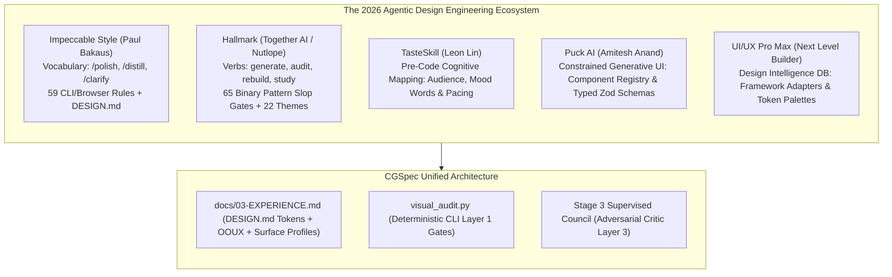

# RES-003: Frontier Agentic Design Skills & Anti-Slop Ecosystem Benchmark

> **CGSpec Technical Spike & Architecture Research Compendium**  
> **Status:** `CONCLUDED (SYNTHESIZED INTO STAGE 2 ENGINE & VISUAL_AUDIT.PY)`  
> **Author:** Antigravity Architect & BeOjefe Engineering  
> **Date:** October 2026  
> **Target Spines:** `docs/spines/03-EXPERIENCE.md`, [`skills/cgspec-ui-ux/SKILL.md`](../../../skills/cgspec-ui-ux/SKILL.md), [`engine/visual_audit.py`](../../../engine/visual_audit.py)  
> **Related Decisions:** `ADR-001` (`docs/adr/ADR-001-first-principles-spec-driven-sdlc-architecture.md`), [`RES-001`](RES-001-ui-design-systems-and-surface-profiles-benchmark.md), [`RES-002`](RES-002-anti-slop-constrained-ui-and-deterministic-gates.md)

---

## 1. Problem Statement & Research Objective

When AI coding assistants (Claude Code, Cursor, Copilot, Codex, Antigravity) are instructed to build user interfaces without a formal design engineering harness, they systematically converge on **statistical median design**—colloquially termed **"AI UI Slop"**. This is characterized by:
* Predictable purple/indigo gradients and neon glow filters.
* Default uncurated Inter typography across all contexts.
* Floating disembodied cards with heavy drop-shadows on flat dark canvases.
* Repetitive 3-column feature grids that ignore domain relationships (OOUX).
* Fake alerts created with `border-l-4` side stripes.
* Deeply nested card hierarchies ("Cardocalypse") that consume all viewport padding.

The objective of this research spike is to:
1. Conduct an exhaustive forensic teardown of the frontier tools created to solve this problem: **Impeccable Style** (`pbakaus/impeccable`), **Hallmark** (`nutlope/hallmark`), **TasteSkill** (`tasteskill.dev`), **UI/UX Pro Max** (`nextlevelbuilder`), and **Puck** (`puckeditor.com`).
2. Deconstruct the multi-layered verification architectures used by these tools (Source/CLI static analysis vs. Browser computed style inspection vs. LLM design review).
3. Synthesize their highest-leverage deterministic rules into CGSpec's **Stage 2 Engine** and [`engine/visual_audit.py`](../../../engine/visual_audit.py).

---

## 2. Landscape Analysis: Frontier Agent Design Frameworks

### Comparative Breakdown Matrix

| Framework / Tool | Author / Governance | Primary Mechanism | Key Strengths | Limitations |
| :--- | :--- | :--- | :--- | :--- |
| **Impeccable Style** (`impeccable.style`) | Paul Bakaus (creator of jQuery UI) | Agent vocabulary (`/polish`, `/distill`, `/clarify`, `/typeset`) + 59 CLI/Browser detector rules + `DESIGN.md` | **Multi-layer verification:** separates code-level CLI checks from browser visual checks; surgical vocabulary for agent refinement; catches subtle visual tells (side-tab borders, wide shadows on hairlines). | CLI detector requires Node environment; focused primarily on CSS/web. |
| **Hallmark** (`usehallmark.com`) | Hassan El Mghari / Together AI | 4 core verbs (`generate`, `audit`, `rebuild`, `study`) + 65 slop-test gates + 22 aesthetic themes | **The `study` verb:** extracts design DNA (macrostructure, type-pairing, color anchor) from reference URLs without pixel-cloning; fast binary pattern checks. | Opinionated themes; less focus on complex multi-pane SaaS spatial ergonomics. |
| **TasteSkill** (`tasteskill.dev`) | Leon Lin | Pre-generation prompt injection: forces agent to determine audience, page type, and mood before coding | Prevents default prompt drift; establishes clear typographic scale and density targets upfront. | Prompt-only skill; lacks automated deterministic verification script. |
| **Puck AI** (`puckeditor.com`) | Amitesh Anand | Constrained UI generation via predefined component registries and typed Zod schemas | Eliminates non-deterministic layout drift by preventing AI from generating raw arbitrary markup; ensures design system preservation. | Requires adoption of Puck visual editor runtime data structures. |
| **UI/UX Pro Max** | Next Level Builder | Comprehensive database of UI styles, color palettes, and framework adapters | Extensive reference catalog across Flutter, React, Tailwind, and SwiftUI. | Heavy database; acts as a static library rather than an active closed-loop auditor. |

---

## 3. Deconstructing Impeccable's 3-Layer Verification Architecture

Impeccable's most profound architectural contribution is its **3-Layer Separation of Quality Checks**:

1. **Layer 1: Source / CLI (Deterministic Static Analysis)**
   - Operates directly on raw HTML, JSX, CSS, or Tailwind source without launching a browser.
   - Evaluates exact pattern matches (e.g. decorative grid backgrounds, side-tab alert stripes, disembodied shadows, font declarations outside `DESIGN.md`).
   - Runs in milliseconds on pre-commit hooks and CI.
2. **Layer 2: Browser (Rendered DOM & Computed Styles)**
   - Operates on the live rendered DOM via headless Chrome or DevTools.
   - Evaluates computed contrast ratios (WCAG), actual rendered font sizes, element clipping, and tap target dimensions.
3. **Layer 3: Design Review / Critique (LLM Judgment)**
   - Reserved exclusively for subjective matters: information hierarchy, cognitive load, domain semantics, and emotional resonance.
   - Never used for checks that can be evaluated deterministically by Layer 1 or Layer 2.

This 3-layer model perfectly validates CGSpec's **Law 9 (Closed-Loop Visual Self-Critique)** and **Phase A (Deterministic Gates) vs. Phase B (Adversarial Critic)** separation.

---

## 4. Key Anti-Patterns Extracted for Programmatic Enforcement

From Impeccable's 59 detector rules and Hallmark's 65 gates, the following patterns provide maximum deterministic leverage when added to [`visual_audit.py`](../../../engine/visual_audit.py):

| Anti-Pattern Name | Code Indicator | Usability Defect | Programmatic Detection |
| :--- | :--- | :--- | :--- |
| **Cardocalypse (Cards in Cards)** | `

` (3+ nested bordered containers) | Squeezes viewport content, introduces redundant padding and shadows, and creates claustrophobic interfaces. | DOM depth traversal flagging nested containers with `border` and `rounded` classes greater than 2 levels deep. |
| **Side-Tab Fake Alert Border** | `border-l-4 border-l-[color]` on non-alert, non-status card | Turns ordinary content into something that looks like a warning or error, creating false cognitive alarms. | Regex detecting `border-l-(?:2\|4\|8)` with accent colors on standard list items or cards lacking alert/status roles. |
| **Kicker Heading Redundancy** | `<small>FEATURES</small><h2>Features Overview</h2>` | Clutters the visual hierarchy with redundant micro-labels that repeat heading text. | Regex detecting uppercase kicker text preceding `<h[1-4]>` that shares >60% word similarity with the heading. |
| **Hairline Border with Wide Soft Shadow** | `border border-zinc-700 shadow-2xl` | Both the sharp edge and the diffuse shadow compete to define the surface contour, causing visual mush. | Class combination check: 1px border combined with `shadow-2xl` / `shadow-xl` without tonal contrast. |
| **Inter Everywhere Monoculture** | CSS declaring only `font-sans: Inter` without display or mono pairings | Devoid of brand personality; numeric data and system tokens lack monospace alignment. | Check verifying font diversity (at least one distinct display or monospace pairing for technical surfaces). |

---

## 5. Architectural Invariants Integrated into CGSpec

1. **Parity with `DESIGN.md`:** CGSpec's `docs/spines/03-EXPERIENCE.md` serves as the canonical design token registry, incorporating Impeccable's token taxonomy (Colors, Radii, Typography Scales, Spatial Elevation).
2. **Deterministic-First Pipeline:** All Layer 1 anti-patterns must be verified by `visual_audit.py` in Phase A before any human review or Layer 3 LLM critique is scheduled.
3. **Agent Refinement Vocabulary:** The Stage 2 Skill ([`skills/cgspec-ui-ux/SKILL.md`](../../../skills/cgspec-ui-ux/SKILL.md)) incorporates Impeccable's refinement verbs (`/distill`, `/clarify`, `/polish`, `/typeset`) to guide agent self-correction during iterations.
