# RES-004: Empirical Vibe-Coded Design Tells, Anti-Slop Scanners & High-Craft Interaction Ergonomics

- **Status:** `[Concluded]`
- **Date:** `2026-10-18T07:35:00Z`
- **Authors:** `@jeanfranck`, `Claude Research Swarm`, `Argon Lead Auditor`
- **Target Spines:** `docs/spines/03-EXPERIENCE.md`, `visual_audit.py`, [`skills/cgspec-ui-ux/SKILL.md`](../../../skills/cgspec-ui-ux/SKILL.md)
- **Primary References:**
  - [JCarterJohnson/vibecoded-design-tells (Reddit-Mined Empirical Study & unslop-ui/code/text)](https://github.com/JCarterJohnson/vibecoded-design-tells)
  - [DesignCode.io (Meng To High-Craft UI, Interactive Tokens & SwiftUI/Web Ergonomics)](https://designcode.io/)
  - [Arctic Shift Reddit Archive Analysis (3.2M Posts, 47 Subreddits, 3,033 Canonical Comments)](https://arctic-shift.photon-reddit.com)

---

## 1. Executive Summary & Problem Statement

As generative AI models saturate frontend development, websites and applications increasingly suffer from **"Vibe-Coded Syndrome"**: a recognizable, formulaic visual and structural aesthetic that online users and developers immediately identify as AI-generated slop.

In a landmark empirical analysis mining 3,214,533 posts and 3,033 canonical comments across 47 AI and SaaS subreddits ([`JCarterJohnson/vibecoded-design-tells`](https://github.com/JCarterJohnson/vibecoded-design-tells)), the data reveals that users clock AI sites **on sight** (named in 13% of all on-topic discussions). More critically, the research identifies the **"Over-Correction Trap"**: swapping the 2024 AI purple gradient for the 2026 "tasteful default" (warm cream background, Instrument Serif / Fraunces headings, and sage green accents) is merely replacing old slop with new slop.

Conversely, premier UI platforms like [DesignCode.io](https://designcode.io/) (Meng To) achieve world-class, visceral appeal through **tactile depth, fluid spring mechanics, crisp specular hairlines, and authentic brand anchors**.

This research spike synthesizes the empirical ranking of vibe-coded tells across UI, code, and copy, deconstructs DesignCode high-craft ergonomics, and codifies deterministic quality gates into `visual_audit.py` to prevent both legacy and 2026 AI design tells programmatically.

---

## 2. Empirical Taxonomy of Vibe-Coded Tells (Reddit Study)

The Arctic Shift dataset ranks the most cited visual tells by their share of on-topic comments:

```mermaid
flowchart TD
    subgraph EmpiricalTells["Empirical Vibe-Coded Tells (3.2M Scanned Posts)"]
        direction TB
        T0["Tell 0: The 2026 'Tasteful Default'<br/>(Cream #faf8f5 + Serif + Sage Green)"]
        T1["Tell 1: Stock shadcn / Tailwind Defaults<br/>(Unthemed rounded-lg border bg-card shadow-sm)"]
        T2["Tell 2: AI Purple / Violet Cliché<br/>(indigo-600, violet-500, #6366f1)"]
        T3["Tell 3: Gradient Text & Aurora Excess<br/>(bg-clip-text text-transparent)"]
        T4["Tell 4: Unprompted Neon Glow & Floats<br/>(box-shadow: 0 0 50px rgba(...))"]
        T5["Tell 5: The Centered Hero + 3-Card Grid<br/>(Generic icon cards with abstract copy)"]
        T6["Tell 6: Cosmetic & Functional Code Tells<br/>(Tutorial boilerplate, swallowed errors)"]
    end

    subgraph DesignCodePillars["DesignCode.io High-Craft Invariants"]
        direction TB
        D1["Tactile Depth & Specular Hairlines<br/>(inset 0 1px 1px rgba(255,255,255,0.15))"]
        D2["Spring Physics & Verifiable FSMs<br/>(Damped springs, zero layout reflow)"]
        D3["Purpose-Driven Content Topology<br/>(Real functional UI over abstract cards)"]
        D4["Deliberate Token System<br/>(Custom neutrals, non-standard brand anchor)"]
    end

    subgraph DeterministicGates["CGSpec Quality Gate Enforcement"]
        direction TB
        G1["visual_audit.py Automated Scanner<br/>(Checks 15-22 exit code gating CI)"]
        G2["Tier 0 Proactive Scouting & Archetypes<br/>(Anchoring to real reference exemplars)"]
    end

    EmpiricalTells --> DeterministicGates
    DesignCodePillars --> DeterministicGates
```

### 2.1 The Ranked Visual Tells Catalog

1. **Tell 0: The 2026 "Tasteful Default" (Cream + Serif + Sage Green):**
   - *Evidence:* The previous wave of anti-slop advice (including Claude's own frontend design guidelines) converged on warm cream backgrounds (`#faf8f5`, `#f5f1e8`, `bg-stone-50`), serif display fonts (`Instrument Serif`, `Fraunces`, `Playfair Display`), and sage/forest green accents (`#15573a`, `emerald-800`).
   - *Why It Fails:* It is an unchosen default. Replacing framework indigo with Anthropic cream is not unslopping; it is trading old slop for new slop.
   - *Invariant:* Palettes must anchor to a real, project-specific brand decision or reference exemplar.

2. **Tell 1: Untouched Stock shadcn / Tailwind Look:**
   - *Evidence:* Named in 2.5% of on-topic comments. The combination of `rounded-lg border bg-card text-card-foreground shadow-sm` repeated across identical slate/zinc cards with default `--radius: 0.5rem`.
   - *Invariant:* Card geometry, radius ramps, neutral scales, and spacing rhythms must be customized to the project's specific density profile.

3. **Tell 2: AI Purple (Violet / Indigo Primary):**
   - *Evidence:* Named in 2.3% of comments. Tailwind's default `#6366f1` (indigo-500) and `#7c3aed` (violet-600) appear whenever no brand color is specified.
   - *Invariant:* Prohibit violet/indigo as the unprompted primary brand color unless explicitly specified in `01-INTENT.md`.

4. **Tell 3: Gradient Text & Gradients Everywhere:**
   - *Evidence:* `bg-clip-text text-transparent` on hero headings and multi-stop rainbow gradients.
   - *Invariant:* Solid, high-contrast typography for headings and technical copy. Gradients, if used, must be subtle, monochromatic, and structural.

5. **Tell 4: Unprompted Neon Glow Shadows:**
   - *Evidence:* `shadow-[0_0_50px_rgba(99,102,241,0.5)]` or disembodied colored blurs behind cards.
   - *Invariant:* Elevation achieved through tonal background shifts (`#09090b` canvas to `#121316` card) and 1px crisp hairlines (`border-white/10`), not neon drops.

6. **Tell 5: The Centered Hero + Three Feature Cards Skeleton:**
   - *Evidence:* The default template skeleton emitted by LLMs when no layout intent is specified.
   - *Invariant:* Structure must follow the real user workflow. Display actual product viewports, working interactive controls, and asymmetric data layouts instead of 3-column icon cards.

---

## 3. The Triad of Vibe-Coded Media: UI, Code, and Text

The study proves that AI slop manifests across three synchronized media:

| Domain | Surface Tells (Cosmetic) | Structural Tells (Critical / Bugs) | CGSpec Remedy |
| :--- | :--- | :--- | :--- |
| **UI Design** (`unslop-ui`) | AI purple, gradient text, neon glow, emoji icons, cream+serif default. | Centered 3-card skeleton, zero empty states, layout overflow, missing keyboard hotkeys. | `visual_audit.py` Checks 15-22, 7-state switchers, Tier 0 reference scouting. |
| **Source Code** (`unslop-code`) | Chat comments (`// rest of code`), narrating comments, emoji in code, generic names (`process_data`). | Swallowed exceptions (`except Exception: pass`), tutorial-shaped code, hallucinated APIs. | Deterministic AST parsing (`ingest.py`), strict static typing, automated tests. |
| **System Text** (`unslop-text`) | Sycophantic greetings, "in conclusion", "it's not just X, it's Y", hype words ("supercharge", "delve"). | Lack of concrete numbers, missing failure modes, vague PRD requirements. | `01-INTENT.md` Anti-Goals, SOP, precise domain invariants, factual disk logs. |

---

## 4. High-Craft Interaction Ergonomics (DesignCode.io Benchmark)

Meng To's work on [DesignCode.io](https://designcode.io/) provides the positive architectural blueprint for crafting interfaces that feel tactile, premium, and durable:

### 4.1 Specular Depth & Hairline Borders
Rather than relying on flat dark mode or heavy drop shadows, high-craft interfaces utilize multi-layer optical depth:
- **Base Canvas:** Deep, non-pure black (e.g. `#08090c` or `#0b0d13`).
- **Translucent Card Surface:** `background: rgba(255, 255, 255, 0.03)` with `backdrop-filter: blur(16px)`.
- **Specular Highlight:** `box-shadow: inset 0 1px 1px rgba(255, 255, 255, 0.12), 0 4px 20px rgba(0, 0, 0, 0.4)`.
- **Hairline Perimeter:** `border: 1px solid rgba(255, 255, 255, 0.08)`.

### 4.2 Spring Physics vs. Linear CSS Transitions
AI prototypes frequently use robotic `transition: all 0.2s ease` or jarring float animations. High-craft systems implement calibrated spring curves:
- Micro-interactions (hover, active press): `cubic-bezier(0.16, 1, 0.3, 1)` (snappy spring, 150ms).
- Drawers and modals (spatial translation): `cubic-bezier(0.32, 0.72, 0, 1)` (Apple/HIG deceleration curve, 280ms).
- Hover feedback: subtle $1\text{px}$ elevation lift or $0.5\%$ scale with corresponding specular intensification, respecting `prefers-reduced-motion`.

### 4.3 Multi-Platform Token Parity
Tokens defined in Stage 2 must map 1:1 between Web (CSS/Tailwind vars) and Native (SwiftUI / Jetpack Compose):
- Spacing: 4px base grid (`space-1`: 4px, `space-2`: 8px, `space-3`: 12px, `space-4`: 16px).
- Typography: Tabular numerals (`font-variant-numeric: tabular-nums`) for all IDs, timestamps, metrics, and currency.
- Corner Radii: Strict semantic roles (`radius-sm: 4px` for tags, `radius-md: 6px` for controls, `radius-lg: 10px` for panels).

---

## 5. Implementation: Automated devibe Checks in `visual_audit.py`

To prevent AI prototypes from regressing into vibe-coded tells, the following automated checks are added to `visual_audit.py`:

- **Check 19 — Gradient Text Scan:** Scans for `bg-clip-text text-transparent` and `-webkit-background-clip: text` on headings.
- **Check 20 — Unprompted Neon Glow Scan:** Scans for `shadow-[0_0_` and `box-shadow: 0 0 [0-9]+px` with high-opacity colored glows.
- **Check 21 — Stock shadcn Card Signature Scan:** Flags repeated occurrences of the untouched stock string `rounded-lg border bg-card text-card-foreground shadow-sm`.
- **Check 22 — Tasteful Default Convergence Scan:** Flags the co-occurrence of cream backgrounds (`#faf8f5`, `#f5f1e8`, `bg-stone-50`) and serif display headings (`Instrument Serif`, `Fraunces`) when not explicitly configured as an intentional brand choice.

---

## 6. Primary References & Citations

1. [JCarterJohnson/vibecoded-design-tells GitHub Repository](https://github.com/JCarterJohnson/vibecoded-design-tells)
2. [DesignCode.io — High-Craft UI & Prompt Architecture Platform](https://designcode.io/)
3. [Arctic Shift Free Public Reddit Discussion Archive](https://arctic-shift.photon-reddit.com)
4. [Meng To — Design+Code Interactive Swift & Web Courses](https://designcode.io/courses)
5. [Tweakcn — Interactive shadcn/ui Theme & Token Customizer](https://tweakcn.com/)
