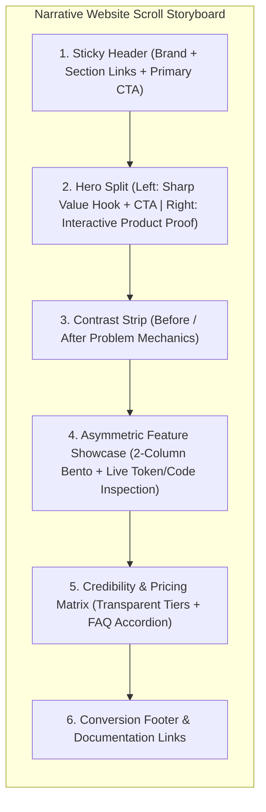
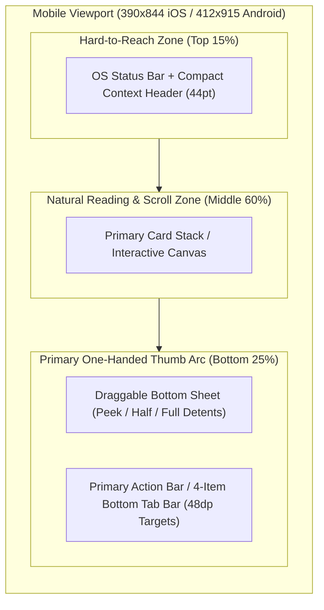
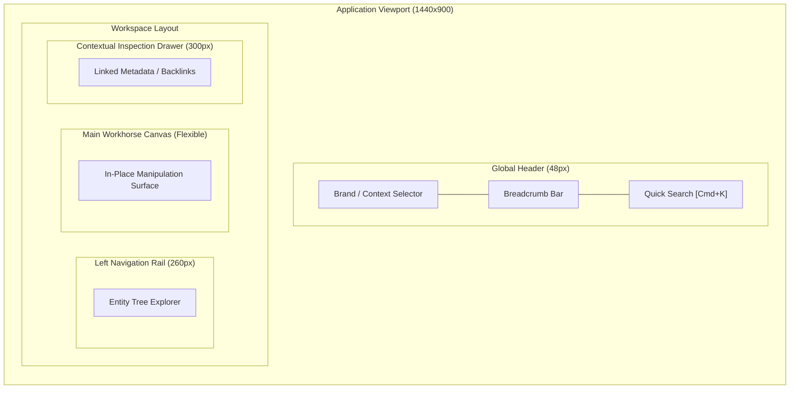

# Playbook 02: Scout References & Explore Spatial Layouts

## Purpose
Guide the human architect and AI agent through Phase 2 of the Experience Cycle: discovering mechanism-driven references, proposing zero-color macro layout hypotheses tailored to the target surface (Simple Website, Mobile iOS/Android, or Web/Desktop App), approving spatial placement via declarative wireframes, and defining tactile interaction contracts.

---

## Operating Invariants

1. **Macro Placement Before Micro Behavior:**
   - The user must review and approve *where primary screen zones live* before discussing micro-behaviors (cursor movements, gestures, syntax rules, color tokens).
2. **Surface-Appropriate Spatial Geometry:**
   - **Simple / Narrative Websites:** Never force a 3-pane IDE layout onto a landing page, portfolio, or blog. Use a **Vertical Scroll Storyboard** with deliberate visual pacing.
   - **Mobile Apps (iOS / Android):** Never use wide horizontal sidebars or hover-dependent menus. Use **Thumb-Zone Ergonomics** (Top context bar, scrollable canvas, draggable bottom sheets with peek/half/full detents, bottom tab bar, and 44pt/48dp hit targets).
   - **Web / Desktop Workspaces:** Use multi-pane viewport partitioning (Header, Navigation Rail, Main Canvas, Contextual Drawer).
3. **Strict Rendering Rule for Wireframes:**
   - **NEVER use wide ASCII character art boxes** (>80 columns). On different screen viewports, wide ASCII tables wrap and produce unreadable, broken text.
   - **ALWAYS use declarative diagramming DSLs** (such as Mermaid `flowchart TB`/`LR` with nested `subgraph` blocks, D2, or PlantUML) supported by the project's rendering environment to visualize spatial wireframes cleanly across all devices.
4. **Mechanism-Driven References:**
   - Reference specific real-world products for concrete mechanisms (e.g. "Cloudflare's shallow jump-list triad", "Apple Maps draggable bottom sheet detents", "Traycer's interactive hero IDE preview").
   - Proactively suggest 2-3 apps or websites that solve similar spatial or navigation problems, explaining what to borrow and what NOT to copy.
5. **Meaningfully Different Hypotheses & Reopenable Checkpoints:**
   - Propose 2 structural options that test genuine ergonomic differences.
   - Explicitly note the condition that would reopen the layout hypothesis during subsequent interaction testing.

---

## Step-by-Step Procedure

### Step 2.1: Mechanism Scouting
1. Identify 2-3 real-world products or sites matching the project's surface profile.
2. For each reference, extract:
   - **The Borrowed Mechanism:** What specific physical behavior works well?
   - **The Anti-Pattern:** What about that product should be avoided for our specific use case?
3. Save to `docs/design/references.md` (or update `docs/03-EXPERIENCE.md`).

### Step 2.2: Propose Two Zero-Color Macro Layout Wireframes
Render both proposals in a dedicated Artifact using a supported declarative diagram (Mermaid, D2, or PlantUML) matching the active **Surface Profile**:

#### Option Pattern A — Simple / Narrative Website (Vertical Scroll Storyboard)

#### Option Pattern B — Mobile App iOS / Android (Thumb-Zone Stack)

#### Option Pattern C — Web / Desktop Workspace (Multi-Pane Viewport)

### Step 2.3: Build Interactive Zero-Color HTML Wireframe (`wireframe-v1.html`) & Run Closed-Loop Self-Critique
Before asking the user to choose a layout hypothesis, build an interactive zero-color HTML wireframe so they can visually experience and toggle between the hypotheses:

1. **Dual-Target Versioned Saving (`v1`, `v2`, `v3` — Never Overwrite):**
   - Write to `<appDataDir>/brain/<conversation-id>/wireframe-v1.html` with `ArtifactMetadata: { UserFacing: true }` so clicking the link in chat opens the **live rendered interactive preview** in the IDE's right-hand Artifact pane (linking only to a workspace file opens raw HTML code!).
   - Also copy to `docs/.cgspec/prototypes/wireframe-v1.html` and commit to Git. On subsequent feedback rounds, create `wireframe-v2.html`, `wireframe-v3.html`—never overwrite previous iterations in place.
   - **Never use `<agent-embed>` inline in chat for desktop multi-column layouts**, as it squeezes a `1440px` workspace into a `500px` chat bubble.
2. **Full-Bleed Viewport Container (`Zero Bottom Whitespace Void`):**
   - Always set `html, body { height: 100%; width: 100%; margin: 0; padding: 0; overflow: hidden; display: flex; flex-direction: column; }` and `flex: 1; min-height: 0;` on the main split container so the wireframe fills 100% of the preview pane without dead space at the bottom.
3. **Mandatory Closed-Loop Visual Self-Critique (`gstack / BMAD` Loop — Execute BEFORE Showing User):**
   - Render `wireframe-vN.html` in a headless browser (`python3 docs/.cgspec/scripts/visual_audit.py` or `chrome-devtools-mcp`) and capture screenshots of:
     - (a) Default active screen (`1440x900`),
     - (b) Secondary screen (`Home / Overview` or `Settings`),
     - (c) Active sub-mode (`Diff / Compare`, `Modal`, or `Drawer Closed`).
   - Call `view_file` on the captured PNG screenshots and audit against the **6 Structural UI Coherence Laws**:
     1. **Zero Dead Viewport Void:** No empty 30-40% white/dark gap at the bottom or sides.
     2. **One Control Per Action:** No duplicate buttons or stacked headers (never two `<- Back to Document` bars stacked in Diff mode; never two `Inspector` toggle buttons; never 4 separate places for `Git Sync`).
     3. **Context-Scoped Top Bar:** Clicking `Home` or `Settings` hides file-specific controls (`Doc Zone | Code Zone`, `Split Tree`, file breadcrumb, `File Inspector`).
     4. **Direct Spatial Manipulation:** Multi-column panes have working draggable splitters (`col-resize`) so truncated names (`services/o...`) can be widened, and clicking the active rail icon collapses/expands the tree.
     5. **Unbroken Tree Hierarchy:** Nested trees (KDE Dolphin style) have continuous vertical/horizontal guide lines (`│`, `├─`, `└─`) with zero artificial number prefixes (`1. CG-Core`) and zero mid-tree subtitle blocks severing parent-to-child lines.
     6. **Unified Resource Hub & Single Access Pill:** Domain nouns of the same archetype (`MCP`, `Prompts`, `Skills`, `Agents`, `Pins`) live in one unified hub, and file ownership/permissions appear as a single compact clickable pill (`Access: Editor · Shared`) rather than 3 separate boxes.
   - If any check fails in the screenshot, **fix the HTML and re-verify before speaking to the user**.

### Step 2.4: Lock the Spatial Hypothesis
- Present the verified visual wireframe Artifact (`wireframe-vN.html`) and declarative diagram to the user, then ask them to evaluate the spatial balance.
- Record the approved layout in `docs/03-EXPERIENCE.md` (updating both the top diagram and the bottom screen matrix table in sync!) with its explicit reopening condition.
- Append a decision record to `docs/design/decisions/` and `.memlog.md`.

