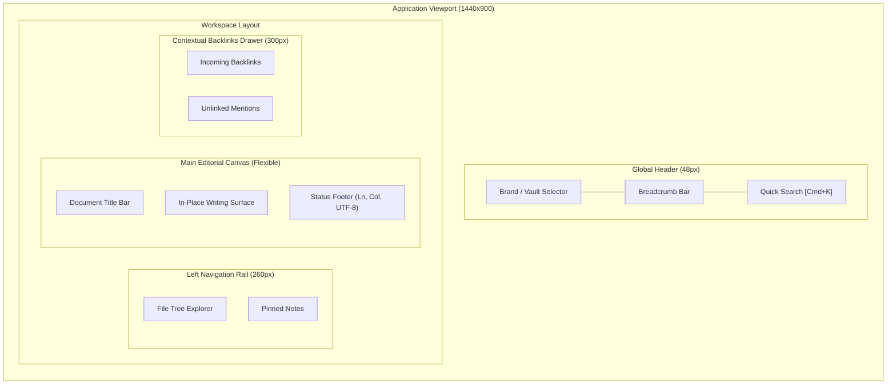

# Playbook 02: Scout References & Explore Spatial Layouts

## Purpose
Guide the human architect and AI agent through Phase 2 of the Experience Cycle: discovering mechanism-driven references, proposing zero-color macro layout hypotheses, approving spatial placement via visual wireframes, and defining tactile interaction contracts.

---

## Operating Invariants

1. **Macro Placement Before Micro Behavior:**
   - The user must review and approve *where primary screen zones live* (Header, Navigation Rail, Main Canvas, Context Drawer) before discussing micro-behaviors (cursor movements, syntax rules, color tokens).
2. **Strict Rendering Rule for Wireframes:**
   - **NEVER use wide ASCII character art boxes** (>80 columns). On different screen viewports, wide ASCII tables wrap and produce unreadable, broken text.
   - **ALWAYS use declarative diagramming DSLs** (such as Mermaid `flowchart TB`/`LR` with nested `subgraph` blocks, D2, or PlantUML) supported by the project's rendering environment to visualize spatial wireframes cleanly across all devices.
3. **Mechanism-Driven References:**
   - Reference specific real-world products for concrete mechanisms (e.g. "Cloudflare's shallow jump-list triad", "Obsidian's collapsible backlink rail", "VS Code's sticky header breadcrumbs").
   - Proactively suggest 2-3 apps or websites that solve similar spatial or navigation problems, explaining what to borrow and what NOT to copy.
   - Provide direct clickable links or embedded screenshot artifacts when available.
4. **Meaningfully Different Hypotheses:**
   - Propose 2 structural options that test genuine ergonomic differences (e.g. persistent split rail vs focused full-canvas with slide-over drawer).
5. **Reopenable Checkpoints:**
   - Layout approval is an initial hypothesis, not an irreversible lock. Explicitly note the condition that would reopen the layout (e.g. "If testing split note comparison requires more horizontal space, we will reopen this split rail layout").

---

## Step-by-Step Procedure

### Step 2.1: Mechanism Scouting
1. Identify 2-3 real-world products that have solved a similar ergonomic challenge.
2. For each reference, extract:
   - **The Borrowed Mechanism:** What specific physical behavior works well?
   - **The Anti-Pattern:** What about that product should be avoided for our specific use case?
3. Save to `docs/design/references.md` (or update `docs/03-EXPERIENCE.md`).

### Step 2.2: Propose Two Zero-Color Macro Layout Wireframes
Render both proposals in a dedicated Artifact using a supported declarative diagram (e.g. Mermaid, D2, or PlantUML):

### Step 2.3: Lock the Spatial Hypothesis
- Ask the user to evaluate the spatial balance and confirm where zones live.
- Record the approved layout in `docs/03-EXPERIENCE.md` with its explicit reopening condition.
- Append a decision record to `docs/design/decisions/` and `.memlog.md`.
