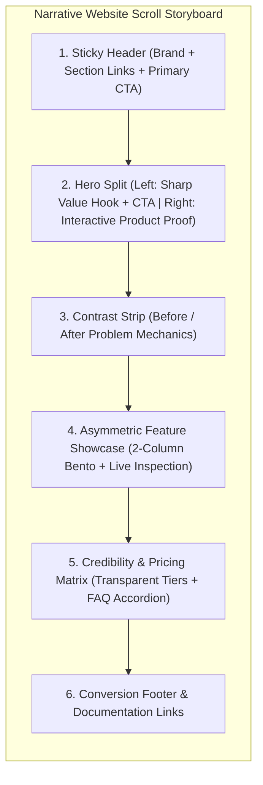
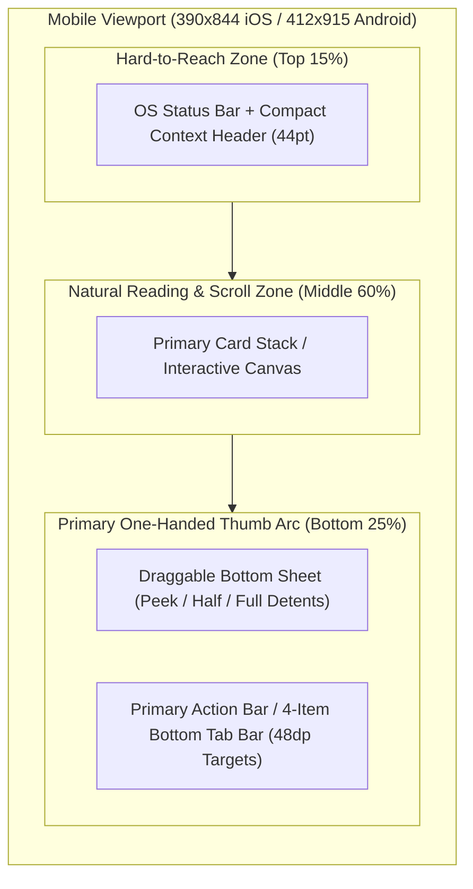
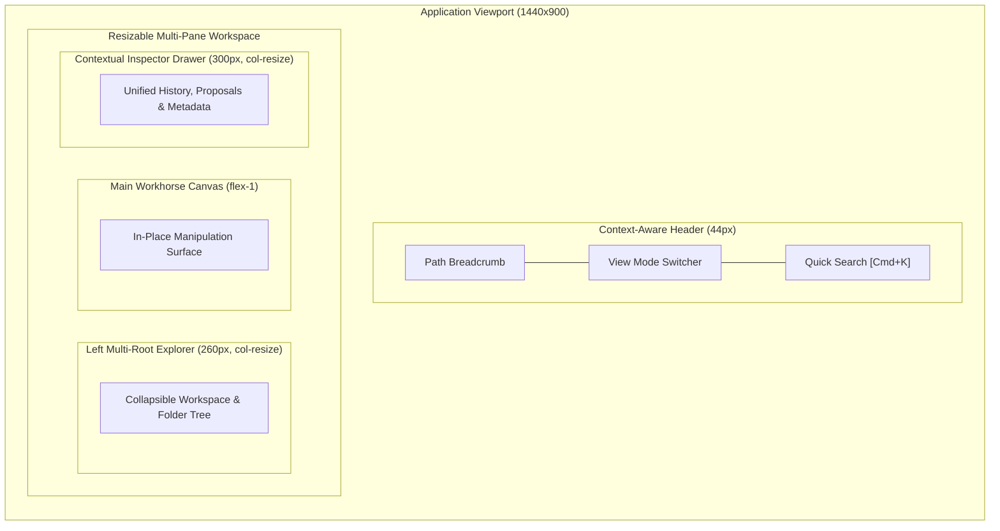

# Playbook 02: Scout References & Explore Spatial Layouts

## Purpose
Guide Phase 2 of the Experience Cycle: discovering mechanism-driven references, proposing two zero-color macro layout hypotheses tailored to the active **Surface Profile** (`Profile A..D` in [`SKILL.md`](../SKILL.md)), rendering an interactive zero-color wireframe (`wireframe-v1.html`), and verifying all **8 Structural UI Coherence Laws** ([`references/quality-rubric.md`](../references/quality-rubric.md)) before asking the user to choose.

---

## Step-by-Step Procedure

### Step 2.1: Mechanism Scouting (`docs/design/references.md`)
1. Identify 2–3 real-world products or sites matching the project's surface profile.
2. Using [`templates/reference-analysis.md`](../templates/reference-analysis.md), document for each reference:
   - **What to Borrow:** The specific physical or spatial mechanism that solves our problem.
   - **What to Avoid (Anti-Pattern):** What creates clutter, confusion, or unnecessary complexity.

### Step 2.2: Propose Two Zero-Color Declarative Layout Hypotheses
Render two meaningfully different structural options using a supported declarative diagram (Mermaid `flowchart TB`/`LR` with nested `subgraph` blocks, D2, or PlantUML—never wide ASCII boxes >80 columns):

#### Pattern A — Simple / Narrative Website (Vertical Scroll Storyboard)

#### Pattern B — Mobile App iOS / Android (Thumb-Zone Stack)

#### Pattern C — Web / Desktop Workspace (Multi-Pane Viewport)

### Step 2.3: Build `wireframe-v1.html` & Run Closed-Loop Visual Self-Critique
1. **Dual-Target Versioned Save:**
   - Write to `<appDataDir>/brain/<conversation-id>/wireframe-v1.html` (`ArtifactMetadata: { UserFacing: true }`) for live side-pane rendering, AND copy to `docs/.cgspec/05-prototype/wireframe-v1.html`.
   - Scope strictly to **1 focal screen** (`SCR-01`) and keep uninterviewed micro-controls out of Phase 2.
2. **Closed-Loop Self-Critique Gate (Before Asking User):**
   - Run `python3 docs/.cgspec/01-script/visual_audit.py docs/.cgspec/05-prototype/wireframe-v1.html --screenshot-dir /tmp/cgspec-shots`.
   - Capture screenshots across `Default`, `Secondary Tab`, and `Diff/Modal/Drawer` states (via `visual_audit.py` or `chrome-devtools-mcp`), inspect them with `view_file`, and fix any violation of the **8 Structural UI Coherence Laws** in [`references/quality-rubric.md`](../references/quality-rubric.md).

### Step 2.4: Lock the Spatial Hypothesis
- Present the verified wireframe Artifact and declarative diagram to the user and ask them to choose via `ask_question`.
- Record the approved layout in `docs/03-EXPERIENCE.md` (updating both top diagrams and bottom tables in sync), `docs/design/decisions/UXD-NNN.md`, and `docs/.memlog.md`.
