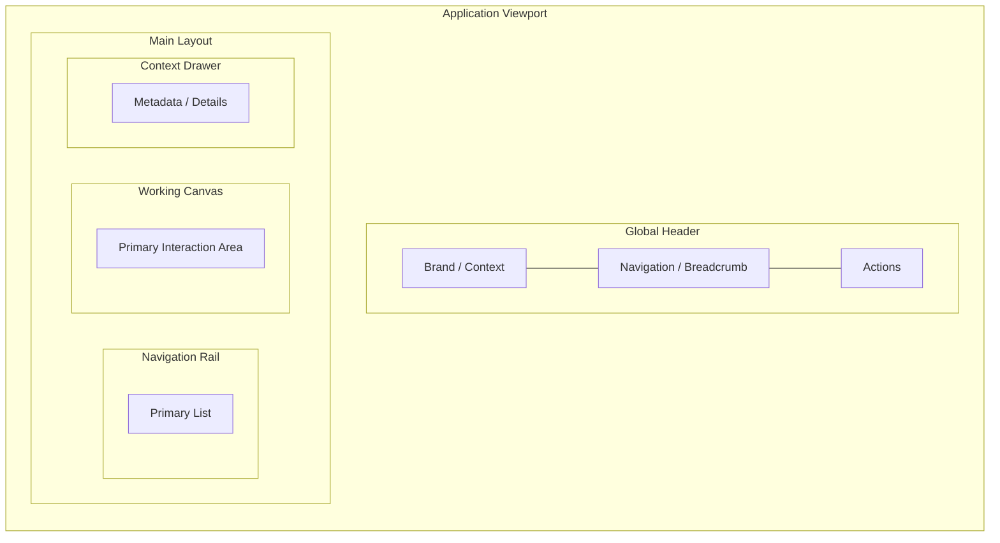

# Screen Specification: [SCR-NNN Screen Name]

## 1. Overview & Placement
- **Screen ID:** SCR-[NNN]
- **Primary Persona:** [Persona Name]
- **Usage Frequency:** [Daily / Hourly / Occasional]
- **Core User Goal:** [1-sentence goal]

## 2. Macro Spatial Wireframe (Mermaid / D2 / PlantUML)
> Note: Use the declarative diagramming DSL supported by your workspace or platform (Mermaid `flowchart TB`, D2, or PlantUML). Avoid wide fixed-width ASCII tables that wrap on smaller screens.

## 3. Spatial Zone Inventory
| Zone | Role | Target Width / Height | Key Interactive Elements |
| :--- | :--- | :--- | :--- |
| **Header** | Navigation & Search | 48px fixed | Breadcrumb, Search (Cmd+K), User profile |
| **Nav Rail** | Entity discovery | 260px collapsible | Tree view, filter input, item counters |
| **Main Canvas** | Primary manipulation | Flexible | Active document / editor, toolbar |
| **Context Drawer** | Linked metadata | 300px collapsible | Backlinks, tags, inspector panels |

## 4. Tactile Ergonomics & Hotkeys
- **Primary Keystrokes:**
  - `Cmd+K` / `Ctrl+K`: Global command search
  - `Tab`: Sequential control focus
  - `Escape`: Close active drawer or modal
- **Inline Editing Behavior:** [Explain in plain English how editing feels]

## 5. Coexisting Component State Matrix
| Component / Zone | Populated | Loading | Empty | Error | Denied 403 | Offline | Filtered Zero |
| :--- | :--- | :--- | :--- | :--- | :--- | :--- | :--- |
| **Nav Rail** | Item tree | Shimmer rows | "No items" CTA | "Failed to list" retry | "Restricted" | Cached list | "No matches" reset |
| **Main Canvas** | Content editor | Skeleton text | Onboarding prompt | Error banner | Access denied | Local edit banner | N/A |
| **Drawer** | Related entities | Skeleton cards | "No links found" | Indexing failed | Hidden | Cached links | Empty filter state |
